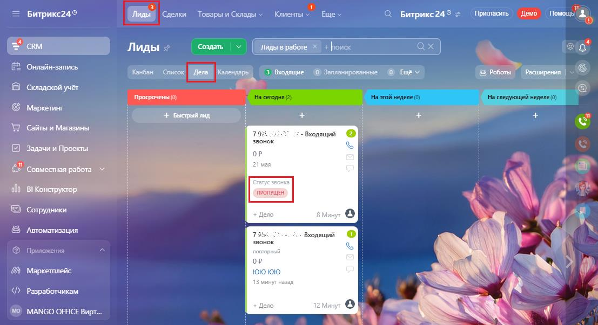
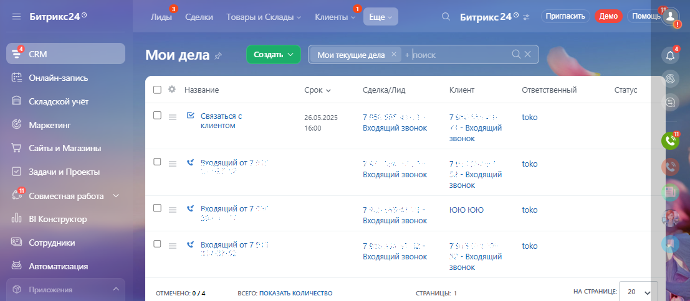

# Обзор

> Трассировка: PDF §3.4 · сквозные стр. 152-154 · источники: ч.1 `kb/sources/integration-bitrix24/Mango_office_integration_Bitrix24.pdf` с.152-154.

Чтобы отслеживать и обрабатывать пропущенные звонки, вам нужно включить функцию автоматического создания лида и дела при входящих звонках. Тогда при входящем звонке в Битрикс24 будет создано дело, содержащее следующую информацию: название, срок, имя Клиента, а также текущий статус и ФИО ответственного за обработку звонка. В Битрикс24 лид и дело, прикрепленное к нему, отображаются следующим образом:

> **Описание иллюстрации INTB24-§3.4-1** (к §3.4 «Обзор», стр. 152; 1107×603 px). Снимок экрана / схема.
> Относится к тексту руководства: «…рок, имя Клиента, а также текущий статус и ФИО ответственного за обработку звонка. В Битрикс24 лид и дело, прикрепленное к нему, отображаются следующим образом:».
> Текст на изображении (OCR, требует сверки): да.; = Битрикс249; Gey Сделки Товары и Склады > Клиенты м; © Битрикс; oe; (Tower.; Помошь $.; то; ole; Лиды +; бомать | У [Гливыврабте # + Поиск; Oe); ke fat; 'Онлайн-запись,; © Роботы — Раавширения |; Kanan coca АВ Yas 3 Bronmye © Запланированные @ Ewe ¥; Складской учёт; Просрочены,; ` Маркетинг; SS И; ‚+ Быстрый лид; Сайты и Магазины; 79:; - Входящий; звонок; Задачи и Проекты:; en; Совместная работа; BI Конструктор; Сотрудники; ' Автоматизация; Зкодящий; ок; puncxenna; oy; 'Маркетплейс; юк; RY?; SS; Разработчикам; Pas; AY; MANGO OFFICE Вирт.

Интеграция Виртуальной АТС MANGO OFFICE и Битрикс24 | Версия от 03.03.2026 В Битрикс24 есть раздел "Мои дела", в котором вы можете увидеть все дела, по которым вы назначены ответственным. Чтобы перейти в раздел "Мои дела", в вашем Битрикс24 выполните: 1) перейдите в раздел "CRM"; 2) выберите пункт "Еще"; 3) нажмите на ссылку "Мои дела":

> **Описание иллюстрации INTB24-§3.4-2** (к §3.4 «Обзор», стр. 153; 1108×441 px). Снимок экрана / схема.
> Относится к тексту руководства: «…ственным. Чтобы перейти в раздел "Мои дела", в вашем Битрикс24 выполните: 1) перейдите в раздел "CRM"; 2) выберите пункт "Еще"; 3) нажмите на ссылку "Мои дела":».
> Текст на изображении (OCR, требует сверки): ый; ре; = Битрикс24®; Й Сделки.; Товары и Склады >.; Клиенты >; aif; emo; Помошь",; ря; Продажи; Лиды <; Создать; `налитика; Онлайн-запись; Канбан Список | flena | Календарь; © Роботы Расширения |; Be; (Cuapr-npoueccet; Складской учет; Настройки; Просрочены; ' Маркетинг; Управ; + Быстрый лид.; Сайты и Магазины; Настроить меню; звонок; Вернуть меню по умолчанию; Задачи и Проекты:; or; 21 man; Скрытые; ‘Совместная работа; Crary; ola; BI Конструктор; История; Сотрудники; Корзина; + Дело; ' Автоматизация

В этом разделе вы можете видеть дела по пропущенным звонкам, а также по сделкам, запланированным звонкам и прочее. Также, в разделе "Мои дела" вы можете смотреть отчетность по эффективности вашей работы с делами. Общий вид раздела "Мои дела" показан на рисунке:

> **Описание иллюстрации INTB24-§3.4-3** (к §3.4 «Обзор», стр. 153; 1107×484 px). Снимок экрана / схема.
> Относится к тексту руководства: «…кам и прочее. Также, в разделе "Мои дела" вы можете смотреть отчетность по эффективности вашей работы с делами. Общий вид раздела "Мои дела" показан на рисунке:».
> Текст на изображении (OCR, требует сверки): = Битрикс24°; Лиды; Сделки; ары и; Склады; Клиенты; Ewe; Burpuxe24!; Moamaoms | feo Mowou; Мои дела; Создать; Мои текущие дела; Онлайн-запись; OF; Название; Срок у; Сделка/Лид; Клиент; Ответственный; ‘статус; {8 Складской учёт; ia); &% Связаться с; 26.05.2025; Ts; tok; клиентом; G маркетинг; 16:00; входящий звонок.; Входящий; звонок.; Сайты и Магазины; toko; зиодащий от?; Задачи и Проекты:; - Входящий; звонок; en; oa; £2" Совместная работа У; Bxonmuti or 7°; 1010 1010; al) BI Конструктор; ro; ©) Сотрудники; Входящий or 7 <; 52 - Входящий; © Автоматизация; ОТМЕЧЕНО: 0/4; ВСЕГО: ПОКАЗАТЬ КОЛИЧЕС…

Ваш руководитель может смотреть отчеты о выполнении вами ваших дел, в том числе о количестве пропущенных звонков и результатах их обработки. Примечание. При наличии прав доступа, вы можете посмотреть дела других сотрудников. Интеграция Виртуальной АТС MANGO OFFICE и Битрикс24 | Версия от 03.03.2026
