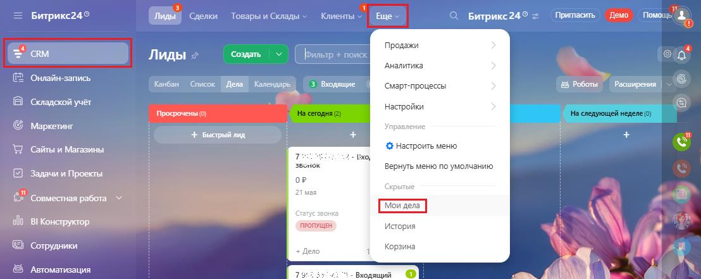
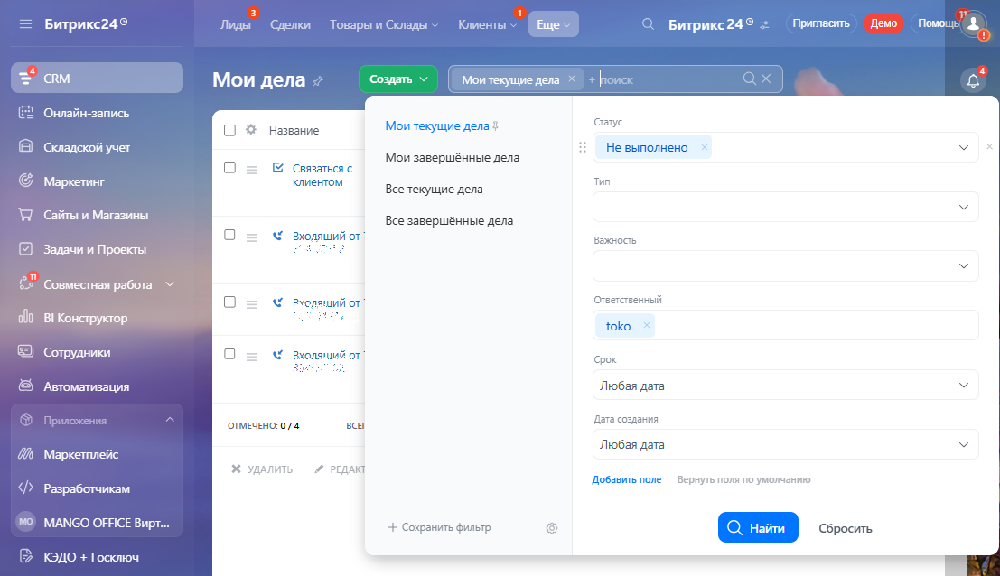
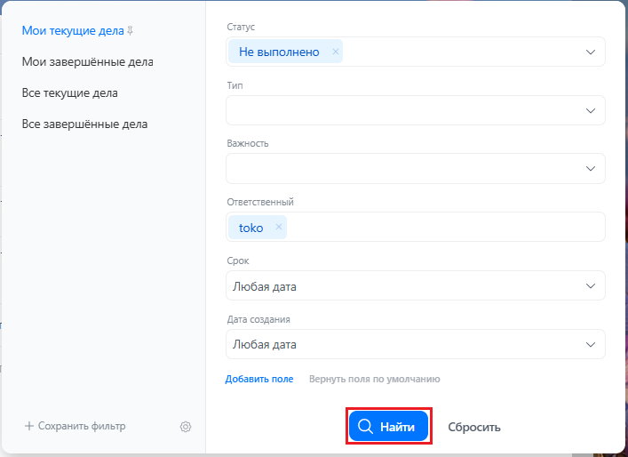
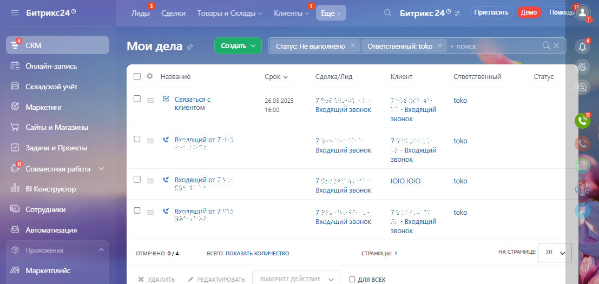
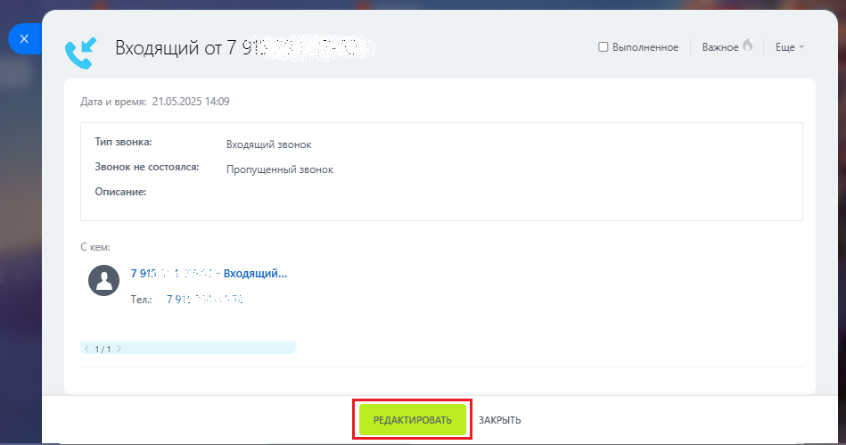
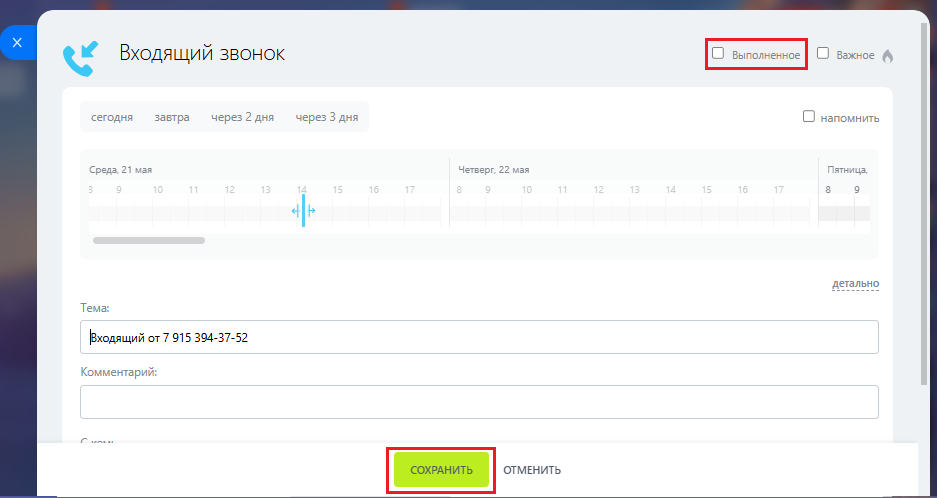
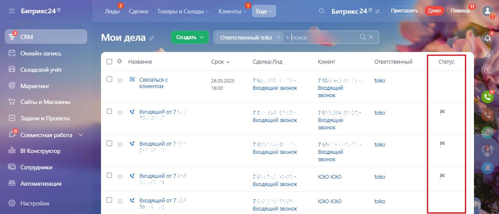

# Как обработать пропущенный звонок

> Трассировка: PDF §3.4 · сквозные стр. 154-157 · источники: ч.1 `kb/sources/integration-bitrix24/Mango_office_integration_Bitrix24.pdf` с.154-157.

Для этого, вам нужно открыть ранее созданное дело о входящем звонке, затем позвонить по номеру, указанному в деле, и поговорить со звонившим. При этом результаты переговоров нужно занести в дело в поле "Описание". Закрытие дел выполняется вручную. Чтобы найти дело по пропущенному звонку, в вашем Битрикс24 выполните: 1) перейдите в раздел "CRM", затем выберите пункт "Еще" и нажмите на ссылку "Мои дела":

> **Описание иллюстрации INTB24-§3.4-1** (к §3.4 «Как обработать пропущенный звонок», стр. 154; 1108×441 px). Снимок экрана / схема.
> Относится к тексту руководства: «…ю. Чтобы найти дело по пропущенному звонку, в вашем Битрикс24 выполните: 1) перейдите в раздел "CRM", затем выберите пункт "Еще" и нажмите на ссылку "Мои дела":».
> Текст на изображении (OCR, требует сверки): ый; ре; = Битрикс24®; Й Сделки.; Товары и Склады >.; Клиенты >; aif; emo; Помошь",; ря; Продажи; Лиды <; Создать; `налитика; Онлайн-запись; Канбан Список | flena | Календарь; © Роботы Расширения |; Be; (Cuapr-npoueccet; Складской учет; Настройки; Просрочены; ' Маркетинг; Управ; + Быстрый лид.; Сайты и Магазины; Настроить меню; звонок; Вернуть меню по умолчанию; Задачи и Проекты:; or; 21 man; Скрытые; ‘Совместная работа; Crary; ola; BI Конструктор; История; Сотрудники; Корзина; + Дело; ' Автоматизация

2) в открывшемся окне вы видите список ваших дел, которые вам нужно выполнить в Битрикс24. Чтобы отфильтровать дела по входящим звонкам, нажмите на поле "Фильтр":

> **Описание иллюстрации INTB24-§3.4-2** (к §3.4 «Как обработать пропущенный звонок», стр. 154; 1107×638 px). Снимок экрана / схема.
> Относится к тексту руководства: «… в открывшемся окне вы видите список ваших дел, которые вам нужно выполнить в Битрикс24. Чтобы отфильтровать дела по входящим звонкам, нажмите на поле "Фильтр":».
> Текст на изображении (OCR, требует сверки): Битрикс249; Лиды; Сделки; Товары и Склады; енты; Битрикс24®; Mpwmnacms — Демо пы"; Создать; Мои текущие дела; Мои дела; Онлайн-запись; Crary; О & Название; Mou текущие дела $; Не выполнено; В Складской учёт; Мои завершенные дела; ia); Связаться с; клиентом; Тип; Маркетинг; Все текущие дела; Сайты и Магазины; Все завершенные дела; Важность; Задачи и Проекты; Виолящий от; en; Совместная работа Y; Ответственный; руслящий от; olo; BI Конструктор; toko; Сотрудники; оли от; pox; Любая дата; ' Автоматизация; Дата создания; OTMEUEHO: 0/4; вс; 'Маркетплейс; "Добавить поле; оля no умолчанию; Разработчик…

Интеграция Виртуальной АТС MANGO OFFICE и Битрикс24 | Версия от 03.03.2026 3) в открывшемся окне настройте фильтр для поиска дел по входящим звонкам. Для этого укажите следующие параметры поиска: - Статус: не выполнено; - Тип: Звонок (входящий); - Ответственный: выберите себя; 4) нажмите кнопку "Найти". Будет выполнена фильтрация ваших дел по входящим звонкам, а результаты показаны на странице "Мои дела":

> **Описание иллюстрации INTB24-§3.4-3** (к §3.4 «Как обработать пропущенный звонок», стр. 155; 707×514 px). Снимок экрана / схема.
> Относится к тексту руководства: «…Ответственный: выберите себя; 4) нажмите кнопку "Найти". Будет выполнена фильтрация ваших дел по входящим звонкам, а результаты показаны на странице "Мои дела":».
> Текст на изображении (OCR, требует сверки): Crary; Мои текущие Zena }; Не выполнено; Мои завершённые дела; Тип; Все текущие дела; Все завершённые дела; Важность; Ответственный; toko; Срок; Любая дата; Дата создани; ona; мол; Добавить поле; оу; + Сохранить фильтр

Далее, откройте карточку дела, нажав на его название:

> **Описание иллюстрации INTB24-§3.4-4** (к §3.4 «Как обработать пропущенный звонок», стр. 155; 1107×525 px). Снимок экрана / схема.
> Относится к тексту руководства: «…". Будет выполнена фильтрация ваших дел по входящим звонкам, а результаты показаны на странице "Мои дела": Далее, откройте карточку дела, нажав на его название:».
> Текст на изображении (OCR, требует сверки): Битрикс249; Лиды; лки; ни; лады; Клиенты; Ewe; Битрикс24®; Притаоить Демо Помошь”,; cRM; Создать; Статус He выполнено.; Ответственный: toko; Мои дела; Онлайн-запись; О & Название; Срок у; Сделка/Лид; Клиент; Ответственный; ‘статус; Складской учет; ia); Связаться с; si; 26.05.2025; 79>; tok; Маркетинг; клиентом; 16:00; Входящий звонок.; Входящий; звонок.; Wy; Сайты и Магазины; одящий от 7:3; Te; toko; Задачи и Проекты:; en; звонок; £2" совместная работа; входящий от? +; 75; ae; 1010 1010; al) BI Конструктор; cae; Pol; ©) Сотрудники; Вуоляш; тт; we; Хх; ® Автоматизация; OTMEUEHO: 0/4; ВСЕГО: ПОК…

Интеграция Виртуальной АТС MANGO OFFICE и Битрикс24 | Версия от 03.03.2026 В открывшейся карточке звонка вы можете: - открыть карточку лида, нажав на ссылку: - позвонить Клиенту, кликнув по номеру телефона. Чтобы добавить комментарий в дело и/или в деле запланировать те или иные действия на будущее (например, перезвонить Клиенту через 2 часа), выполните: 1) нажмите кнопку "Редактировать" в карточке лида. Будет открыто окно редактирования дела;

> **Описание иллюстрации INTB24-§3.4-5** (к §3.4 «Как обработать пропущенный звонок», стр. 156; 949×499 px). Снимок экрана / схема.
> Относится к тексту руководства: «…я на будущее (например, перезвонить Клиенту через 2 часа), выполните: 1) нажмите кнопку "Редактировать" в карточке лида. Будет открыто окно редактирования дела;».
> Текст на изображении (OCR, требует сверки): О Выполненное; Важное; Ewe; Y Входящий or 7 9; Тип звонка:; Входящий звонок; Звонок не состоялся;; Пропущенный звонок; Описание:; Crem:; входящий...; [2] 7985; Ten:; 79:; ал

2) при необходимости, настройте уведомление о выполнении тех или иных действий в деле, добавьте комментарий в дело по результатам звонка этому Клиенту, пометьте дело как важное; 3) чтобы закрыть дело, установите флаг "Выполненное"; 4) нажмите кнопку "Сохранить" чтобы сохранить правки в деле:

> **Описание иллюстрации INTB24-§3.4-6** (к §3.4 «Как обработать пропущенный звонок», стр. 156; 937×498 px). Снимок экрана / схема.
> Относится к тексту руководства: «…онка этому Клиенту, пометьте дело как важное; 3) чтобы закрыть дело, установите флаг "Выполненное"; 4) нажмите кнопку "Сохранить" чтобы сохранить правки в деле:».
> Текст на изображении (OCR, требует сверки): О важное; Y Входящий звонок; ‘сегодня; завтра; через 2 дня; через 3 дня; О напомнить,; 2 a; ale; aeraneo; Tema; Вмодящий or 7 915 394-37-52; Комментарий

Интеграция Виртуальной АТС MANGO OFFICE и Битрикс24 | Версия от 03.03.2026

> **Описание иллюстрации INTB24-§3.4-7** (к §3.4 «Как обработать пропущенный звонок», стр. 157; 18×22 px). Пиктограмма (значок элемента интерфейса).
> Относится к тексту руководства: «…онка этому Клиенту, пометьте дело как важное; 3) чтобы закрыть дело, установите флаг "Выполненное"; 4) нажмите кнопку "Сохранить" чтобы сохранить правки в деле:».
> Текста на изображении нет; назначение элемента — см. текст, к которому он относится.

Закрытые дела помечаются пиктограммой в разделе "Мои дела":

> **Описание иллюстрации INTB24-§3.4-8** (к §3.4 «Как обработать пропущенный звонок», стр. 157; 1156×498 px). Снимок экрана / схема.
> Относится к тексту руководства: «…Закрытые дела помечаются пиктограммой в разделе "Мои дела":».
> Текст на изображении (OCR, требует сверки): 40; ous; Burpuxc24°; Mab; Сделки; рыи; ады; Битрикс24.; рита; Мои дела; Создать; Ответственный toko; Онлайн-запись; О $ Название; Сделка/лид; Клиент; Ответственный; срок У; ‘статус; Складской учёт; "Связаться с; 26052025; 75:; toko; Маркетинг; клиентом; 1600; входящий звонок; входящий; звонок; ‘Сайты и Магазины; Of; 79; входящий or 7; а ебта —; ae; Входящий от?; af; BI Korcrpyxtop; Сотрудники; og; Входящий от7; те; юююю; Автоматизация; me; 1010 1010; астройку; Входящий от7 :;; ‘Входящий звонок
