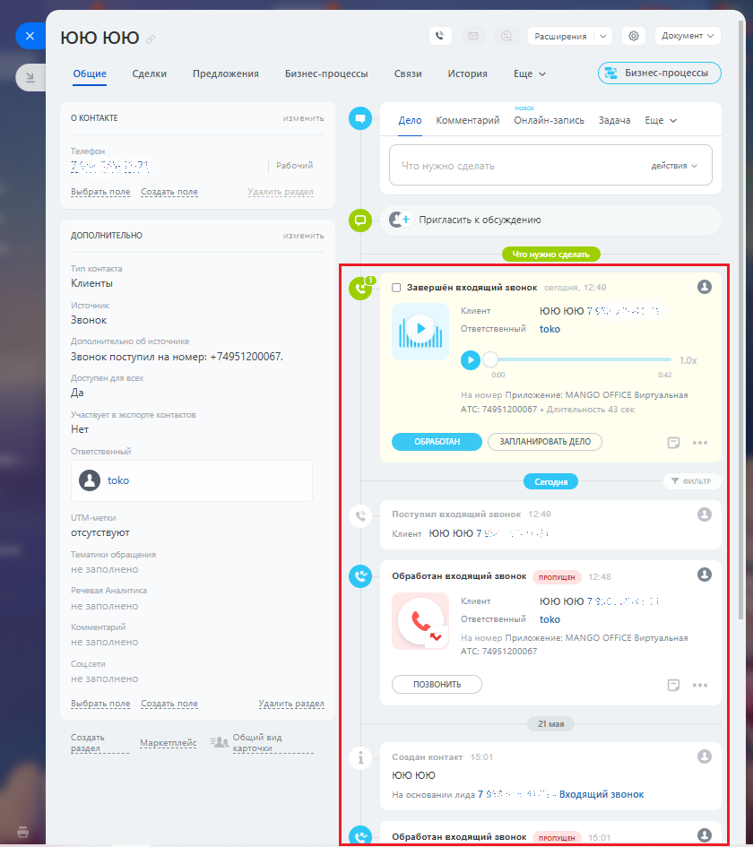

# 3.5. История вызовов

> Трассировка: PDF §3.5 · сквозные стр. 157-158 · источники: ч.1 `kb/sources/integration-bitrix24/Mango_office_integration_Bitrix24.pdf` с.157-158.

Каждый звонок от Клиента отображается в карточке клиента, в истории взаимоотношений с ним:

> **Описание иллюстрации INTB24-§3.5-1** (к §3.5 «История вызовов», стр. 157; 840×945 px). Снимок экрана / схема.
> Относится к тексту руководства: «…ела помечаются пиктограммой в разделе "Мои дела": 3.5 История вызовов Каждый звонок от Клиента отображается в карточке клиента, в истории взаимоотношений с ним:».
> Текст на изображении (OCR, требует сверки): Документ v; FOO юю; Расширения; Общие; Сделки; Предложения; Бизнес-процессы; Связи; История; Еще м; новое; О КОНТАКТЕ; ен; Дело; Комментарий; Онлайн-запись; Задача; Еще v; действия; бр:; по.; ать по,; о С: Пригласить к обсуждению; ДОПОЛНИТЕЛЬНО.; Клиенты; GS С] Завершён входящий звонок; Клиент; toto HOW 7; Звонок; toko; Звонок поступил на номер: +74951200067.; Да; МАМСО О; СЕ Bi; туальная; АТС:; Нет; ОБРАБОТАН; ЗАПЛАНИРОВАТЬ ДЕЛО.; [2] toko; отсутствуют; toro 10107; © Обработан входящий звонок — пропущЕН; ЮюЮюЮюЮ?:; Ore!; MAN; льная; TC:; ПОЗВОНИТЬ; 21 мая; Создать; зд; Общий вид; Маркет; vic;…

Интеграция Виртуальной АТС MANGO OFFICE и Битрикс24 | Версия от 03.03.2026 Если в Виртуальной АТС включена услуга записи разговоров, то здесь же можно прослушать или скачать запись разговора. Примечание. Запись разговора может отобразиться в карточке контакта с небольшой задержкой.
