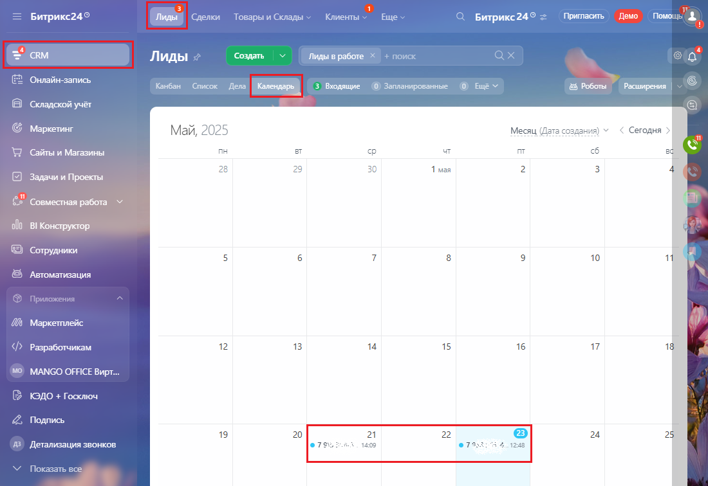

# 3.6. Просмотр сведений о звонках в календаре

> Трассировка: PDF §3.6 · сквозные стр. 158-159 · источники: ч.1 `kb/sources/integration-bitrix24/Mango_office_integration_Bitrix24.pdf` с.158-159.

В календаре Битрикс24 фиксируются совершенные звонки и звонки, переназначенные на другого пользователя. По умолчанию данная возможность включена, но вы можете ее выключить. Чтобы посмотреть звонки в календаре, выполните следующие действия: 1) перейдите в раздел CRM; 2) на открывшейся странице нажмите "Календарь". Информация о звонке содержит следующие данные: • номер звонившего Клиента; • дата и время совершения вызова:

> **Описание иллюстрации INTB24-§3.6-1** (к §3.6 «Просмотр сведений о звонках в календаре», стр. 158; 1100×756 px). Снимок экрана / схема.
> Относится к тексту руководства: «…2) на открывшейся странице нажмите "Календарь". Информация о звонке содержит следующие данные: • номер звонившего Клиента; • дата и время совершения вызова:».
> Текст на изображении (OCR, требует сверки): = Битрикс24°; `делки; Товары и Склады; Кл; нты; Euy; Битрикс24®; Пратаоть) feo Mowou; Создать; лиды в работе; Онлайн-запись; 3 Входящие; О) Запланированные; & Роботы; Расширения; Складской учет; Маркетинг; Месяц; та создания) ¥; < Сегодня; Май, 2025; Сайты и Магазины; пн; чт; ag; 28; 29; 30; 1 мая; Задачи и Проекты; en; 62; Совместная работа Y; al) BI Конструктор; Сотрудники; 10; rN; Asromarveayna; Mapxemnneiic; Разработчикам; 12; 13; 15; 16; 18; MANGO OFFICE Вир; КЭДО + Госключ; Подпись; 19; 20; 21; 22; 24; 25; Детализация звонков:; ет,; 07935; 5 4.1248; Tox; ль все

Интеграция Виртуальной АТС MANGO OFFICE и Битрикс24 | Версия от 03.03.2026
