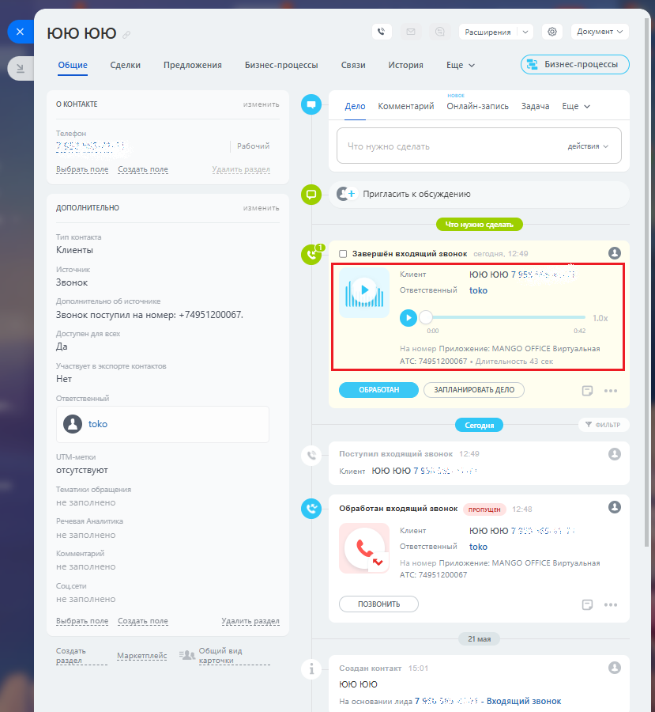

# 3.7. Запись разговоров

> Трассировка: PDF §3.7 · сквозные стр. 159-160 · источники: ч.1 `kb/sources/integration-bitrix24/Mango_office_integration_Bitrix24.pdf` с.159-160.

Если в Виртуальной АТС подключена услуга записи разговоров и в настройках API включен флаг "Предоставлять возможность генерации и использования ссылок" (см. Настройка Виртуальной АТС MANGO OFFICE, п.4), то при наличии записи разговора ее можно прослушать в Битрикс24:

> **Описание иллюстрации INTB24-§3.7-1** (к §3.7 «Запись разговоров», стр. 159; 829×900 px). Снимок экрана / схема.
> Относится к тексту руководства: «…озможность генерации и использования ссылок" (см. Настройка Виртуальной АТС MANGO OFFICE, п.4), то при наличии записи разговора ее можно прослушать в Битрикс24:».
> Текст на изображении (OCR, требует сверки): Документ v; FOO юю; Расширения; Общие; Сделки; Предложения; Бизнес-процессы; Связи; История; Еще м; новое; О КОНТАКТЕ; ен; Дело; Комментарий; Онлайн-запись; Задача; Еще v; действия; ыбрать по.; Со:; поле; [$] С: Пригласить к обсуждению; ДОПОЛНИТЕЛЬНО.; Что нужно сделать; Клиенты; С] Завершён входящий звонок; HT; ЮЮ 1010 7 95$; Звонок; toko; Звонок поступил на номер: +74951200067.; Да; МАМСО; СЕ Виртуальная; АТС:; 512; Нет; ОБРАБОТАН; ЗАПЛАНИРОВАТЬ ДЕЛО.; [2] toko; отсутствуют; toro ЮЮ 7$; ПРОПУЩЕН; © Обработан входящий звонок; нт; юююю 7; MAN; pr; ьная; TC:; 51200; ПОЗВОНИТЬ; 21 мая; Создать; …

Примечания: 1. Запись разговора может отобразиться в карточке контакта с небольшой задержкой. 2. Если длительность разговора менее 6 сек, то запись разговора не сохранится в Виртуальной АТС и соответственно не отобразится в Битрикс24. Если в ходе обработки вызова, сотрудники переводили его на других сотрудников, то в Битрикс24 будет сохранены все записи разговоров Клиентам с каждым из сотрудников. Интеграция Виртуальной АТС MANGO OFFICE и Битрикс24 | Версия от 03.03.2026
