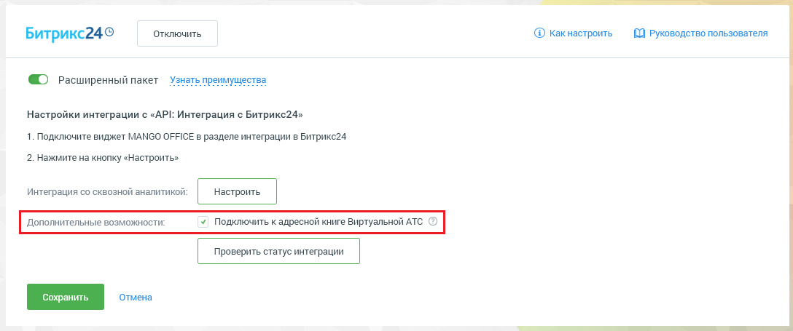
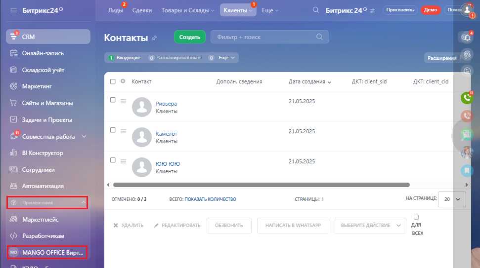
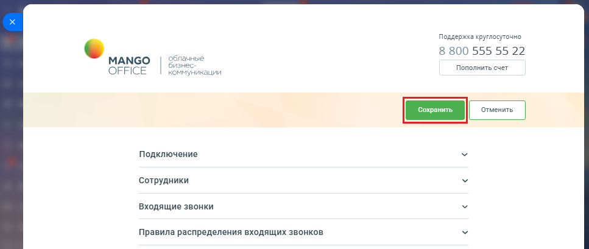
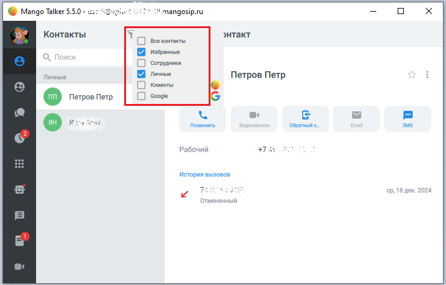
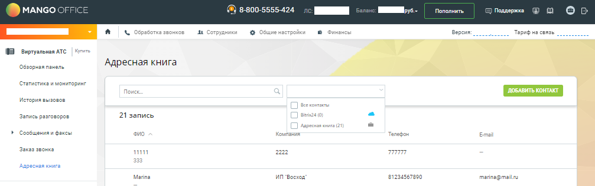

# 4. Интеграция с адресной книгой Виртуальной АТС

> Трассировка: PDF §4 · сквозные стр. 160-163 · источники: ч.1 `kb/sources/integration-bitrix24/Mango_office_integration_Bitrix24.pdf` с.160-163.

Если вы используете расширенный пакет интеграции, то в Личном кабинете вы можете подключить Битрикс24 как внешний источник контактов в адресную книгу MANGO OFFICE. Установите флаг "Подключить к адресной книге Виртуальной АТС" и нажмите "Сохранить". Начнется отображение лидов, контактов и компаний из Битрикс24 в адресной книге Виртуальной АТС:

> **Описание иллюстрации INTB24-§4-1** (к §4 «Интеграция с адресной книгой Виртуальной АТС», стр. 160; 1088×455 px). Снимок экрана / схема.
> Относится к тексту руководства: «…ключить к адресной книге Виртуальной АТС" и нажмите "Сохранить". Начнется отображение лидов, контактов и компаний из Битрикс24 в адресной книге Виртуальной АТС:».
> Текст на изображении (OCR, требует сверки): Битрикс249; ‘отключить; © какнастроить; £0 Руководство пользователя; © расширенный пакет Узнать преимущества; Настройки интеграции с «API: Интеграция с Битрикс24»; 1. Подключите виджет MANGO OFFICE в разделе интеграции в Битрикс24; 2. Нажмите на кнопку «Настроить»; Интеграция со сквозной аналитикой

После установки флага "Подключить к адресной книге Виртуальной АТС" пересохраните настройки приложения интеграции. Это необходимо, чтобы номера контактов из Битрикс24 стали доступны в адресной книге Виртуальной АТС. Вот как это сделать: 1) открыть ваш Битрикс24; 2) нажать на ссылку "MANGO OFFICE Виртуальная АТС". Будут открыты настройки приложения интеграции: Интеграция Виртуальной АТС MANGO OFFICE и Битрикс24 | Версия от 03.03.2026

> **Описание иллюстрации INTB24-§4-2** (к §4 «Интеграция с адресной книгой Виртуальной АТС», стр. 161; 971×543 px). Снимок экрана / схема.
> Относится к тексту руководства: «…ртуальной АТС. Вот как это сделать: 1) открыть ваш Битрикс24; 2) нажать на ссылку "MANGO OFFICE Виртуальная АТС". Будут открыты настройки приложения интеграции:».
> Текст на изображении (OCR, требует сверки): Лиды; ды; Клиенты; Ewe; Битрикс24'; ape uC; см; Контакты; ‘создать; Онлайн-запись; 1 Водящие; Запзнироваины; расширения; В Складской учёт; О 3 коек; Дополн, сведения; Дата создания v; AKT: client sia; AKT: client cid; Маркетинг; WD сойыи Магазины; Ривьера:; 21.05.2025; © задачии Проекты; Камелот; Gemma; ola. Koncpycop; 1010 1010; ® сотрудники; © Автоматизация; иран».; ВСЕГО: ПОКАЗАТЬ КОЛИЧЕСТВО; араницы: 1; HA CTPABME:; Ws Mapnernneiic; wn; be; ana; всех; Разработчикам

3) нажать кнопку "Сохранить":

> **Описание иллюстрации INTB24-§4-3** (к §4 «Интеграция с адресной книгой Виртуальной АТС», стр. 161; 967×409 px). Снимок экрана / схема.
> Относится к тексту руководства: «…3) нажать кнопку "Сохранить":».
> Текст на изображении (OCR, требует сверки): Поддержка круглосуточно; облачнье; 8 800 555 55 22; MANGO; онес-; Пополнить счет; ОРАСЕ; коммуникации; Подключение; Сотрудники; входящие звонки; Правила распределения входящих звонков

Теперь, лиды, контакты и компании из Битрикс24 будут видны: - в Личном кабинете Виртуальной АТС в разделе "Адресная книга"; - в Mango Talker; - в Контакт-Центре. Интеграция Виртуальной АТС MANGO OFFICE и Битрикс24 | Версия от 03.03.2026 В MANGO TALKER:

> **Описание иллюстрации INTB24-§4-4** (к §4 «Интеграция с адресной книгой Виртуальной АТС», стр. 162; 729×466 px). Снимок экрана / схема.
> Относится к тексту руководства: «…В MANGO TALKER:».
> Текст на изображении (OCR, требует сверки): va; mangosip.ru; Контакты; Все контакты; энтакт; Избранные; Личные; Петров Петр; Google; о Петров Петр; {52; Позвонить; Обратный 3.; SMS; Рабочий; +7 55; История вызовов; 18; Отменен; ый

В Личном кабинете Виртуальной АТС:

> **Описание иллюстрации INTB24-§4-5** (к §4 «Интеграция с адресной книгой Виртуальной АТС», стр. 162; 1007×316 px). Снимок экрана / схема.
> Относится к тексту руководства: «…В MANGO TALKER: В Личном кабинете Виртуальной АТС:».
> Текст на изображении (OCR, требует сверки): MANGO OFFI; 424; по; нить; cnn; ry; Ne обработка звонков; At Сотрудники; 8 оансы; Версия; Taped wa; noe; Bupryanonan ATC; co; Адресная книга; обзорная панель; стетистика и мониторит; Поиск; ‘история вызовов; енот; Запись pasrosopes; 21 запись; рвения; сообщенияи факсы; vo; Keune; телефон; emai; кая звонка; mm; 22; 333; Marne; ГИП Bocxoa; 81734567290; поппавтаяль

Внимание! В адресной книге Виртуальной АТС, ЦОВ, MANGO TALKER вы можете просматривать карточку лида/контакта/компании, но не можете редактировать. Редактировать ее можно только из Битрикс24. Интеграция Виртуальной АТС MANGO OFFICE и Битрикс24 | Версия от 03.03.2026
