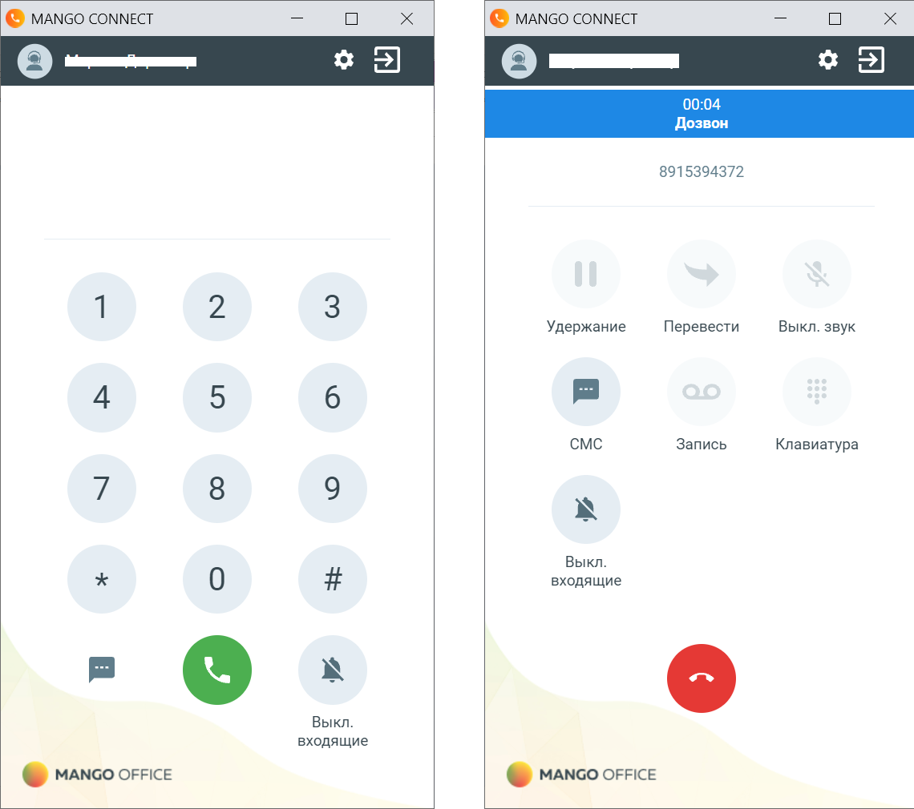
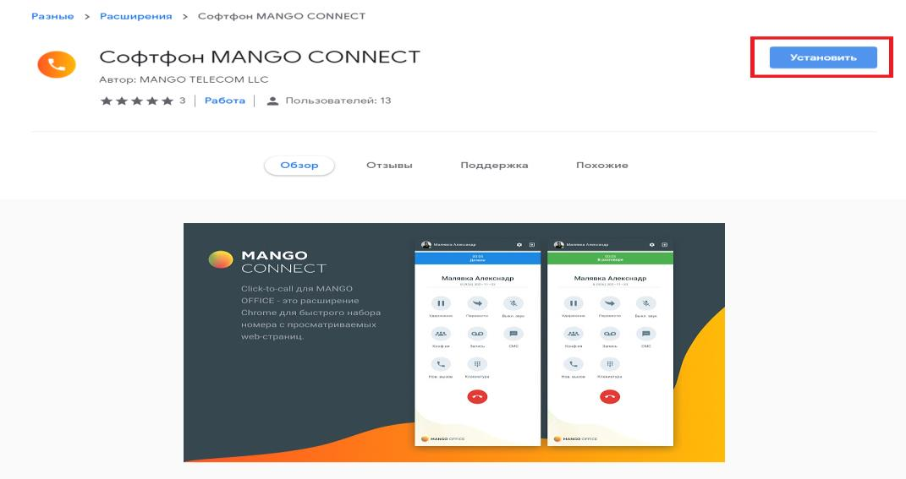
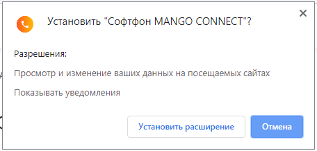
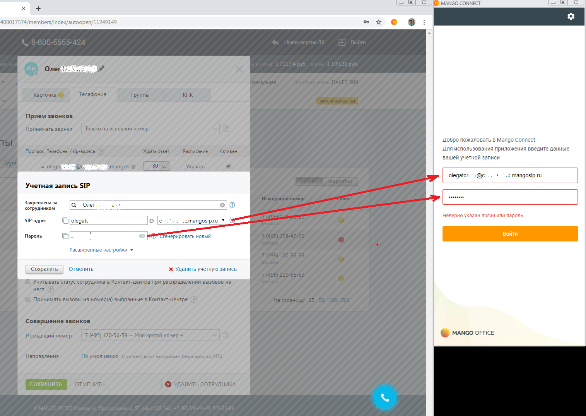
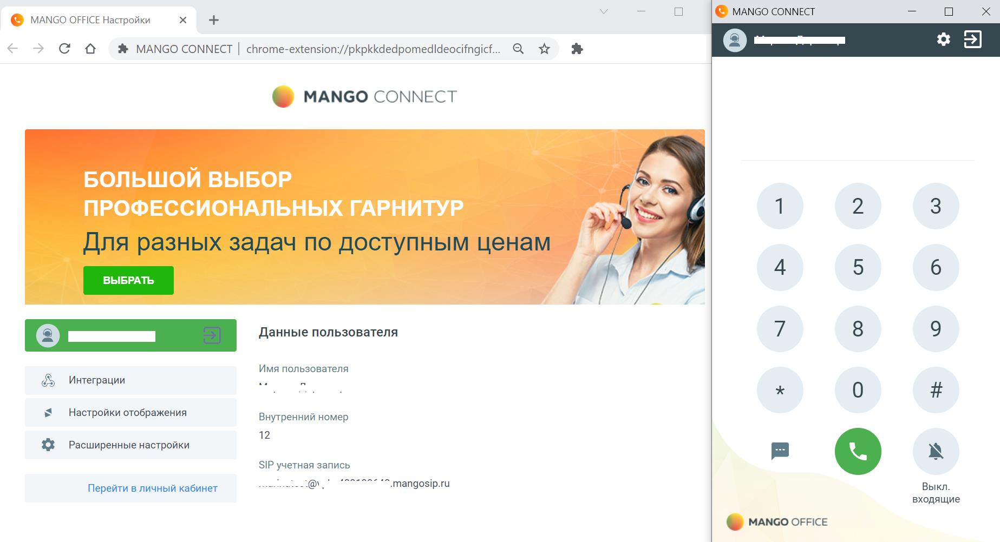
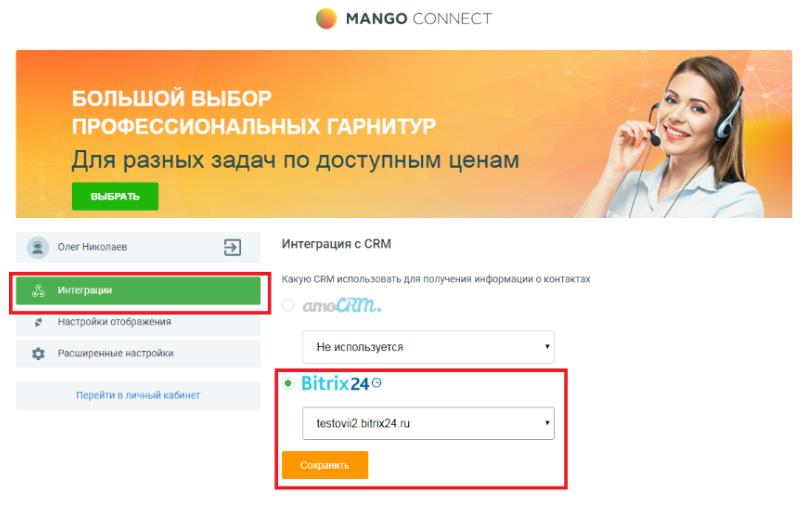

# 5.1. Описание

> Трассировка: PDF §5.1 · сквозные стр. 163-167 · источники: ч.1 `kb/sources/integration-bitrix24/Mango_office_integration_Bitrix24.pdf` с.163-167.

Софтфон "MANGO CONNECT" - расширение для Google Chrome, которое при интеграции виртуальной АТС с CRM-системой позволит звонить, принимать вызовы и отправлять SMS из окна браузера. Работает с Битрикс24 и только при наличии услуги "Расширенные возможности интеграции". Внимание! Браузерный софтфон MANGO CONNECT предназначен только для работы в браузере Chrome! Для установки софтфона перейдите в Chrome по ссылке - скачать Софтфон MANGO CONNECT Чтобы звонить из браузера требуется только установленное расширение MANGO CONNECT и гарнитура. Все функции MANGO CONNECT: • прием входящих звонков; • работа в режиме "Не беспокоить" / DND, в котором все входящие вызовы автоматически сбрасываются; • набор номера на клавиатуре или с помощью номеронабирателя в приложении; • исходящие звонки по клику из CRM-системы; • возможность набора DTMF-команд при дозвоне на голосовое меню; • перевод вызова на другого сотрудника или внешний номер; • запись разговора во время звонка; • отключение звука во время разговора; • постановка вызова на удержание; • отображение имени или телефона Клиента; • отправка SMS из приложения; • всплывающее уведомление и звуковое оповещение при входящем звонке; • приложение работает со всеми гарнитурами. Интеграция Виртуальной АТС MANGO OFFICE и Битрикс24 | Версия от 03.03.2026

> **Описание иллюстрации INTB24-§5.1-1** (к §5.1 «Описание», стр. 164; 1140×1010 px). Снимок экрана / схема.
> Относится к тексту руководства: «…отправка SMS из приложения; • всплывающее уведомление и звуковое оповещение при входящем звонке; • приложение работает со всеми гарнитурами.».
> Текст на изображении (OCR, требует сверки): @ МА\СО CONNECT; (© МА\СО CONNECT; зы; 00:04; Дозвон; 8915394372; Удержание; Перевести; Выкл. звук; CMC; Запись; Клавиатура; Выкл.; входящие; NY; @ manco ОЕРСЕ; © manco ОЕРСЕ

Установку расширения необходимо выполнить каждому сотруднику. 1. нажмите "Установить"

> **Описание иллюстрации INTB24-§5.1-2** (к §5.1 «Описание», стр. 164; 1071×567 px). Снимок экрана / схема.
> Относится к тексту руководства: «…Установку расширения необходимо выполнить каждому сотруднику. 1. нажмите "Установить"».
> Текст на изображении (OCR, требует сверки): Разные; Расширония; софтфон MANGO CONNECT; Автор: MANGO TELECOM LLC; tet te tee | Работа |; Обзор; отзывы; Поддоржка; Похожие; MANGO; CONNEC; En

Интеграция Виртуальной АТС MANGO OFFICE и Битрикс24 | Версия от 03.03.2026 2) подтвердите разрешение на установку:

> **Описание иллюстрации INTB24-§5.1-3** (к §5.1 «Описание», стр. 165; 456×218 px). Снимок экрана / схема.
> Относится к тексту руководства: «…2) подтвердите разрешение на установку:».
> Текст на изображении (OCR, требует сверки): @ Установить "Софтфон MANGO CONNECT"?; Разрешения:; Просмотр и изменение ваших данных на посещаемых сайтах; Показывать уведомления

3) ввести данные SIP ID сотрудника и пароля; 4) нажать на кнопку "Войти":

> **Описание иллюстрации INTB24-§5.1-4** (к §5.1 «Описание», стр. 165; 1515×1075 px). Снимок экрана / схема.
> Относится к тексту руководства: «…2) подтвердите разрешение на установку: 3) ввести данные SIP ID сотрудника и пароля; 4) нажать на кнопку "Войти":».
> Текст на изображении (OCR, требует сверки): 8 MANGO CONNECT; 2s; 400017574/members/index/autoopen/11249149; Добро пожаловать в Mango Connect; Для использования приложения введите данные; вашей учетной записи; АВЕ АИ; olegat; mangosip.ru; Учетная запись SIP; Закреплена 2a; ия; ‘сотрудником; Ц Oner; Неверно указан логин или пароль; 51Р-адрес; Claes; Пароль; ировать HC; ый; Расширенные настройки у; х Удалить учетную запись; Отменить; (©) МАМСО orice

Интеграция Виртуальной АТС MANGO OFFICE и Битрикс24 | Версия от 03.03.2026 5) после успешной авторизации пользователя будут показаны настройки расширения и окно софтфона:

> **Описание иллюстрации INTB24-§5.1-5** (к §5.1 «Описание», стр. 166; 1847×1002 px). Снимок экрана / схема.
> Относится к тексту руководства: «…5) после успешной авторизации пользователя будут показаны настройки расширения и окно софтфона:».
> Текст на изображении (OCR, требует сверки): @ МАМбО connect; @ MANGO OFFICE Настройки; зы; < > С @ _— # MANGO CONNECT | chrome-extension://pkpkkdedpomedideocifngicf.. Q we №; @ МАМСО CONNECT; БОЛЬШОЙ ВЫБОР; ПРОФЕССИОНАЛЬНЫХ ГАРНИТУР; LA; ВЫБРАТЬ; Данные пользователя; Имя пользователя; ее; «& Интеграции; Настройки отображения; Внутренний номер; 3$ Расширенные настройки; 12; SIP учетная запись; ета; -Mangosip.ru; Выкл.; Перейти в личный кабинет; входящие; @ manco ОЕРСЕ

6) после авторизации уже можно звонить и принимать звонки;

> **Описание иллюстрации INTB24-§5.1-6** (к §5.1 «Описание», стр. 166; 42×41 px). Пиктограмма (значок элемента интерфейса).
> Относится к тексту руководства: «…5) после успешной авторизации пользователя будут показаны настройки расширения и окно софтфона: 6) после авторизации уже можно звонить и принимать звонки;».
> Текста на изображении нет; назначение элемента — см. текст, к которому он относится.

7) нажмите на кнопку окне софтфона (см. рисунок выше) и в открывшихся настройках укажите ваш домен в CRM и сохраните:

> **Описание иллюстрации INTB24-§5.1-7** (к §5.1 «Описание», стр. 166; 808×505 px). Снимок экрана / схема.
> Относится к тексту руководства: «…ации уже можно звонить и принимать звонки; 7) нажмите на кнопку окне софтфона (см. рисунок выше) и в открывшихся настройках укажите ваш домен в CRM и сохраните:».
> Текст на изображении (OCR, требует сверки): @ MANGO CONNECT; SE; Для разных задач по доступным ценам; Интеграция с CRM; = Олег Никопаев; какую CRM использовать для получения информации о контактах; рации; CRM.; Настройки отображения; Расширенные настройки; Не используется; ® Bitrix240; перейти в личный кабинет; lestovn2 bitrix24 ги

8) Софтфон MANGO CONNECT настроен на работу с CRM. Интеграция Виртуальной АТС MANGO OFFICE и Битрикс24 | Версия от 03.03.2026
