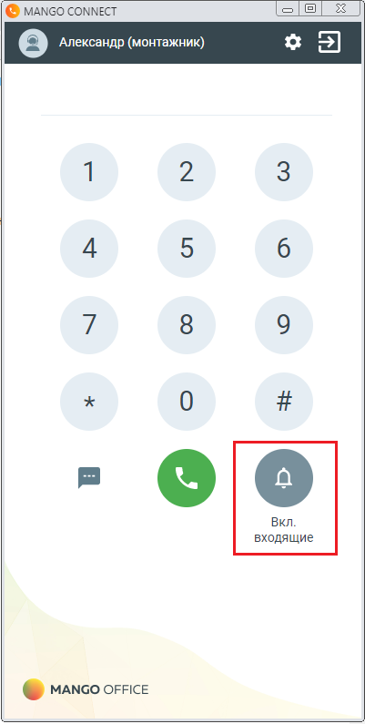
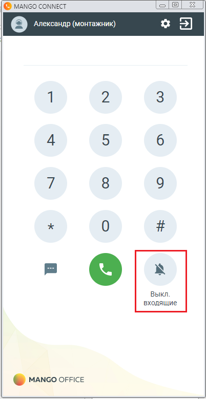

# 5.2. Дополнительно. Как включить и выключить режим "Не беспокоить" / DND

> Трассировка: PDF §5.2 · сквозные стр. 167-168 · источники: ч.1 `kb/sources/integration-bitrix24/Mango_office_integration_Bitrix24.pdf` с.167-168.

беспокоить" / DND MANGO CONNECT поддерживает режим "Не беспокоить". Если вы включили данный режим, то все ваши всходящие звонки автоматически сбрасываются. Примечание. В данном режиме входящий звонок завершается с кодом 1123, который означает "Получен сигнал "Не беспокоить". Чтобы перевести ваш MANGO CONNECT в режим "Не беспокоить", нажмите на

> **Описание иллюстрации INTB24-§5.2-1** (к §5.2 «Дополнительно. Как включить и выключить режим "Не беспокоить" / DND», стр. 167; 62×65 px). Фрагмент интерфейса (кнопка, переключатель или поле).
> Относится к тексту руководства: «…ходящий звонок завершается с кодом 1123, который означает "Получен сигнал "Не беспокоить". Чтобы перевести ваш MANGO CONNECT в режим "Не беспокоить", нажмите на».
> Текста на изображении нет; назначение элемента — см. текст, к которому он относится.

кнопку . Чтобы отключить "Режим не беспокоить", в вашем MANGO

> **Описание иллюстрации INTB24-§5.2-2** (к §5.2 «Дополнительно. Как включить и выключить режим "Не беспокоить" / DND», стр. 167; 70×63 px). Фрагмент интерфейса (кнопка, переключатель или поле).
> Относится к тексту руководства: «…учен сигнал "Не беспокоить". Чтобы перевести ваш MANGO CONNECT в режим "Не беспокоить", нажмите на кнопку . Чтобы отключить "Режим не беспокоить", в вашем MANGO».
> Текста на изображении нет; назначение элемента — см. текст, к которому он относится.

CONNECT нажмите кнопку .

> **Описание иллюстрации INTB24-§5.2-3** (к §5.2 «Дополнительно. Как включить и выключить режим "Не беспокоить" / DND», стр. 167; 401×795 px). Снимок экрана / схема.
> Относится к тексту руководства: «…ь". Чтобы перевести ваш MANGO CONNECT в режим "Не беспокоить", нажмите на кнопку . Чтобы отключить "Режим не беспокоить", в вашем MANGO CONNECT нажмите кнопку .».
> Текст на изображении (OCR, требует сверки): | @ MANGO CONNECT; Qa Александр (монтажник); ое; Вкл.; входящие; © manco ОЕЕСЕ

> **Описание иллюстрации INTB24-§5.2-4** (к §5.2 «Дополнительно. Как включить и выключить режим "Не беспокоить" / DND», стр. 167; 402×779 px). Снимок экрана / схема.
> Относится к тексту руководства: «…ь". Чтобы перевести ваш MANGO CONNECT в режим "Не беспокоить", нажмите на кнопку . Чтобы отключить "Режим не беспокоить", в вашем MANGO CONNECT нажмите кнопку .».
> Текст на изображении (OCR, требует сверки): | @ MANGO CONNECT; Выкл.; входящие; ® MANGO OFFICE

Интеграция Виртуальной АТС MANGO OFFICE и Битрикс24 | Версия от 03.03.2026
