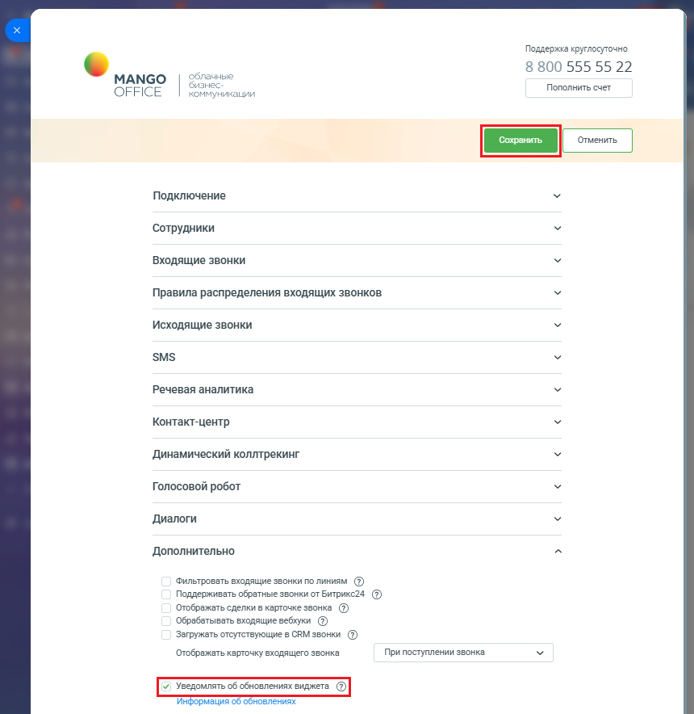

# 7. Обновление приложения

> Трассировка: PDF §7 · сквозные стр. 169-170 · источники: ч.1 `kb/sources/integration-bitrix24/Mango_office_integration_Bitrix24.pdf` с.169-170.

Команда разработки постоянно работает над улучшениями приложения интеграции MANGO OFFICE с Битрикс24. Чтобы вам стали доступны новые возможности, обновите приложение. При появлении нового обновления приложения – над формой настройки приложения вы увидите уведомлении о появлении новой версии. Кликните на "Перейти к установке" и пройдите процесс обновления. Все настройки интеграции будут сохранены! Вы можете включить или выключить показ уведомления о новой версии приложения. Для этого: 1) откройте форму настройки приложения интеграции, откройте блок "Дополнительно"; 2) установите флаг "Уведомлять об обновлениях виджета", чтобы включить показ уведомлений, либо снимите этот флаг, чтобы выключить показ уведомлений; Примечание. Нажав на ссылку "Информация об обновлениях", вы перейдете на сайт MANGO OFFICE, на котором показан список обновлений приложения. 3) нажмите кнопку "Сохранить" в верхней части формы настройки приложения интеграции:

> **Описание иллюстрации INTB24-§7-1** (к §7 «Обновление приложения», стр. 169; 860×884 px). Снимок экрана / схема.
> Относится к тексту руководства: «…дете на сайт MANGO OFFICE, на котором показан список обновлений приложения. 3) нажмите кнопку "Сохранить" в верхней части формы настройки приложения интеграции:».
> Текст на изображении (OCR, требует сверки): Поддержка круглосуточно; 8 800 555 55 22; MANGO; 12; Пополнить счет; OFFICE; чикации; Подключение; Сотрудники; Входящие звонки; Правила распределения входящих звонков; Исходящие звонки; SMS; Речевая аналитика; Контакт-центр; Динамический коллтрекинг; Голосовой робот; Диалоги; Дополнительно; Фильтровать входящие звонки по линиям ($); Поддерживать обратные звонки от Битрикс24 (2); Отображать сделки в карточке звонка (2); Обрабатывать входящие вебхуки (7); Загружать отсутствующие в CRM звонки ($); Отображать карточку входящего звонка; При поступлении звонка; Инф; мация о; бновлениях

Интеграция Виртуальной АТС MANGO OFFICE и Битрикс24 | Версия от 03.03.2026
