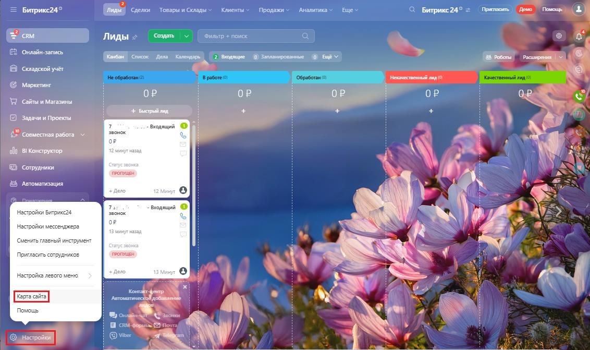
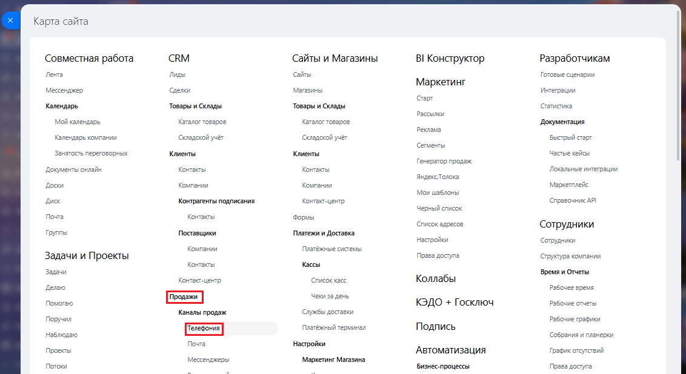
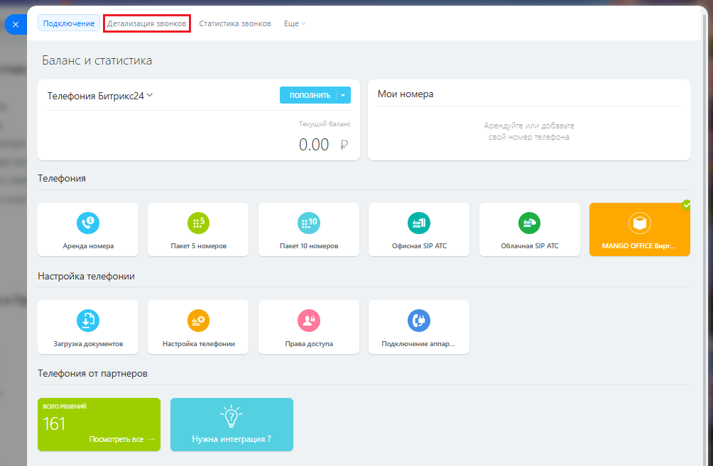
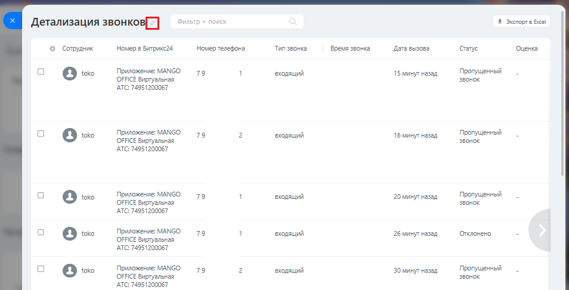

# А. Как открыть отчет "Детализация звонков" в Битрикс24

> Трассировка: PDF §— · сквозные стр. 170-172 · источники: ч.1 `kb/sources/integration-bitrix24/Mango_office_integration_Bitrix24.pdf` с.170-172.

Чтобы открыть отчет "Детализация звонков", в вашем Битсрикс24 выполните: 1) нажмите "Настройки"; 2) выберите пункт "Карта сайта"

> **Описание иллюстрации INTB24-§—-1** (к §— «А. Как открыть отчет "Детализация звонков" в Битрикс24», стр. 170; 1132×671 px). Снимок экрана / схема.
> Относится к тексту руководства: «…етализация звонков" в Битрикс24 Чтобы открыть отчет "Детализация звонков", в вашем Битсрикс24 выполните: 1) нажмите "Настройки"; 2) выберите пункт "Карта сайта"».
> Текст на изображении (OCR, требует сверки): Клиенты v; Продажи; Аналитика; ще; Tommasi feo Mowoup |; = Битрике24°; TRB) Сделки — Товары м Склады; С Битрикс24° =; Лида Cag; eo; ЕЁ онлайн-запись,; [ее Ue; 9-0; B складской учат; "Нечественный лид; G маркетинг; a ca; oP; Cia и Магазины!; ое; Задачи и Проекты; Anu; 2 совместная работа м; ок; Sy; es); ola. 81 Конструктор; © сотрудники; 8 Аноматизация,; «ae; Бодящий; ии; Ve; cep; WAY; главный инструмент; Pow; yre сотрудни; oro; ото менк; SS; oy; помощь; oun ae ve; Ela SS

3) нажмите "Телефония" в блоке "Продажи":

> **Описание иллюстрации INTB24-§—-2** (к §— «А. Как открыть отчет "Детализация звонков" в Битрикс24», стр. 170; 1132×618 px). Снимок экрана / схема.
> Относится к тексту руководства: «…ыть отчет "Детализация звонков", в вашем Битсрикс24 выполните: 1) нажмите "Настройки"; 2) выберите пункт "Карта сайта" 3) нажмите "Телефония" в блоке "Продажи":».
> Текст на изображении (OCR, требует сверки): Карта сайта; CRM; ‘Сайты и Магазины; Совместная работа; BI Конструктор; Разработчикам; Лента; Лады; сайты; Готовые сценарии; Маркетинг; Мессенджер; Сделки; Магазины; Интеграции; Сарт; Календарь,; Товары и Склады; ‘статистика; Рассылки; Мой календарь; Каталог товаров:; Документация; реклама; Календарь комгании; Складской учёт; ‘Складской учёт; Быстрый старт; Сементы; Клиенты:; Частые кейсы; Занятость переговорных; Генератор продаж; "Документы онлайн; Контакты; Локальные интеграции; Яндекстолока; ‘Доски; Компании; Меркетилейс; Мои шаблоны; Дик; Контрагенты подписания; Контакт-центр; ‘Справочник …

4) нажмите на пункт "Детализация звонков"; Интеграция Виртуальной АТС MANGO OFFICE и Битрикс24 | Версия от 03.03.2026

> **Описание иллюстрации INTB24-§—-3** (к §— «А. Как открыть отчет "Детализация звонков" в Битрикс24», стр. 171; 1004×657 px). Снимок экрана / схема.
> Относится к тексту руководства: «…тсрикс24 выполните: 1) нажмите "Настройки"; 2) выберите пункт "Карта сайта" 3) нажмите "Телефония" в блоке "Продажи": 4) нажмите на пункт "Детализация звонков";».
> Текст на изображении (OCR, требует сверки): Подключение; статистика звонков; Ewe; Баланс и статистика; Mou номера; Телефония Битрикс24 У; 0.00 Р; Телефония; ws; `дренда номера; Пакет 5 номеров:; Пакет 10 номеров; ‘офисная SIP АТС; Облзиная SIP ATC; [MANGO OFFICE Вирт; Настройка телефонии; Загрузка документов; "настройка телефонии,; Права доступа,; Подключение авпар.; Телефония от партнеров; cro puna; Гос; ис; Нужна интеграция?

5) будет открыт отчет "Детализация звонков";

> **Описание иллюстрации INTB24-§—-4** (к §— «А. Как открыть отчет "Детализация звонков" в Битрикс24», стр. 171; 954×487 px). Снимок экрана / схема.
> Относится к тексту руководства: «…5) будет открыт отчет "Детализация звонков";».
> Текст на изображении (OCR, требует сверки): Фильтр + поиск; & экпортв вся; Детализация звонков[`]; 2 Сотрудник; Номер в Битрикс4; "Номер телефона:; Тип звонка; время звонка; Дата вызова,; Gane; Приложение MANGO; 79; входящий; 15 минут назад; Пропущенный; OFFICE Виртуальная; звонок; ‘ATC: 74951200067; 1бминут назад; [3 v0; 20 минут назад; бминуг назад; "отклонено; 30 минут назад; “ATC: 74951200067

6) чтобы этот отчет отображался постоянно в меню Битрикс24, нажмите на

> **Описание иллюстрации INTB24-§—-5** (к §— «А. Как открыть отчет "Детализация звонков" в Битрикс24», стр. 171; 17×15 px). Пиктограмма (значок элемента интерфейса).
> Относится к тексту руководства: «…5) будет открыт отчет "Детализация звонков"; 6) чтобы этот отчет отображался постоянно в меню Битрикс24, нажмите на».
> Текста на изображении нет; назначение элемента — см. текст, к которому он относится.

кнопку около названия отчета. Интеграция Виртуальной АТС MANGO OFFICE и Битрикс24 | Версия от 03.03.2026
