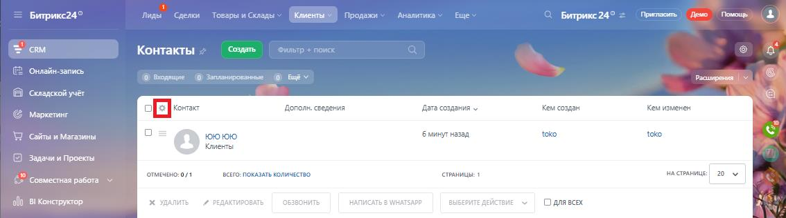
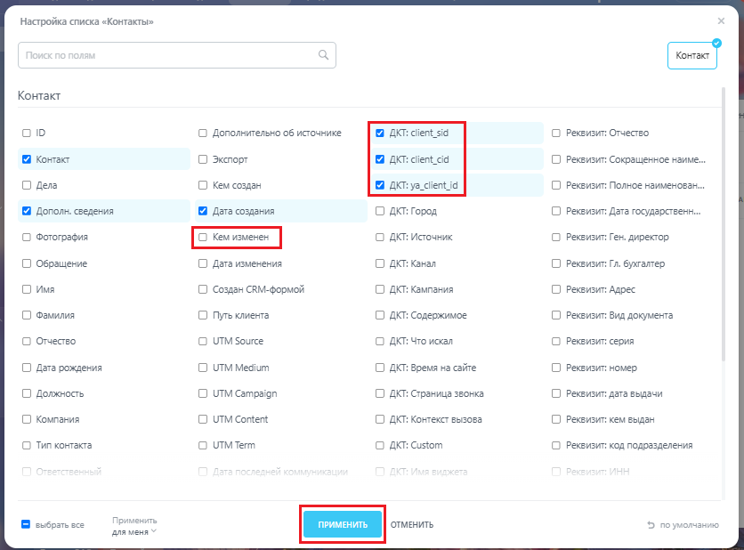
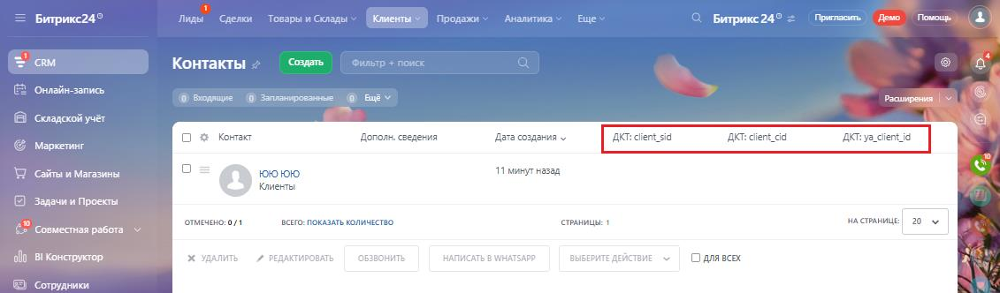

# Б. Настройка отображения колонок в списке лидов, сделок, контактов

> Трассировка: PDF §— · сквозные стр. 172-174 · источники: ч.1 `kb/sources/integration-bitrix24/Mango_office_integration_Bitrix24.pdf` с.172-174.

контактов Чтобы настроить отображение колонок в списке "Контакты" \ "Лиды \ "Контакты", в вашем Битрикс24 следует: 1) откройте нужный раздел: "Контакты" \ "Лиды \ "Контакты;

> **Описание иллюстрации INTB24-§—-1** (к §— «Б. Настройка отображения колонок в списке лидов, сделок, контактов», стр. 172; 16×20 px). Пиктограмма (значок элемента интерфейса).
> Относится к тексту руководства: «…бы настроить отображение колонок в списке "Контакты" \ "Лиды \ "Контакты", в вашем Битрикс24 следует: 1) откройте нужный раздел: "Контакты" \ "Лиды \ "Контакты;».
> Текста на изображении нет; назначение элемента — см. текст, к которому он относится.

2) нажмите на кнопку "Шестеренка" в заголовке списка;

> **Описание иллюстрации INTB24-§—-2** (к §— «Б. Настройка отображения колонок в списке лидов, сделок, контактов», стр. 172; 1134×316 px). Снимок экрана / схема.
> Относится к тексту руководства: «… "Лиды \ "Контакты", в вашем Битрикс24 следует: 1) откройте нужный раздел: "Контакты" \ "Лиды \ "Контакты; 2) нажмите на кнопку "Шестеренка" в заголовке списка;».
> Текст на изображении (OCR, требует сверки): ды; Сделки; ы и Склады; Каменты:; Продажи; Аналитика; Ewe; pwnaceme Few; Гомо; Битрикс24°; RM; Контакты; `Онлайн запись; @ Боращие; @ Serapoaewe; Poca; ‘Cxnagcxoii учёт; Контакт; пол; ния; Kew; Кемизмен; Маркетинг; far; дания <; дан; Ss; "Сайты м Магазины; юююю; быину назад; ‘oko; toko; Клиенты; Задачи Проекты; псзго: показать колич; a crane; ae; {> Cosmectas работа; commeseno-0/1; станице т; oun; all в Конструктор,; рн; Одлявсх

3) настройте отображение колонок: - активируйте "галочки" в названии тех колонок, которые надо показать (например, в колонках "ДКТ:…"); - деактивируйте "галочки" в названии тех колонок, которые надо скрыть (например, в колонке "Кем изменен"); 4) нажмите кнопку "Применить"; Интеграция Виртуальной АТС MANGO OFFICE и Битрикс24 | Версия от 03.03.2026

> **Описание иллюстрации INTB24-§—-3** (к §— «Б. Настройка отображения колонок в списке лидов, сделок, контактов», стр. 173; 836×618 px). Снимок экрана / схема.
> Относится к тексту руководства: «…, в колонках "ДКТ:…"); - деактивируйте "галочки" в названии тех колонок, которые надо скрыть (например, в колонке "Кем изменен"); 4) нажмите кнопку "Применить";».
> Текст на изображении (OCR, требует сверки): Настройка списка «Контакты»; Контакт; О Дополнительно об источнике; AKT: client_sid; О Реквизит: Отчество; О Экспорт; AKT: client_cid; О Реквизит: Сокращенное наиме.; О дела; С) Кем создан; ДКТ: ya_client_id; О Реквизит: Полное наименован; Дополн. сведения; Дата создания; О ДКТ: Город; СО Реквизит: Дата государственн..; О Фотография; О ДКТ: Источник; О Реквизит: Ген. директор; О Обращение; СО Дата изменения; С) AKT: Канал; С Реквизит: Гл. бухгалтер; О Имя; О Создан СВМ-формой; С) AKT: Кампания; О Реквизит: Адрес; О Фамилия; СО Путь клиента; ОО AKT: Содержимое; С) Реквизит: Вид документа; О Отч…

5) будут отображены выбранные вами колонки (например, в колонках "ДКТ:…").

> **Описание иллюстрации INTB24-§—-4** (к §— «Б. Настройка отображения колонок в списке лидов, сделок, контактов», стр. 173; 1131×332 px). Снимок экрана / схема.
> Относится к тексту руководства: «…5) будут отображены выбранные вами колонки (например, в колонках "ДКТ:…").».
> Текст на изображении (OCR, требует сверки): Битрикс24°; Pinas; Сделки,; Товары и С; Клиенты:; Продажи; Аналитика; Ewe; Притвсить — flewo — Помощь; сам; Контакты; ис; Онлайн запись; © Бобищие; @ рианированные; росла; Складской учёт; oe; Контакт; Доголн,; дения; Да; ния; AKT cl; Kr:; Маркетинг; минут назад; "Сайты и Магазины; юююю; Клиенты; Задачи и Проекты; опмечено:оу1; cero: показать количество; станицы:; wa атанице; ae; {2 совместная работа ©; ofp BI Конструктор,; для вых; © сллрудники

Интеграция Виртуальной АТС MANGO OFFICE и Битрикс24 | Версия от 03.03.2026
