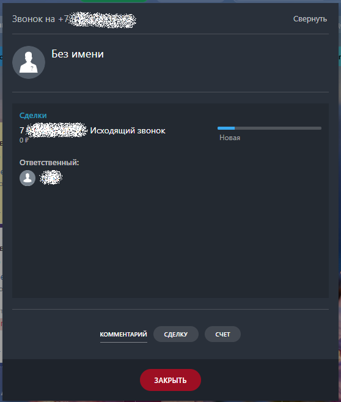
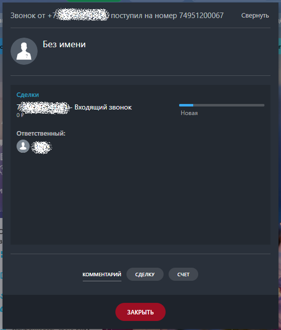

# 1.5. Как позвонить или принять звонок

> Трассировка: PDF §1.5 · сквозные стр. 23-25 · источники: ч.1 `kb/sources/integration-bitrix24/Mango_office_integration_Bitrix24.pdf` с.23-25.

Чтобы позвонить Клиенту (исходящий звонок), пользователь может: - кликнуть на номер телефона в Битрикс24. При этом, если сотрудник кликнул на номер телефона в Битрикс24, то сначала зазвонит его рабочий телефон, и только после того как сотрудник поднимет трубку – начнется звонок на выбранный номер телефона; - набрать номер в номеронабирателе Битрикс24; - набрать номер на экранной клавиатуре Mango Talker и нажать кнопку "Вызов". В Битрикс24 будет показана карточка исходящего звонка.

> **Описание иллюстрации INTB24-§1.5-1** (к §1.5 «Как позвонить или принять звонок», стр. 23; 558×657 px). Снимок экрана / схема.
> Относится к тексту руководства: «… номеронабирателе Битрикс24; - набрать номер на экранной клавиатуре Mango Talker и нажать кнопку "Вызов". В Битрикс24 будет показана карточка исходящего звонка.».
> Текст на изображении (OCR, требует сверки): Звонок на +; a Без имени; Сделки; Исходящий звонок; Новая; ОР; Ответственный:; oe; КОММЕНТАРИЙ СДЕЛКУ; СЧЕТ

Интеграция Виртуальной АТС MANGO OFFICE и Битрикс24 | Версия от 03.03.2026 При входящем звонке у сотрудника зазвонит Mango Talker, либо его рабочий SIP-телефон и в Битрикс24 покажется карточка звонка:

> **Описание иллюстрации INTB24-§1.5-2** (к §1.5 «Как позвонить или принять звонок», стр. 24; 560×657 px). Снимок экрана / схема.
> Относится к тексту руководства: «…При входящем звонке у сотрудника зазвонит Mango Talker, либо его рабочий SIP-телефон и в Битрикс24 покажется карточка звонка:».
> Текст на изображении (OCR, требует сверки): Звонок от +; поступил на номер 74951200067; a Без имени; Сделки; Входящий звонок; oP; Hosaa; Ответственный:; КОММЕНТАРИИ; СДЕЛКУ; СЧЕТ; ОИ

Интеграция Виртуальной АТС MANGO OFFICE и Битрикс24 | Версия от 03.03.2026
