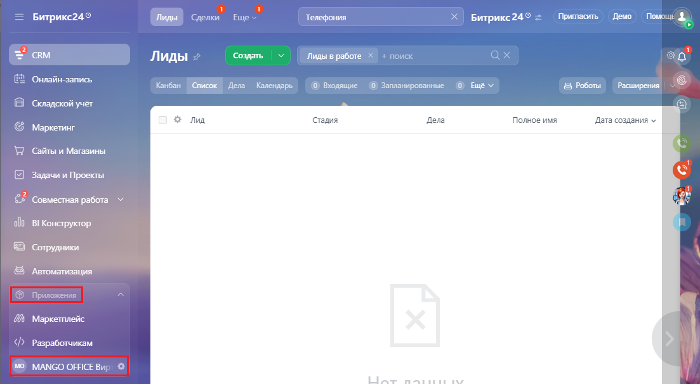
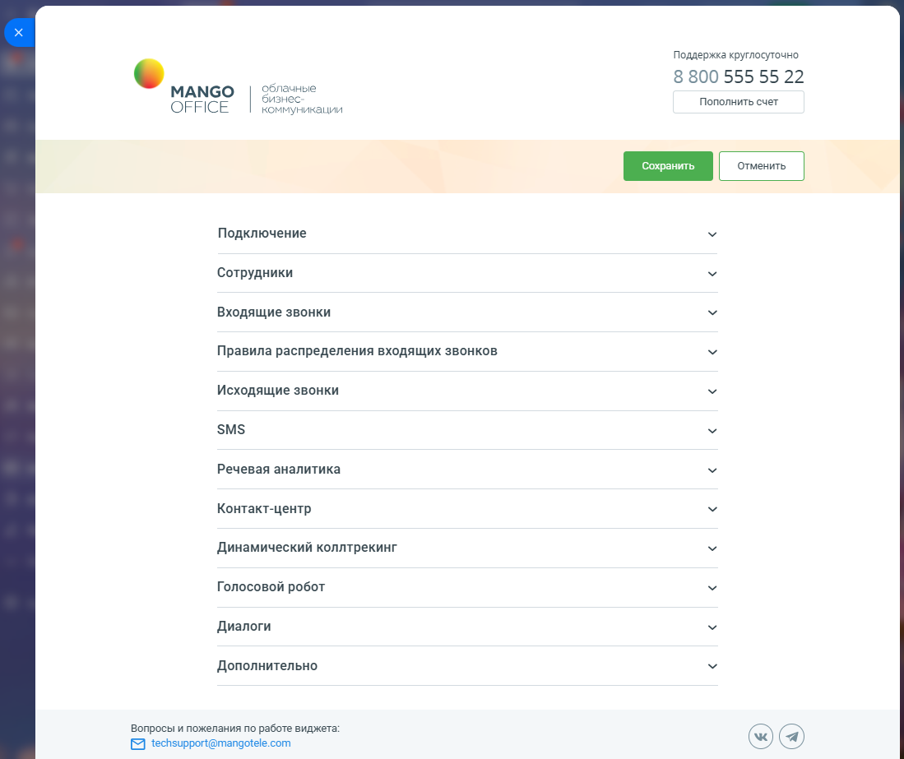

# 2.1. Как открыть форму настройки приложения

> Трассировка: PDF §2.1 · сквозные стр. 25-27 · источники: ч.1 `kb/sources/integration-bitrix24/Mango_office_integration_Bitrix24.pdf` с.25-27.

Для того чтобы открыть настройки интеграции, в вашем Битрикс24 выберите пункт "MANGO OFFICE Виртуальная АТС" (этот пункт может быть в группе "Приложения"):

> **Описание иллюстрации INTB24-§2.1-1** (к §2.1 «Как открыть форму настройки приложения», стр. 25; 1103×606 px). Снимок экрана / схема.
> Относится к тексту руководства: «…ения Для того чтобы открыть настройки интеграции, в вашем Битрикс24 выберите пункт "MANGO OFFICE Виртуальная АТС" (этот пункт может быть в группе "Приложения"):».
> Текст на изображении (OCR, требует сверки): Лиды; лки; Пригласить; Демо; Битрикс249; Телефония; Битрикс24®; ae; cRM; Создать; Лиды в работе; Онлайн-запись; Канбан; Список lena; Kan; ендарь,; © Вмодящие; © Запланированные; Роботы; Расширения; В складской учёт; fe; sua; Стадия; Дела; Полное имя; Дата создания у; © маркетинг; Сайты и Магазины; Задачи и Проекты:; Совместная работа VY; 000 ВИКонструктор:; © сотрудники; Автоматизация; (№ Маркетплейс; Разработчикам

Интеграция Виртуальной АТС MANGO OFFICE и Битрикс24 | Версия от 03.03.2026 В открывшемся окне "Подключение" показаны настройки интеграции. Обратите внимание, что если у вас базовый пакет, в этом окне не будет доступа ко многим настройкам интеграции (они доступны только в расширенном пакете).

> **Описание иллюстрации INTB24-§2.1-2** (к §2.1 «Как открыть форму настройки приложения», стр. 26; 1099×923 px). Снимок экрана / схема.
> Относится к тексту руководства: «…рации. Обратите внимание, что если у вас базовый пакет, в этом окне не будет доступа ко многим настройкам интеграции (они доступны только в расширенном пакете).».
> Текст на изображении (OCR, требует сверки): Поддержка круглосуточно; 8 800 555 55 22; МАМСО; Облачные; бизнес:; Пополнить счет; OFFICE; коммуникации; Подключение; Сотрудники; Входящие звонки; Правила распределения входящих звонков; Исходящие звонки; SMS; Речевая аналитика; Контакт-центр; Динамический коллтрекинг; Голосовой робот; Диалоги; Дополнительно; Вопросы и пожелания по работе виджета:; [2 techsupport@mangotele.com

Интеграция Виртуальной АТС MANGO OFFICE и Битрикс24 | Версия от 03.03.2026
