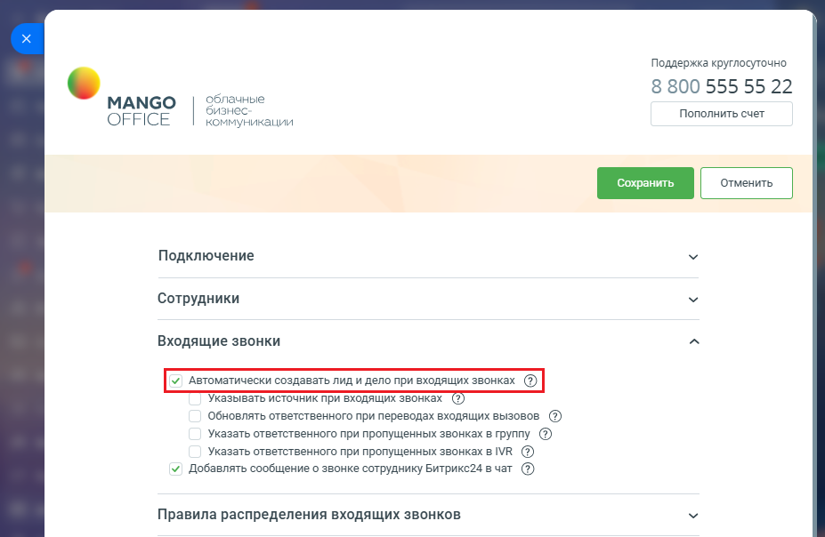
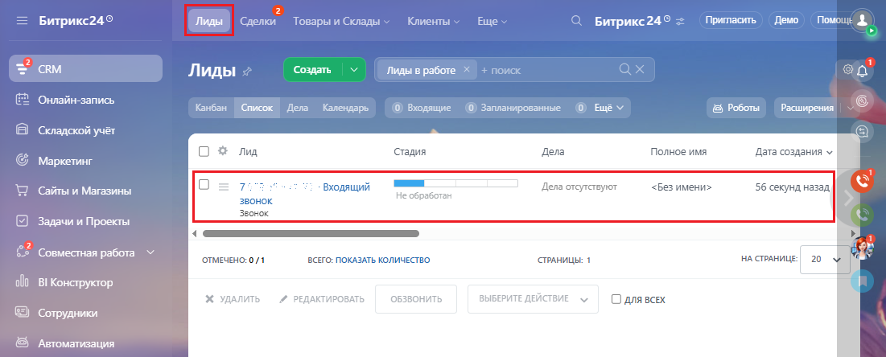
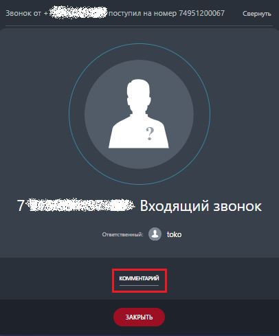
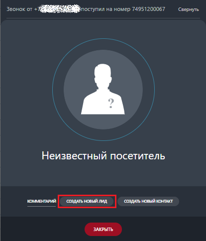

# Автоматически создавать лид и дело при входящих звонках

> Трассировка: PDF §2.3 · сквозные стр. 30-32 · источники: ч.1 `kb/sources/integration-bitrix24/Mango_office_integration_Bitrix24.pdf` с.30-32.

Откройте форму настройки приложения интеграции. В блоке "Входящие звонки" вы увидите флаг "Автоматически создавать лид и дело при входящих звонках". По умолчанию настройка включена.

> **Описание иллюстрации INTB24-§2.3-1** (к §2.3 «Автоматически создавать лид и дело при входящих звонках», стр. 30; 927×604 px). Снимок экрана / схема.
> Относится к тексту руководства: «…йки приложения интеграции. В блоке "Входящие звонки" вы увидите флаг "Автоматически создавать лид и дело при входящих звонках". По умолчанию настройка включена.».
> Текст на изображении (OCR, требует сверки): Поддержка круглосуточно; 8 800 555 55 22; Облачные; МАМСО; бизнес:; OFFICE; Пополнить счет; коммуникации; Подключение; Сотрудники; Входящие звонки; Указывать источник при входящих звонках CO); обновлять ответственного при переводах входящих вызовов ®; Указать ответственного при пропущенных звонках в груплу ®; Указать ответственного при пропущенных звонках в МВ @®; У Добавлять сообщение о звонке сотруднику Битрикс24 вчат @; Правила распределения входящих звонков

Если флаг включен, при входящем звонке c номера, ранее не сохраненного в Битрикс24, будет автоматически создан новый лид:

> **Описание иллюстрации INTB24-§2.3-2** (к §2.3 «Автоматически создавать лид и дело при входящих звонках», стр. 30; 1101×444 px). Снимок экрана / схема.
> Относится к тексту руководства: «…ках". По умолчанию настройка включена. Если флаг включен, при входящем звонке c номера, ранее не сохраненного в Битрикс24, будет автоматически создан новый лид:».
> Текст на изображении (OCR, требует сверки): Битрикс249; ШИ Gren Товарыи Сады Kaveri Ewes; С Битрикс24® =; Притасить, Демо Помощ; RM; ‘Создать; Лиды в работе Х; + поиск; ах; Лиды х; Онлайн-запись; Канбан; Список | Дела Календарь; © Выодящие; ©) Запланированные; Роботы; Расширения; Складской учет; oe; Лид; Стадия; Дела; Полное имя; Дата создания v; G Маркетинг; одящий; Dena отсутствуют; 3 имени>; 56 секунд назад,; WD сайты и Магазины; He обработан; зво; Звонок; Задачи и Проекты:; — EEE; 22 Совместная работе; уе; ‘OTMEUEHO:0/1; ВСЕГО: ПОКАЗАТЬ КОЛИЧЕСТВО; стРАНИЦЫЕ 1; нлстинии 20; 000 В! Конструктор:; % удалить,; РЕДАКТИРОВАТЬ; овзвонить; …

Интеграция Виртуальной АТС MANGO OFFICE и Битрикс24 | Версия от 03.03.2026 При этом, в карточке звонка в Битрикс24 НЕ будет предложено создать лид (только добавить комментарий):

> **Описание иллюстрации INTB24-§2.3-3** (к §2.3 «Автоматически создавать лид и дело при входящих звонках», стр. 31; 406×489 px). Снимок экрана / схема.
> Относится к тексту руководства: «…При этом, в карточке звонка в Битрикс24 НЕ будет предложено создать лид (только добавить комментарий):».
> Текст на изображении (OCR, требует сверки): Звонок от +; ступил на номер 74951200067; Свернуть; Входящий звонок; Ответственный: (Ф) toko; eG»

Если флаг выключен, то при входящем звонке с номера, ранее не сохраненного в Битрикс24, НЕ будет автоматически создан новый лид и в карточке звонка в Битрикс24 будет предложено создать лид:

> **Описание иллюстрации INTB24-§2.3-4** (к §2.3 «Автоматически создавать лид и дело при входящих звонках», стр. 31; 414×484 px). Снимок экрана / схема.
> Относится к тексту руководства: «…одящем звонке с номера, ранее не сохраненного в Битрикс24, НЕ будет автоматически создан новый лид и в карточке звонка в Битрикс24 будет предложено создать лид:».
> Текст на изображении (OCR, требует сверки): Звонок от; ‘поступил на номер 74951200067; Свернуть; Неизвестный посетитель; cect) осин | пе

Обратите внимание, что если номер звонящего внесен в Битрикс24 в список исключений (CRM - Настройки - Другое - Список исключений), то лид при звонке с этого номера не будет создан. Подробнее… Интеграция Виртуальной АТС MANGO OFFICE и Битрикс24 | Версия от 03.03.2026
