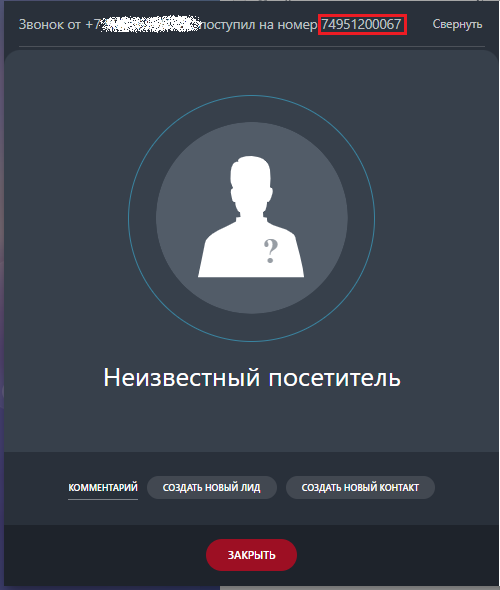
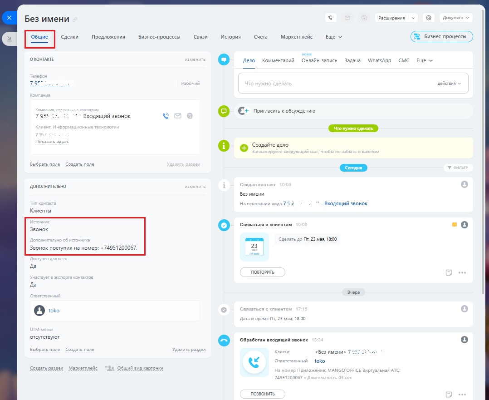
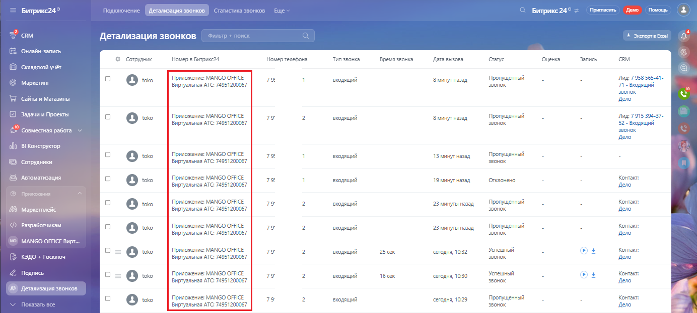
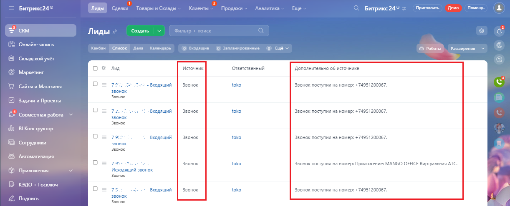

# На что влияет эта настройка

> Трассировка: PDF §2.3 · сквозные стр. 32-33 · источники: ч.1 `kb/sources/integration-bitrix24/Mango_office_integration_Bitrix24.pdf` с.32-33.

Если у вас несколько номеров подключено к Виртуальной АТС, и вы хотите разделять Клиентов, обращающихся по разным номерам, то приложение интеграции поддерживает эту возможность. При поступлении звонка от Клиента, приложение интеграции будет передавать в Битрикс24 номер, на который звонил Клиент. Этот номер будет показан: 1) в карточке звонка:

> **Описание иллюстрации INTB24-§2.3-1** (к §2.3 «На что влияет эта настройка», стр. 32; 500×590 px). Снимок экрана / схема.
> Относится к тексту руководства: «…ступлении звонка от Клиента, приложение интеграции будет передавать в Битрикс24 номер, на который звонил Клиент. Этот номер будет показан: 1) в карточке звонка:».
> Текст на изображении (OCR, требует сверки): Звонок от +74; оступил на номер! 74951200067; Свернуть; Неизвестный посетитель; КОММЕНТАРИЙ СОЗДАТЬ НОВЫЙ ЛИД; СОЗДАТЬ НОВЫЙ КОНТАКТ

2) в карточке Клиента:

> **Описание иллюстрации INTB24-§2.3-2** (к §2.3 «На что влияет эта настройка», стр. 32; 1078×881 px). Снимок экрана / схема.
> Относится к тексту руководства: «…ента, приложение интеграции будет передавать в Битрикс24 номер, на который звонил Клиент. Этот номер будет показан: 1) в карточке звонка: 2) в карточке Клиента:».
> Текст на изображении (OCR, требует сверки): расширения; Документ м; Без имени; Сделки; Предложения; Бизнес-процессы; связи; `История; ‘Счета; `Маркетплейс; Ewe v; OKOMTAKTE; ue; Дело; Комментарий; Онлайн -запись; Задача; WhatsApp CMC; действия v; (6 tee; 798; Входящий звонок; Показать дз; @ Сайте zene; Выбрать none; Cozame none; Сегодня; дополнитель; Безимени; Hs сеовзнии лида 7 5.; _ Входящий звонок.; Клиенты; Сепзвться © клиентом; Звонок; Звонок поступил на номер: +74951200067.; Ow; ara v время Tr, 23 wan, 1800; ‘отсутствуют; `Обработан входящий звонок; Выбрать поле; езаать none; Клиент; <без имени> 7; Ответственный; toko; создать раз…

Интеграция Виртуальной АТС MANGO OFFICE и Битрикс24 | Версия от 03.03.2026 3) в детализации звонков; Примечание. Как открыть отчет "Детализация звонков" описано в приложении А.

> **Описание иллюстрации INTB24-§2.3-3** (к §2.3 «На что влияет эта настройка», стр. 33; 1384×624 px). Снимок экрана / схема.
> Относится к тексту руководства: «…3) в детализации звонков; Примечание. Как открыть отчет "Детализация звонков" описано в приложении А.».
> Текст на изображении (OCR, требует сверки): = Битрикс24°; Подключение; Детализация звонков.; ати; Битрикс24°; Детализация звонков; Экспорт Eel; Онлай; 2 сордник; Номер в Битрикса4; Номер телефона; Тип звонка; Время звонка; Дата вызова; Саус; Оценка; Запись; crm; Складской учёт; Приложение: MANGO OFFICE; Пропущенный; Ладу 7 958 565-41-; Маркетинг; 79; водящий; Зминутназад.; звонок; Виртуальная ATC: 74951200067; 71 - Входящий; звонок.; "Сайты и Магазины; Дело; Задачи м Проекты; toko; ‘ag: 7 915 394-37.; 52 - Входящий; {2 совместная работа >; ol; BI Koncrpyxrop; 1Зминут назад; "Сотрудники!; Автоматизация; Контакт; 19минут назад; Оплонено; …

4) в лиде (в пользовательских полях) сохранится информация о номере, на который поступил звонок (об источнике):

> **Описание иллюстрации INTB24-§2.3-4** (к §2.3 «На что влияет эта настройка», стр. 33; 1222×495 px). Снимок экрана / схема.
> Относится к тексту руководства: «…ет "Детализация звонков" описано в приложении А. 4) в лиде (в пользовательских полях) сохранится информация о номере, на который поступил звонок (об источнике):».
> Текст на изображении (OCR, требует сверки): Битрикс?4'; Лиды; Сре; Tos:; ae; Клиенты; Продажи; Аналитика; Ewe; Битрикс24'; Townes | lewo | Помощь; см; ‘Создать; Ге; 'Онлайн-заги; Kanan; список; Дела; олени; © веодящие; @ запланы; анные; расширения; В Складской учат; оз; лид; источник; Ответственный; Дополнительно 06 источнике; © Маркетинг; звонок; око; WD сайыи Магазины; - Виодящий; звонок поступил на номер: +74951200067.; емо; © Saye и Проекты; Виодящий; Совместная работа; об В Koncpycrop; те:; < - Входящий; ® сотрудники; © Автоматизация; Звонок поступил на номер: Приложение: MANGO OFFICE Виртуальная АТС.; © припожения; Исюдящий звонок…
