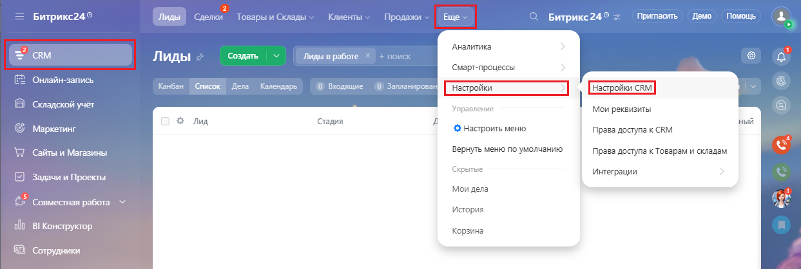
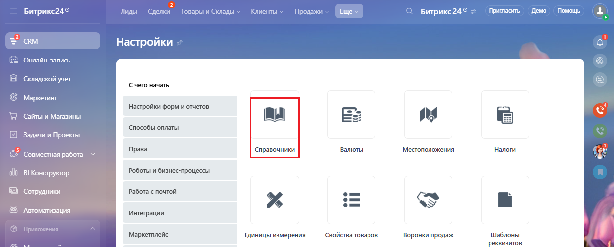
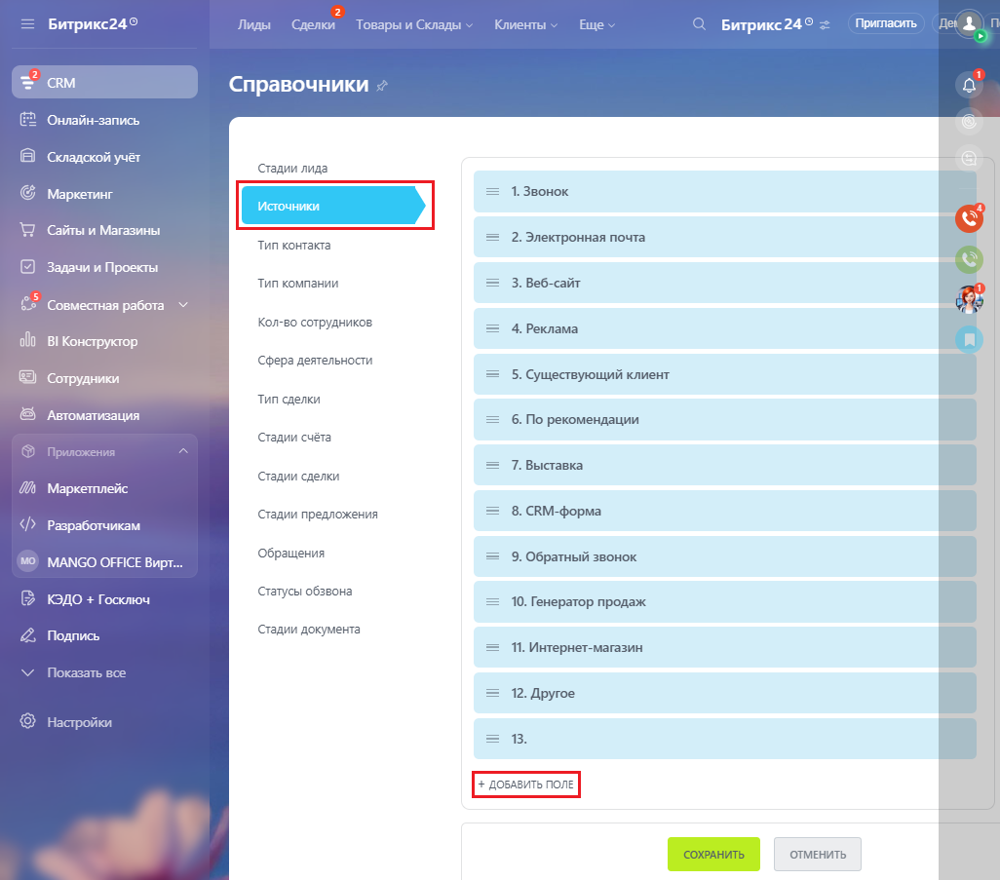
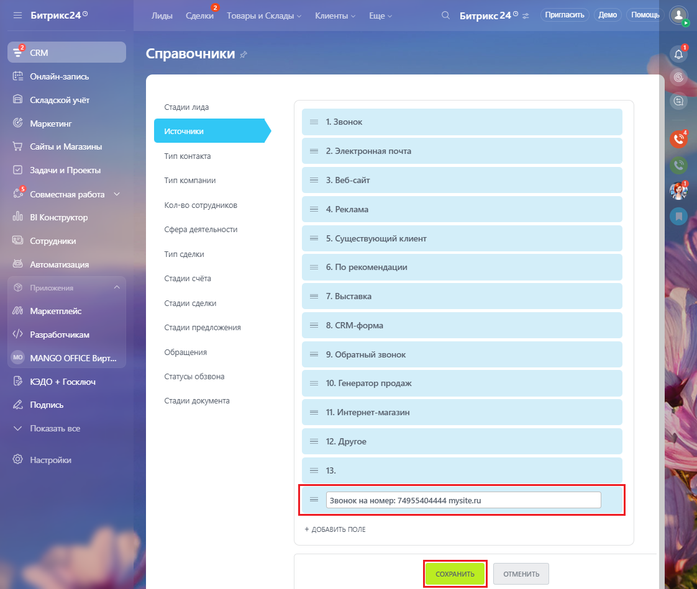
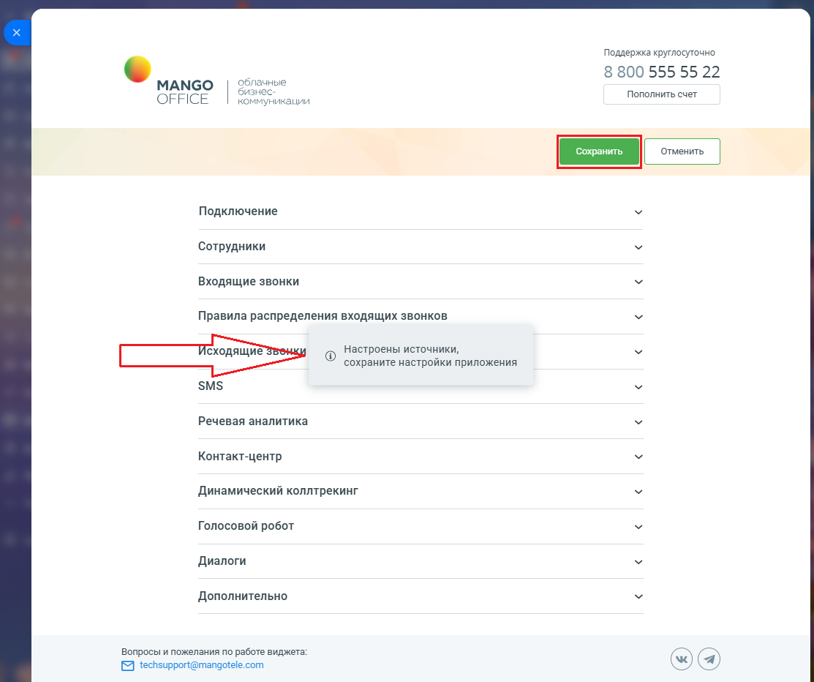

# Как настроить справочник источников

> Трассировка: PDF §2.3 · сквозные стр. 34-38 · источники: ч.1 `kb/sources/integration-bitrix24/Mango_office_integration_Bitrix24.pdf` с.34-38.

Для этого в вашем Битрикс24 следует: 1) перейдите в раздел "CRM", затем выберите пункт "Настройки CRM";

> **Описание иллюстрации INTB24-§2.3-1** (к §2.3 «Как настроить справочник источников», стр. 34; 1243×418 px). Снимок экрана / схема.
> Относится к тексту руководства: «…Как настроить справочник источников Для этого в вашем Битрикс24 следует: 1) перейдите в раздел "CRM", затем выберите пункт "Настройки CRM";».
> Текст на изображении (OCR, требует сверки): Лиды; Сделки; Товары и; клады; нты; Пригласить; Демо; Помощь; Битрикс24 9; Битрикс24®; Аналитика; ‘Создать; Лиды в работе; Смарт-процессы; Онлайн-запись; Канбан; Список lena; Календарь; © Внодящие; О) Запланирован]; Настройки; Настройки САМ; } Складской учёт; Мои реквизиты; sua; Стадия; ный; © маркетинг; © Настроить меню; Права доступа к CRM; WD сайыи Магазины; Вернуть меню по умолчанию; Права доступа к Товарам и складам; vue; интеграции; Задачи и Проекты:; Мои дела; es; Совместная работа VY; История; fd; 000 BI Koxctpyxrop; Корзина; © Сотрудники

2) выберите пункт "Справочники":

> **Описание иллюстрации INTB24-§2.3-2** (к §2.3 «Как настроить справочник источников», стр. 34; 1238×498 px). Снимок экрана / схема.
> Относится к тексту руководства: «…ь справочник источников Для этого в вашем Битрикс24 следует: 1) перейдите в раздел "CRM", затем выберите пункт "Настройки CRM"; 2) выберите пункт "Справочники":».
> Текст на изображении (OCR, требует сверки): Лиды; елки; Клиенты; жи; Еще; Пригласить; Демо; Помощь; Битрикс24 9; Товары и Склады; Np; Битрикс24®; Настройки; Онлайн-запись; Складской учёт; (Cuero начать; Mapxerwar; настройки форм и отчетов; 2 сайыи Магазины; ‘способы оплаты:; Задачи и Проекты:; Валюты; Местоположения; Налоги; es; Права; Справочники; ‘Совместная работа; роботы и бизнес-процессы; 000 ВИКонструктор:; © Сотрудники; работа с почтой; © Автомативация; 'Интеграции; @ Приложения; Маркетплейс; ЕДИНИЦЫ измерения; свойства товаров; воронки продаж; Шаблоны; реквизитов.

Интеграция Виртуальной АТС MANGO OFFICE и Битрикс24 | Версия от 03.03.2026 3) выберите пункт "Источники"; 4) выберите пункт "+Добавить поле":

> **Описание иллюстрации INTB24-§2.3-3** (к §2.3 «Как настроить справочник источников», стр. 35; 1026×903 px). Снимок экрана / схема.
> Относится к тексту руководства: «…3) выберите пункт "Источники"; 4) выберите пункт "+Добавить поле":».
> Текст на изображении (OCR, требует сверки): = Битрикс24:; Лиды Сделки Товары и Склады; Клиенты; Еще; Битрикс24<; Пригласить; Справочники; Онлайн-запись; Складской учёт; Стадии лида; ` Маркетинг; 1. Звонок; WD сайты и Магазины; 2. Электронная почта.; Тип контакта; Задачи и Проекты; Тип компании; 3. Веб-сайт; > Совместная р; та; Кол-во сотрудников; 4. Реклама; ol BI; Сфера деятельности; 5. Существующий клиент; Тип сделки; ' Автоматизация; 6. По рекомендации; Стадии счёта; Приложения; 7. Выставка; Стадии сделки; 'Маркетплейс; Стадии предложения; 8. СВМ-форма; Разработчикам; Обращения; Э. Обратный звонок; MANGO OFFICE Вирт.; статусы обзвона…

Интеграция Виртуальной АТС MANGO OFFICE и Битрикс24 | Версия от 03.03.2026 5) введите новые источники с названием и нажмите кнопку "Enter". При вводе названия источника необходимо точно соблюдать следующий формат названия: Звонок на номер: Ваш номер К примеру, "Звонок на номер: 74955404444". При вводе вашего номера укажите только значение номера, без пробелов, тире, скобок. Примечания: а) после вашего номера вы можете указать любой поясняющий текст, к примеру "Звонок на номер: 74955404444 mysite.ru"; б) если к Виртуальной АТС подключен номер другого оператора, то необходимо указывать адрес подключенной sip-линии, к примеру: "Звонок на номер: sip:user1@vpbx400012345.mangosip.ru" 6) нажмите кнопку "Сохранить":

> **Описание иллюстрации INTB24-§2.3-4** (к §2.3 «Как настроить справочник источников», стр. 36; 1122×949 px). Снимок экрана / схема.
> Относится к тексту руководства: «…ператора, то необходимо указывать адрес подключенной sip-линии, к примеру: "Звонок на номер: sip:user1@vpbx400012345.mangosip.ru" 6) нажмите кнопку "Сохранить":».
> Текст на изображении (OCR, требует сверки): = Битрикс249; Лиды Сделки; Товары и Склады; Клиенты; Еще; Битрикс249; Пригласить; Справочники; Онлайн-запись; Складской учёт; Стадии лида; (ey; 1. Звонок; G маркетинг; WY сайты и Магазины; 2. Электронная почта.; Тип контакта; Задачи и Проекты; Тип компании; 3. Веб-сайт; es; os; Совместная работа Y; age; Кол-во сотрудников; 4. Реклама; ol; BI Конструктор; Сфера деятельности; 5. Существующий клиент; Тип сделки; 6. По рекомендации; Стадии счёта; Приложения.; 7. Выставка; Стадии сделки; 'Маркетплейс; Стадии предложения; 8. СВМ-форма; Разработчикам; Обращения; MANGO OFFICE Вирт.; 9. Обратный звонок…

Интеграция Виртуальной АТС MANGO OFFICE и Битрикс24 | Версия от 03.03.2026 Внимание! После настройки источников обязательно откройте форму настройки приложения интеграции. В ней вы увидите предупреждение "Настроены источники, сохраните настройки приложения". Нажмите кнопку "Сохранить", чтобы приложение интеграции "увидело" ваши настройки источников:

> **Описание иллюстрации INTB24-§2.3-5** (к §2.3 «Как настроить справочник источников», стр. 37; 1113×932 px). Снимок экрана / схема.
> Относится к тексту руководства: «…едупреждение "Настроены источники, сохраните настройки приложения". Нажмите кнопку "Сохранить", чтобы приложение интеграции "увидело" ваши настройки источников:».
> Текст на изображении (OCR, требует сверки): Поддержка круглосуточно; 8 800 555 55 22; МАМСО; Облачные; бизн; Пополнить счет; OFFICE; коммуникации; Подключение; Сотрудники; Входящие звонки; Правила распределения входящих звонков; Исходящие; BS; 'Настроены источники,; сохраните настройки приложения; SMS; Речевая аналитика; Контакт-центр; Динамический коллтрекинг; Голосовой робот; Диалоги; Дополнительно; Вопросы и пожелания по работе виджета:; [2 techsupport@mangotele.com

Интеграция Виртуальной АТС MANGO OFFICE и Битрикс24 | Версия от 03.03.2026
