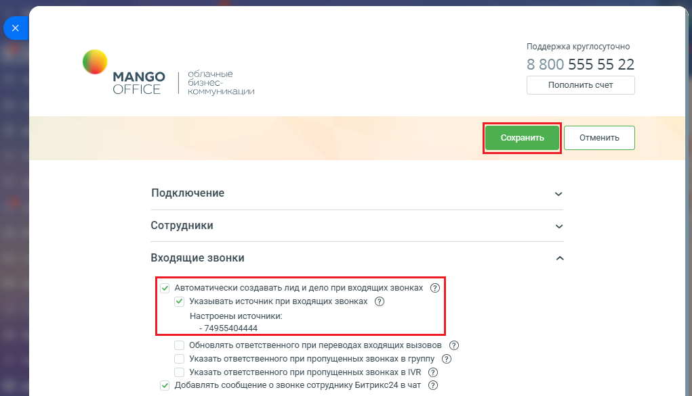

# Как включить настройку

> Трассировка: PDF §2.3 · сквозные стр. 38-39 · источники: ч.1 `kb/sources/integration-bitrix24/Mango_office_integration_Bitrix24.pdf` с.38-39.

Для того чтобы включить настройку "Указывать источник при входящих звонках", необходимо: 1) настройте справочник источников, если это не было сделано ранее; 2) откройте форму настройки приложения интеграции; 3) включите автосоздание лидов и дел при входящих звонках; 4) установите флаг "Указывать источник при входящих звонках"; 5) нажмите кнопку "Сохранить" в верхней части формы настройки приложения интеграции:

> **Описание иллюстрации INTB24-§2.3-1** (к §2.3 «Как включить настройку», стр. 38; 1021×586 px). Снимок экрана / схема.
> Относится к тексту руководства: «…ящих звонках; 4) установите флаг "Указывать источник при входящих звонках"; 5) нажмите кнопку "Сохранить" в верхней части формы настройки приложения интеграции:».
> Текст на изображении (OCR, требует сверки): Поддержка круглосуточно; 8 800 555 55 22; МАМСО; Облачные; бизнес:; Пополнить счет; OFFICE; коммуникации; Подключение; Сотрудники; Входящие звонки; У Автоматически создавать лид и дело при входящих звонках @); У, Указывать источник при входящих звонках @; настроены источники;; - 74955404444.; Обновлять ответственного при переводах входящих вызовов ®; Указать ответственного при пропущенных звонках в группу ®; Указать ответственного при пропущенных звонках BIVR @®; У) Добавлять сообщение о звонке сотруднику Битрикс24 вчат ®

6) после включения настройки, при автоматическом создании лида при входящем звонке, в лиде сохраняется информация об источнике. Примечание. Как настроить отображение колонок в списке Лидов описано в приложении Б.

> **Описание иллюстрации INTB24-§2.3-2** (к §2.3 «Как включить настройку», стр. 38; 1222×495 px). Снимок экрана / схема.
> Относится к тексту руководства: «…дании лида при входящем звонке, в лиде сохраняется информация об источнике. Примечание. Как настроить отображение колонок в списке Лидов описано в приложении Б.».
> Текст на изображении (OCR, требует сверки): Битрикс?4'; Лиды; Сре; Tos:; ae; Клиенты; Продажи; Аналитика; Ewe; Битрикс24'; Townes | lewo | Помощь; см; ‘Создать; Ге; 'Онлайн-заги; Kanan; список; Дела; олени; © веодящие; @ запланы; анные; расширения; В Складской учат; оз; лид; источник; Ответственный; Дополнительно 06 источнике; © Маркетинг; звонок; око; WD сайыи Магазины; - Виодящий; звонок поступил на номер: +74951200067.; емо; © Saye и Проекты; Виодящий; Совместная работа; об В Koncpycrop; те:; < - Входящий; ® сотрудники; © Автоматизация; Звонок поступил на номер: Приложение: MANGO OFFICE Виртуальная АТС.; © припожения; Исюдящий звонок…

Интеграция Виртуальной АТС MANGO OFFICE и Битрикс24 | Версия от 03.03.2026
