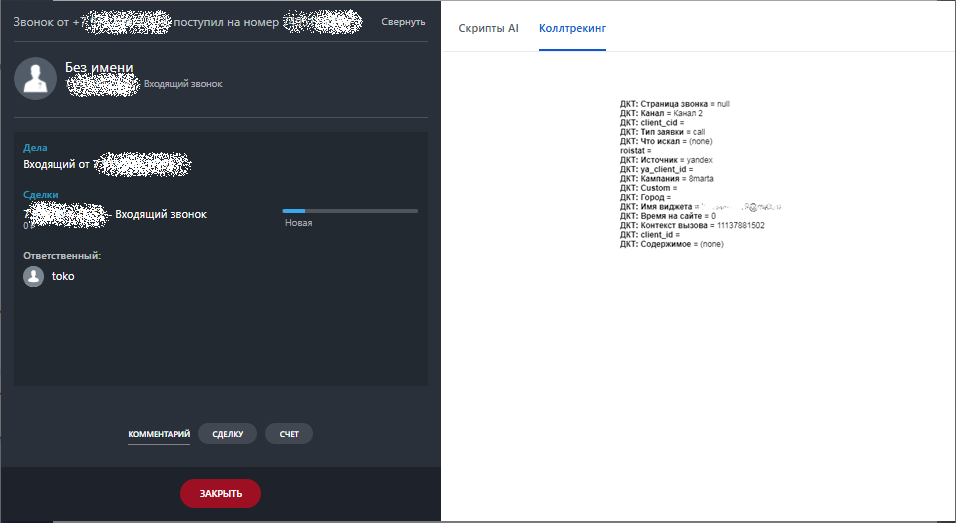
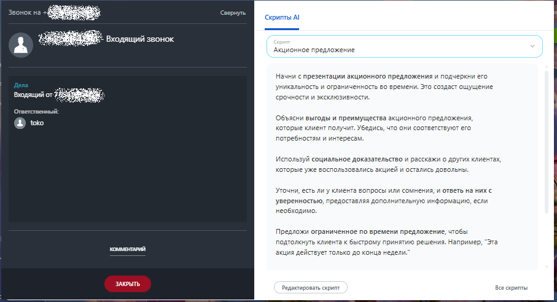
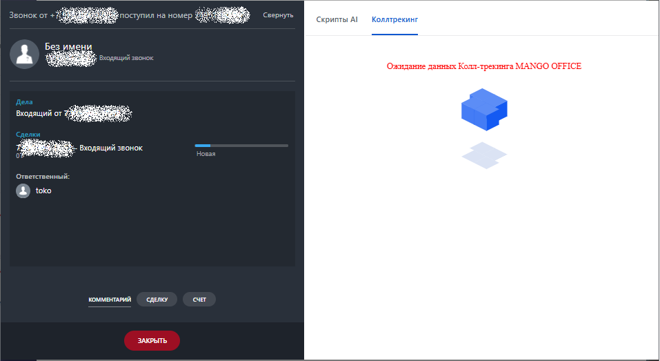

# Во время звонка

> Трассировка: PDF §2.3 · сквозные стр. 43-45 · источники: ч.1 `kb/sources/integration-bitrix24/Mango_office_integration_Bitrix24.pdf` с.43-45.

Если вы подключили интеграцию с динамическим коллтрекингом, а также настроили динамический коллтрекинг, то: - при входящем звонке от Клиента, в карточке звонка будут показаны данные коллтрекинга. Отображаемые в карточке звонка данные коллтрекинга изменить невозможно. Пример отображения данных коллтрекинга показан на рисунке:

> **Описание иллюстрации INTB24-§2.3-1** (к §2.3 «Во время звонка», стр. 43; 957×523 px). Снимок экрана / схема.
> Относится к тексту руководства: «…показаны данные коллтрекинга. Отображаемые в карточке звонка данные коллтрекинга изменить невозможно. Пример отображения данных коллтрекинга показан на рисунке:».
> Текст на изображении (OCR, требует сверки): Saber; ступил на =; yr; ЗИ; ‘Скрипты Al; Коллтрекинг; aa:; ona; страница звони ©; an; Br:; Det; Slant cd; ber; ‘io wcran; ‘oa; ‘rou; Der; Hoan; cet; Coton; ope; Br; ‘hn; ne; . Входящ; звонок; oer; pew; are; owe; xt; Bt; ont; Conepmasce; ответственны; комментавий; cane; cur

Интеграция Виртуальной АТС MANGO OFFICE и Битрикс24 | Версия от 03.03.2026 • при исходящем звонке данные коллтрекинга не отображаются:

> **Описание иллюстрации INTB24-§2.3-2** (к §2.3 «Во время звонка», стр. 44; 907×492 px). Снимок экрана / схема.
> Относится к тексту руководства: «…• при исходящем звонке данные коллтрекинга не отображаются:».
> Текст на изображении (OCR, требует сверки): нь; Скрипты Al; wes; oe; р. Входящий звонок; Акционное предложение; Начни с презентации акционного предложения и подчеркни его; уникальность и ограниченность во времени, Это создаст ощущение; срочности и эксклюзивности,; ыы; Оттетствеиный; Объясни выгоды и преимущества экционного предложения,; которые клиент получит. Убедись, что они соответствуют его; потребностям и интересам,; используй социальное доказательство и расскажи о других клиентах,; которые уже воспользовались экцией и остались довольны.; Youn, есть ли у клиента вопросы или сомнения, и ответь на них с; уверенностью, предоставляя до…

Если во время звонка в интеграцию еще не поступили данные коллтрекинга, в карточке звонка в Битрикс24 будет показано сообщение "Ожидание данных Коллтрекинга MANGO OFFICE". Пример отображения данных коллтрекинга показан на рисунке:

> **Описание иллюстрации INTB24-§2.3-3** (к §2.3 «Во время звонка», стр. 44; 957×523 px). Снимок экрана / схема.
> Относится к тексту руководства: «…, в карточке звонка в Битрикс24 будет показано сообщение "Ожидание данных Коллтрекинга MANGO OFFICE". Пример отображения данных коллтрекинга показан на рисунке:».
> Текст на изображении (OCR, требует сверки): Зы; жот +; пил нан; ep; ss; Скрипты Al; Ожидание данных Колл-трекинга MANGO OFFICE; Дела; aren; ‘одящий от; mh; елки; Входящий звонок; "Ответственный:; комментаний; ‘делю; our; ЗАКРЫТЬ

Интеграция Виртуальной АТС MANGO OFFICE и Битрикс24 | Версия от 03.03.2026
