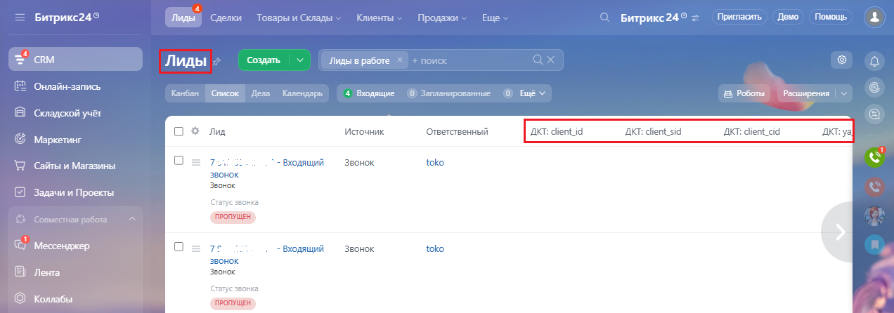
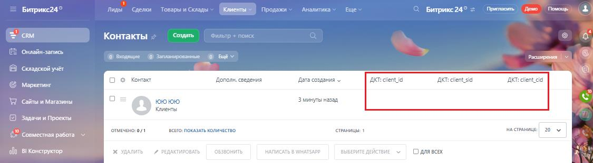

# В отчетах и списках Битрикс24

> Трассировка: PDF §2.3 · сквозные стр. 45-46 · источники: ч.1 `kb/sources/integration-bitrix24/Mango_office_integration_Bitrix24.pdf` с.45-46.

Теперь при каждом входящем звонке (даже если он и был пропущен) на номер динамического или статического коллтрекинга от нового Клиента, в Битрикс24 будет сохранена информация о посетителе сайта (если, конечно, вами ранее была включена настройка автоматического создания лида и дела при входящем звонке):

> **Описание иллюстрации INTB24-§2.3-1** (к §2.3 «В отчетах и списках Битрикс24», стр. 45; 1272×446 px). Снимок экрана / схема.
> Относится к тексту руководства: «…кс24 будет сохранена информация о посетителе сайта (если, конечно, вами ранее была включена настройка автоматического создания лида и дела при входящем звонке):».
> Текст на изображении (OCR, требует сверки): Клиенты ^; Пригласить; Демо Помощь; Битрикс249; Tings; Сделки — Товары и Склады; Продажи; Еще v; С Битрикс24® =; cRM; Создать; „Лиды в работе *; + поиск; ах; Лиды; Онлайн-запись; Канбан; Список.; Дела Календарь; 4 Виодящие; Запланированные:; 5 Роботы; Расширения; Складской учёт; Лид; ‘источник; Ответственный; AKT:; id; yal; Маркетинг; - Входящий; Звонок; toko; Сайты и Магазины; Задачи и Проекты; Crary; вонка; Мессенджер; юн; Лента; нок; ка; Коллабы

При конвертации лида в сделку и/или контакт, информация о посетителе из лида автоматически будет сохранена:

> **Описание иллюстрации INTB24-§2.3-2** (к §2.3 «В отчетах и списках Битрикс24», стр. 45; 1125×311 px). Снимок экрана / схема.
> Относится к тексту руководства: «…тического создания лида и дела при входящем звонке): При конвертации лида в сделку и/или контакт, информация о посетителе из лида автоматически будет сохранена:».
> Текст на изображении (OCR, требует сверки): Сделки,; и Склады; Клиенты:; Аналитика; Прелесть; Демо; Помочь; Битрикс24°; Лиды; Продажи; Еще; Битрикс24° =; сам; Контакты; Онлайн-запись; © opm; acum; @ Seveposmwne У; Складской учёт; 0$ ют; onan. сведения; да; здания <; AKT: cent; AKT:; jent sid; AKT: client cid; @ Маркетинг; WD сайыи Магазины; юююю; минуты назад; Ки; ты; ©) задачим Проекты:; 20; {> совместная работа =; commeseno-0/1; cero: показать количество; станицы; wa атанице; alo В Конструктор,; 28; Dana ecex

Примечание. Как настроить отображение колонок в списке Лидов \ Контактов описано в приложении Б. Интеграция Виртуальной АТС MANGO OFFICE и Битрикс24 | Версия от 03.03.2026
