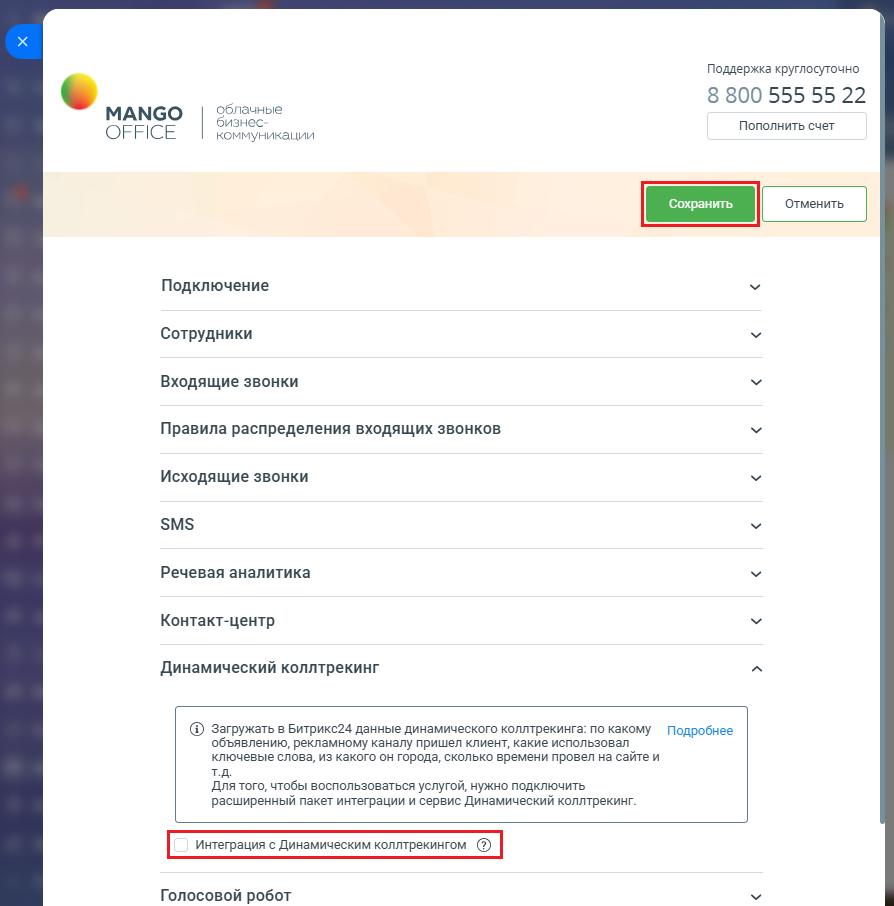

# Как включить настройку

> Трассировка: PDF §2.3 · сквозные стр. 46-47 · источники: ч.1 `kb/sources/integration-bitrix24/Mango_office_integration_Bitrix24.pdf` с.46-47.

Для этого, в вашем Битрикс24 выполните: 1) откройте форму настройки приложения интеграции; 2) нажмите на пункт "Динамический коллтрекинг"; 3) затем установите флаг "Интеграция с Динамическим коллтрекингом"; 4) нажмите кнопку "Сохранить" в верхней части формы настройки приложения интеграции:

> **Описание иллюстрации INTB24-§2.3-1** (к §2.3 «Как включить настройку», стр. 46; 894×906 px). Снимок экрана / схема.
> Относится к тексту руководства: «…екинг"; 3) затем установите флаг "Интеграция с Динамическим коллтрекингом"; 4) нажмите кнопку "Сохранить" в верхней части формы настройки приложения интеграции:».
> Текст на изображении (OCR, требует сверки): Поддержка круглосуточно; 8 800 555 55 22; МАМСО; облачные; бизнес; Пополнить счет; OFFICE; коммуникации; Подключение; Сотрудники; Входящие звонки; Правила распределения входящих звонков; Исходящие звонки; SMS; Речевая аналитика; Контакт-центр; Динамический коллтрекинг; @ загружать в Битрикс24 данные динамического коллтрекинга: по какому Подробнее; объявлению, рекламному каналу пришел клиент, какие использовал; ключевые слова, из какого он города, сколько времени провел на сайте и; Для того, чтобы воспользоваться услугой, нужно подключить; расширенный пакет интеграции и сервис Динамический колл…

Интеграция Виртуальной АТС MANGO OFFICE и Битрикс24 | Версия от 03.03.2026
