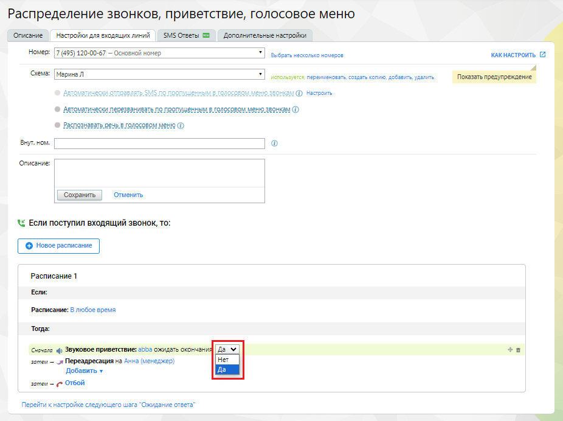

# Предварительные действия. Включение звукового приветствия

> Трассировка: PDF §2.3 · сквозные стр. 49-50 · источники: ч.1 `kb/sources/integration-bitrix24/Mango_office_integration_Bitrix24.pdf` с.49-50.

Чтобы включить голосовое приветствие в схему распределения Виртуальной АТС в Личном кабинете MANGO OFFICE перейдите в раздел "Голосовое меню и распределение звонков":

> **Описание иллюстрации INTB24-§2.3-1** (к §2.3 «Предварительные действия. Включение звукового приветствия», стр. 49; 827×174 px). Снимок экрана / схема.
> Относится к тексту руководства: «…включить голосовое приветствие в схему распределения Виртуальной АТС в Личном кабинете MANGO OFFICE перейдите в раздел "Голосовое меню и распределение звонков":».
> Текст на изображении (OCR, требует сверки): (®) 8-800-5555-424; ® manco orr; at; © O6w; ит; ьеще; Номера подключенные к АТС; №5} виртуальная ATC; Голосовое меню и распределение звонков; Обзорная панель; Настройки ожидания ответа; обро nom; татистика и мониторинг

В схеме распределения перед распределением звонка укажите звуковое приветствие длительностью не менее 5 сек, а также укажите значение "да" в параметре "ожидать окончания":

> **Описание иллюстрации INTB24-§2.3-2** (к §2.3 «Предварительные действия. Включение звукового приветствия», стр. 49; 926×692 px). Снимок экрана / схема.
> Относится к тексту руководства: «…пределения перед распределением звонка укажите звуковое приветствие длительностью не менее 5 сек, а также укажите значение "да" в параметре "ожидать окончания":».
> Текст на изображении (OCR, требует сверки): Распределение звонков, приветствие, голосовое меню; "Описание; "Настройки для входящих линий; SMS Отееты Ш Дополительные настройки; "Номер: [7 (495) 120-00-57 — Основной номер.; Выбрать есолько номеров; кАКНАСТРОИТЬ ©; ‘Семи [Марина; venassayerca, переименовать conse копию, добить удалить; Показать предупреждение; Recomm; © Asrouarmecor перезванивать го пропущенным в лолосовом меню agora Ф; Bayt ном.; Описание:; Сохранить; Отменить; < Если поступил входящий звонок, то:; Расписание 1; ‘Если:; Расписание: В любое время; ‘Тогда:; ‘cuowara 4 Звуковое приветствие: 5555 ожидать окончен; By; oo; soma…

Интеграция Виртуальной АТС MANGO OFFICE и Битрикс24 | Версия от 03.03.2026
