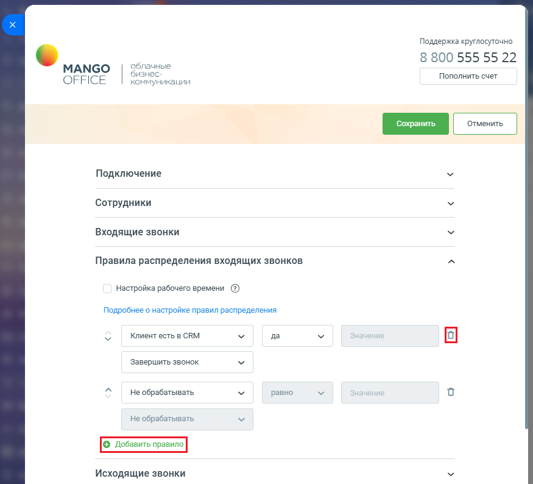
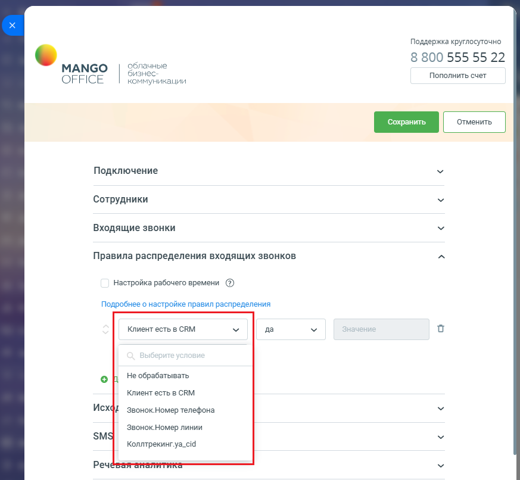
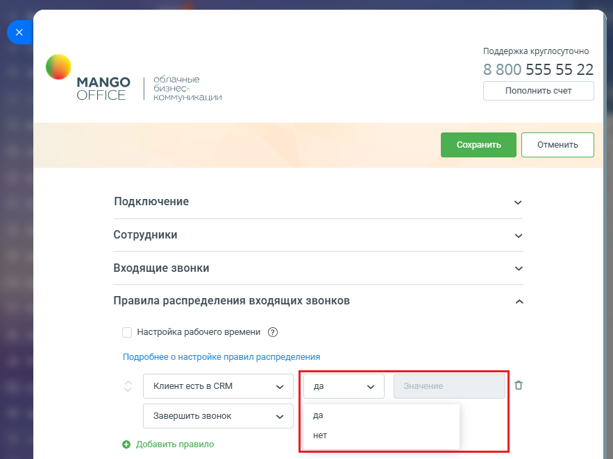
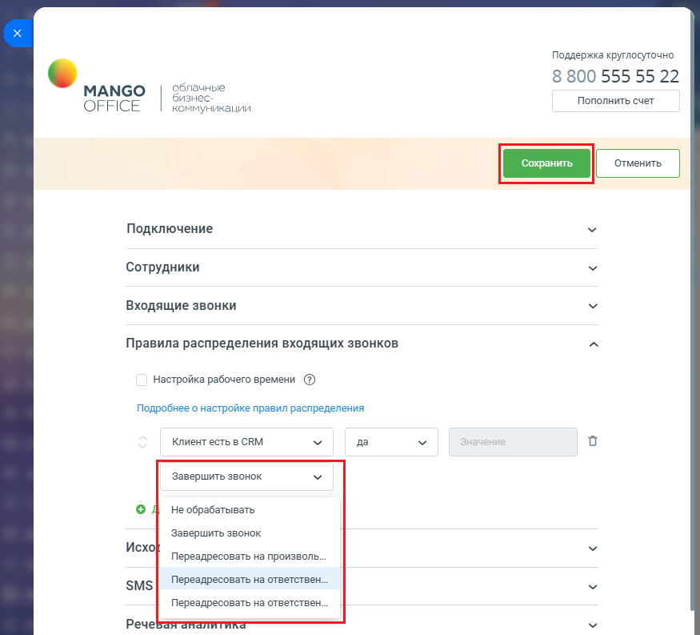

# Как настроить распределение звонков в приложении интеграции

> Трассировка: PDF §2.3 · сквозные стр. 50-53 · источники: ч.1 `kb/sources/integration-bitrix24/Mango_office_integration_Bitrix24.pdf` с.50-53.

Вы можете настроить собственный алгоритм распределения, указав правила разработки в группе полей "Правила распределения входящих звонков". Можно указать до 10 правил, при звонке правила анализируются в настроенном порядке, сверху-вниз. Для изменения порядка правил

> **Описание иллюстрации INTB24-§2.3-1** (к §2.3 «Как настроить распределение звонков в приложении интеграции», стр. 50; 18×13 px). Пиктограмма (значок элемента интерфейса).
> Относится к тексту руководства: «…порядке, сверху-вниз. Для изменения порядка правил».
> Текста на изображении нет; назначение элемента — см. текст, к которому он относится.

нажимайте на стрелки вверх ( ) и/или вниз ( ) необходимое количество раз.

> **Описание иллюстрации INTB24-§2.3-2** (к §2.3 «Как настроить распределение звонков в приложении интеграции», стр. 50; 16×9 px). Пиктограмма (значок элемента интерфейса).
> Относится к тексту руководства: «…порядке, сверху-вниз. Для изменения порядка правил».
> Текста на изображении нет; назначение элемента — см. текст, к которому он относится.

Чтобы настроить распределение звонков, необходимо: 1) откройте форму настройки приложения интеграции; 2) откройте блок "Правила распределения входящих звонков"; 3) для добавления нового правила нажмите кнопку "Добавить правило", для

> **Описание иллюстрации INTB24-§2.3-3** (к §2.3 «Как настроить распределение звонков в приложении интеграции», стр. 50; 18×21 px). Пиктограмма (значок элемента интерфейса).
> Относится к тексту руководства: «…тройки приложения интеграции; 2) откройте блок "Правила распределения входящих звонков"; 3) для добавления нового правила нажмите кнопку "Добавить правило", для».
> Текста на изображении нет; назначение элемента — см. текст, к которому он относится.

удаления кнопку "Корзина" ;

> **Описание иллюстрации INTB24-§2.3-4** (к §2.3 «Как настроить распределение звонков в приложении интеграции», стр. 50; 875×794 px). Снимок экрана / схема.
> Относится к тексту руководства: «…; 2) откройте блок "Правила распределения входящих звонков"; 3) для добавления нового правила нажмите кнопку "Добавить правило", для удаления кнопку "Корзина" ;».
> Текст на изображении (OCR, требует сверки): Поддержка круглосуточно; 8 800 555 55 22; облачные; МАМСО; бизнес; OFFICE; Пополнить счет; коммуникации; Подключение; Сотрудники; Входящие звонки; Правила распределения входящих звонков; Настройка рабочего времени (2); Подробнее о настройке правил распределения; Клиент есть в CRM; да; Завершить звонок; “aw; He обрабатывать; равно; Не обрабатывать; Исходящие звонки

Интеграция Виртуальной АТС MANGO OFFICE и Битрикс24 | Версия от 03.03.2026 4) при настройке правила укажите какое значение анализировать: • из данных коллтрекинга о текущем звонке (если на вкладке "Дополнительно" включена интеграция с Динамическим коллтрекингом и к Виртуальной АТС подключен коллтрекинг). К примеру, Коллтрекинг.medium; • из данных коллтрекинга, ранее сохраненных в CRM (к примеру, Контакт.ДКТ:Город); • из Битрикс24 (для этого в Битрикс24 выполняется поиск по номеру звонящего и для найденного Клиента выполняется анализ данных) – для лидов, контактов, сделок. По всем полям, в том числе пользовательским;

> **Описание иллюстрации INTB24-§2.3-5** (к §2.3 «Как настроить распределение звонков в приложении интеграции», стр. 51; 873×806 px). Снимок экрана / схема.
> Относится к тексту руководства: «…яется поиск по номеру звонящего и для найденного Клиента выполняется анализ данных) – для лидов, контактов, сделок. По всем полям, в том числе пользовательским;».
> Текст на изображении (OCR, требует сверки): Поддержка круглосуточно; 8 800 555 55 22; облачные; МАМСО; бизнес; Пополнить счет; OFFICE; коммуникации; Подключение; Сотрудники; Входящие звонки; Правила распределения входящих звонков; Настройка рабочего времени (2); Подробнее о настройке правил распределения; Клиент есть в CRM; да; On; He обрабатывать; Исха; Звонок.Номер телефона; Звонок.Номер линии; SMS; Коллтрекинг.уа_с19; Реч; Ba

Интеграция Виртуальной АТС MANGO OFFICE и Битрикс24 | Версия от 03.03.2026 5) укажите операцию сравнения ("равно", "не равно", "содержит" и т.д.) и укажите с каким значением необходимо сравнивать;

> **Описание иллюстрации INTB24-§2.3-6** (к §2.3 «Как настроить распределение звонков в приложении интеграции», стр. 52; 883×662 px). Снимок экрана / схема.
> Относится к тексту руководства: «…5) укажите операцию сравнения ("равно", "не равно", "содержит" и т.д.) и укажите с каким значением необходимо сравнивать;».
> Текст на изображении (OCR, требует сверки): Поддержка круглосуточно; 8 800 555 55 22; облачные; МАМСО; бизнес; OFFICE; Пополнить счет; коммуникации; Подключение; Сотрудники; Входящие звонки; Правила распределения входящих звонков; Настройка рабочего времени (2); Подробнее о настройке правил распределения; Клиент есть в CRM; да; Завершить звонок; нет; © Добавить правило

6) укажите какое действие необходимо выполнить, если результат проверки будет успешным (переадресовать на номер, переадресовать на ответственного, переадресовывать на ответственного и переадресовывать далее на номер, если нет ответа и другие); Примечание. Настройте правила так, как вам нужно, руководствуясь примерами, описанными далее. 7) нажмите кнопку "Сохранить" в верхней части формы настройки приложения интеграции. Будет выполнена проверка настройки умных правил, а также проверка корректной настройки схемы распределения вызовов. Если нет проблем, то настройки работы умных алгоритмов будут сохранены, иначе будет выдано сообщение; 8) настройте расписание работы умных алгоритмов. Интеграция Виртуальной АТС MANGO OFFICE и Битрикс24 | Версия от 03.03.2026

> **Описание иллюстрации INTB24-§2.3-7** (к §2.3 «Как настроить распределение звонков в приложении интеграции», стр. 53; 875×793 px). Снимок экрана / схема.
> Относится к тексту руководства: «… вызовов. Если нет проблем, то настройки работы умных алгоритмов будут сохранены, иначе будет выдано сообщение; 8) настройте расписание работы умных алгоритмов.».
> Текст на изображении (OCR, требует сверки): Поддержка круглосуточно; 8 800 555 55 22; облачные; МАМСО; бизнес; Пополнить счет; OFFICE; коммуникации; Подключение; Сотрудники; Входящие звонки; Правила распределения входящих звонков; Настройка рабочего времени (2); Подробнее о настройке правил распределения; Клиент есть в CRM; да; Завершить звонок; од; Не обрабатывать; Исхо; Переадресовать на произволь.; Переадресовать на ответствен; SMS; Речева
