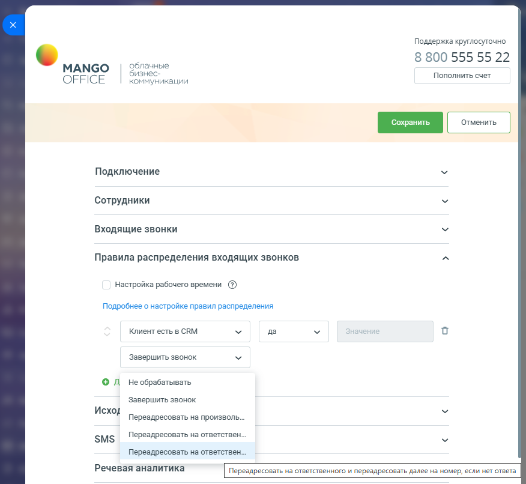
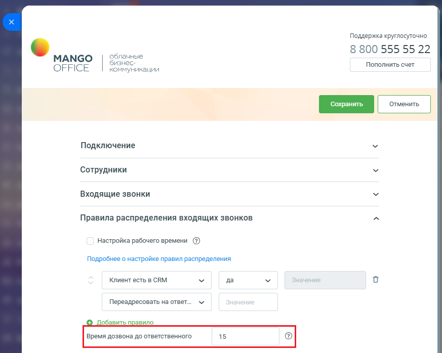
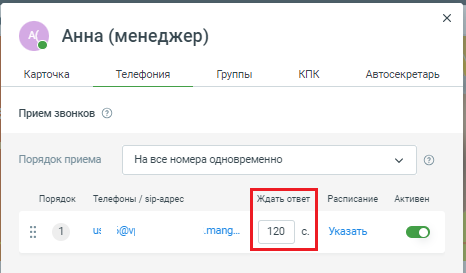

# Значение "Переадресовывать на ответственного и переадресовывать далее на номер, если нет ответа"

> Трассировка: PDF §2.3 · сквозные стр. 54-56 · источники: ч.1 `kb/sources/integration-bitrix24/Mango_office_integration_Bitrix24.pdf` с.54-56.

номер, если нет ответа" Данное значение вы можете выбрать в качестве "действия, которое нужно выполнить умному алгоритму над звонком" (см. шаг 6 "Как настроить распределение звонков в приложении интеграции"):

> **Описание иллюстрации INTB24-§2.3-1** (к §2.3 «Значение "Переадресовывать на ответственного и переадресовывать далее на номер, если нет ответа"», стр. 54; 876×806 px). Снимок экрана / схема.
> Относится к тексту руководства: «…е выбрать в качестве "действия, которое нужно выполнить умному алгоритму над звонком" (см. шаг 6 "Как настроить распределение звонков в приложении интеграции"):».
> Текст на изображении (OCR, требует сверки): Поддержка круглосуточно; 8 800 555 55 22; облачные; МАМСО; бизнес; OFFICE; Пополнить счет; коммуникации; Подключение; Сотрудники; Входящие звонки; Правила распределения входящих звонков; Настройка рабочего времени (2); Подробнее о настройке правил распределения; Клиент есть в CRM; да; Завершить звонок; oa; He обрабатывать; Исхо; Переадресовать Ha произволь...; SMS; Переадресовать на ответствен...; Речевая аналитика; Переадресовать на ответственного и переадресовать далее на номер, если нет ответа

Интеграция Виртуальной АТС MANGO OFFICE и Битрикс24 | Версия от 03.03.2026 Если звонок соответствует условию, то он будет переадресован на сотрудника, ответственного за звонок, при этом, если ответственный не принял вызов, то звонок будет переадресован далее на указанный вами номер телефона. По умолчанию, виджет дозванивается до ответственного в течение 15 секунд. Чтобы определить время дозвона до ответственного сотрудника, используйте опцию "Время дозвона до ответственного". Тогда виджет интеграции будет дозваниваться до ответственного определенное Вами количество секунд, по истечении которых переадресует вызов на указанный вами номер.

> **Описание иллюстрации INTB24-§2.3-2** (к §2.3 «Значение "Переадресовывать на ответственного и переадресовывать далее на номер, если нет ответа"», стр. 55; 873×698 px). Снимок экрана / схема.
> Относится к тексту руководства: «…да виджет интеграции будет дозваниваться до ответственного определенное Вами количество секунд, по истечении которых переадресует вызов на указанный вами номер.».
> Текст на изображении (OCR, требует сверки): Поддержка круглосуточно; 8 800 555 55 22; МАМСО; облачные; бизнес; Пополнить счет; OFFICE; коммуникации; Подключение; Сотрудники; Входящие звонки; Правила распределения входящих звонков; Настройка рабочего времени (2); Подробнее о настройке правил распределения; Клиент есть в CRM; да; Переадресовать на ответ...; Добавить правило; Время дозвона до ответственного; 15

Обратите внимание. Для каждого сотрудника ВАТС, в его карточке в разделе "Телефония", определено время дозвона до сотрудника.

> **Описание иллюстрации INTB24-§2.3-3** (к §2.3 «Значение "Переадресовывать на ответственного и переадресовывать далее на номер, если нет ответа"», стр. 55; 466×273 px). Снимок экрана / схема.
> Относится к тексту руководства: «…ует вызов на указанный вами номер. Обратите внимание. Для каждого сотрудника ВАТС, в его карточке в разделе "Телефония", определено время дозвона до сотрудника.».
> Текст на изображении (OCR, требует сверки): @ Анна (менеджер); Карточка; Телефония; Группы; КПК; Автосекретарь; Прием звонков ©; Порядок приема; На все номера одновременно; Ждать ответ; Расписание; Активен; Порядок; Телефоны / sip-agpec; us; Ov; 120; Указать

Интеграция Виртуальной АТС MANGO OFFICE и Битрикс24 | Версия от 03.03.2026 Мы рекомендуем в карточке сотрудника ВАТС указывать время дозвона большее, чем в умном алгоритме. Иначе, переадресация звонка будет выполнена ранее, чем указано в настройке умного алгоритма. Например, в умном алгоритме в настройке "Время дозвона до ответственного" указано значение 15 секунд. Поступает звонок на ответственного, в карточке которого время дозвона указано 12 секунд. Тогда, умный алгоритм будет дозваниваться до ответственного только в течении 12 секунд, то есть на 3 секунды меньше, чем указано в его настройках.
