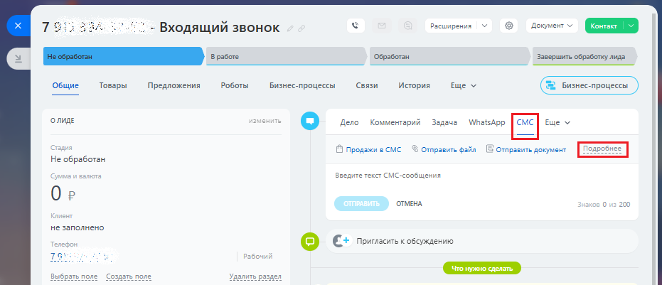
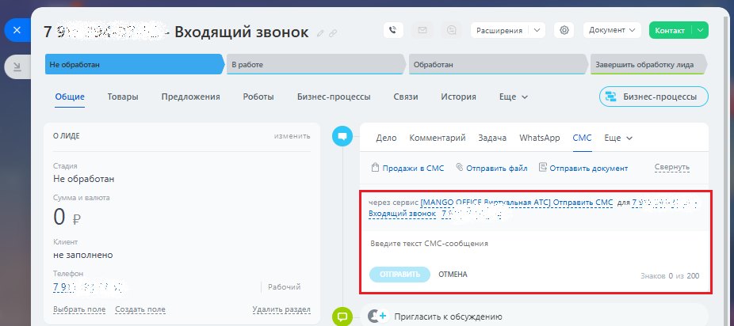

# Обзор

> Трассировка: PDF §2.5 · сквозные стр. 68-70 · источники: ч.1 `kb/sources/integration-bitrix24/Mango_office_integration_Bitrix24.pdf` с.68-70.

В приложении интеграции с Битрикс24 доступна возможность отправки SMS вручную из карточки лида/контакта/сделки. Информация об отправленной SMS и статусе доставки фиксируется в карточке. Примечание. Для обновления приложения интеграции с Битрикс24 – воспользуйтесь разделом Обновление приложения. Если настройка включена, то в карточке лида/контакта/сделки появится возможность выбирать приложение MANGO OFFICE как провайдера SMS при Интеграция Виртуальной АТС MANGO OFFICE и Битрикс24 | Версия от 03.03.2026 отправке SMS. Выберите контактный номер, на который надо отправить SMS, нажмите "Подробнее":

> **Описание иллюстрации INTB24-§2.5-1** (к §2.5 «Обзор», стр. 69; 931×401 px). Снимок экрана / схема.
> Относится к тексту руководства: «…отправке SMS. Выберите контактный номер, на который надо отправить SMS, нажмите "Подробнее":».
> Текст на изображении (OCR, требует сверки): 73; Re 2° - Входящий звонок; расширения; отт; обработан; Завершить обработку лида; Общие; Товары; Предложения; Роботы; Бизнес-процессы; связи; ‘история; ще х; onmae; Beno; Комментарий; Задача; \МпавАрр; Ewe v; аа; О продажи в смс; $ отправить фэйл; [В отпрзвить документ; Не обработан,; vera; едите текст СМС-сообщения; Oe; ‘OmMEHA; 200; не заполнено; © Ee rere oscmaons; рабоч; Выбрать none; Удалить раздел

Появится возможность выбирать приложение MANGO OFFICE как провайдера SMS при отправке SMS. Введите текст SMS и нажмите "Отправить". Информация об отправке будет добавлена в историю контакта. После доставки SMS получателю – статус обновится на "Доставлено".

> **Описание иллюстрации INTB24-§2.5-2** (к §2.5 «Обзор», стр. 69; 926×412 px). Снимок экрана / схема.
> Относится к тексту руководства: «…те текст SMS и нажмите "Отправить". Информация об отправке будет добавлена в историю контакта. После доставки SMS получателю – статус обновится на "Доставлено".».
> Текст на изображении (OCR, требует сверки): TED; ЗА; расширения; - Входящий звонок; обработан; Завершить обработку лида; Роботы; связи; Общие; Товары; Предложения; Бизнес-процессы; ‘история; ще х; onmae; Beno; Комментарий; Задача; \МпавАрр; смс; Ewe v; О продажи в смс; Отправить файл; [В отправить документ; свернуть; Не обработан,; ‘через сервис [MANGO OFFICE Aunmvanguan ATC] Отправить CMC для.; Oe; едите текст СМС-сообщения; не заполнено; отмена.; 200; 72; Bu; none; comm; © с: ъелольковожиенио

Требования 1) Настройка доступна только для расширенного пакета интеграции. Стоимость SMS - согласно вашему тарифному плану; 2) SMS НЕ будет отправляться если в настройке сопоставления сотрудников НЕ указан сотрудник, от чьего имени отправляется SMS. Интеграция Виртуальной АТС MANGO OFFICE и Битрикс24 | Версия от 03.03.2026
