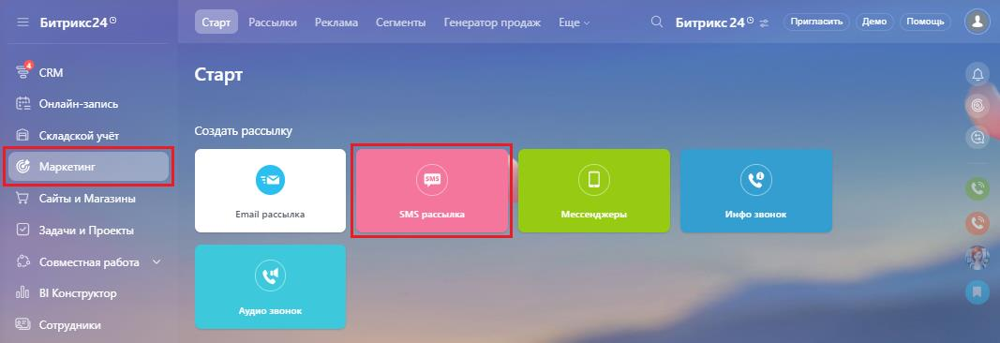
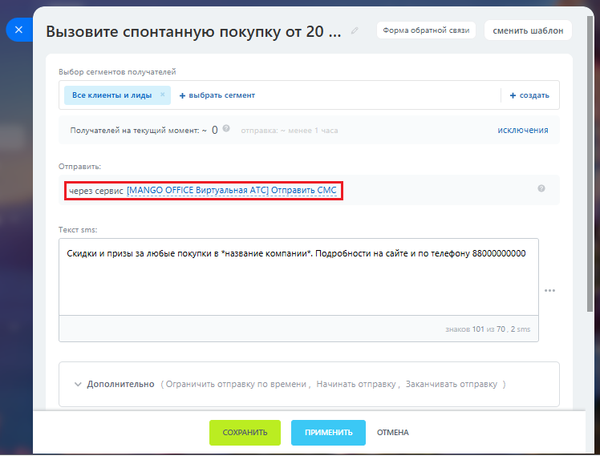
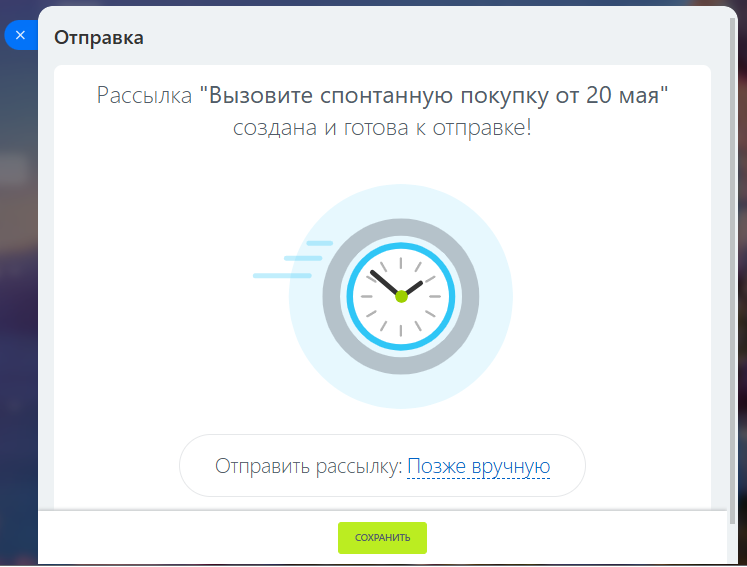
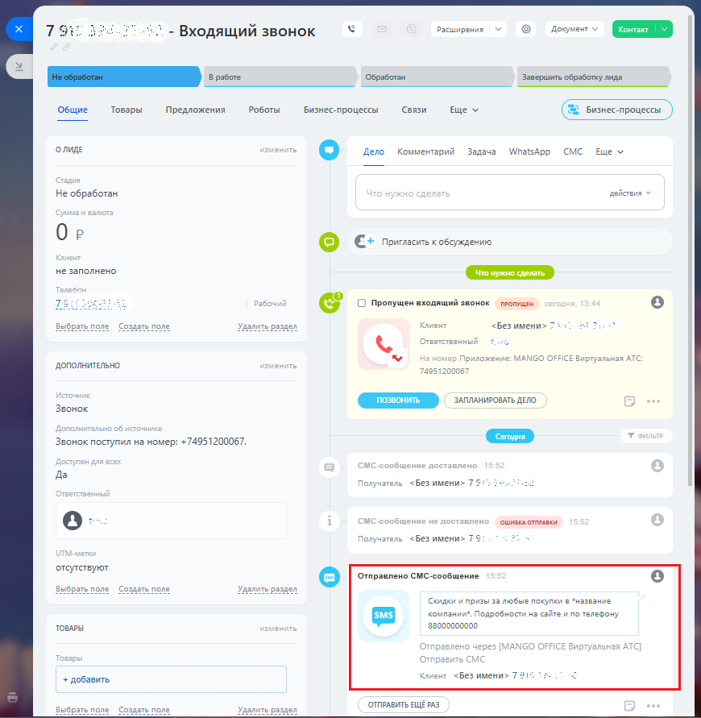

# Как отправить sms-рассылку

> Трассировка: PDF §2.6 · сквозные стр. 71-74 · источники: ч.1 `kb/sources/integration-bitrix24/Mango_office_integration_Bitrix24.pdf` с.71-74.

Чтобы сделать рассылку, в Битрикс24 следует: 1) выберите "Маркетинг"; 2) выберите "SMS-рассылка":

> **Описание иллюстрации INTB24-§2.6-1** (к §2.6 «Как отправить sms-рассылку», стр. 71; 1067×366 px). Снимок экрана / схема.
> Относится к тексту руководства: «…ранить" в верхней части этой формы. Как отправить sms-рассылку Чтобы сделать рассылку, в Битрикс24 следует: 1) выберите "Маркетинг"; 2) выберите "SMS-рассылка":».
> Текст на изображении (OCR, требует сверки): Рассылки; Реклама; Сепаенты; Еще; Припасить Демо Помощь; = Битрикс24°; Crapr; Генератор продаж; Битрикс24® =; CRM.; Старт; Onnaii-sannce; 2 Conapcxod yer; ‘Создать рассылку.; \2 самы и Магазины; Email рассылка; SMS рассылка,; ‘инфо звонок; Задачи и Проекты; >> Совместная работа ©; allt BI Конструктор.; © сотрудники

Интеграция Виртуальной АТС MANGO OFFICE и Битрикс24 | Версия от 03.03.2026 3) выберите шаблон рассылки или создайте новый:

> **Описание иллюстрации INTB24-§2.6-2** (к §2.6 «Как отправить sms-рассылку», стр. 72; 1076×727 px). Снимок экрана / схема.
> Относится к тексту руководства: «…3) выберите шаблон рассылки или создайте новый:».
> Текст на изображении (OCR, требует сверки): Выбрать шаблон рассылки; вр:; Предустановленные; зовите спонтанно зуопокупку; Вызовите спонтам ную покузку; Превратите лид в клиента; th A; Превратите лид; Увеличьте; РА satis; To; as; Yep; pena умах xnenror; Укрепяйте брендв умах клиент; Вызовите повторную продажу; se; ПОКАЗАТЬ ЕЩЕ ЭЛЕМЕНТЫ

4) при настройке рассылки выберите приложение MANGO OFFICE для отправки SMS:

> **Описание иллюстрации INTB24-§2.6-3** (к §2.6 «Как отправить sms-рассылку», стр. 72; 748×569 px). Снимок экрана / схема.
> Относится к тексту руководства: «…3) выберите шаблон рассылки или создайте новый: 4) при настройке рассылки выберите приложение MANGO OFFICE для отправки SMS:».
> Текст на изображении (OCR, требует сверки): Форма обратной связи; сменить шаблон; Вызовите спонтанную покупку от 20...; Выбор сегментов получа; Все клиенты и лиды; + выбрать сегмент; + создать; Получателей на текущий момент: ~ (0; исключения; Отправить:; Tex; sms:; Скидки и призы за любые покупки в *название компании*. Подробности на сайте и по телефону 88000000000; 7 2; 0.2; Дополнительно; bo; en; Ha

Интеграция Виртуальной АТС MANGO OFFICE и Битрикс24 | Версия от 03.03.2026 5) настройте остальные параметры рассылки, выберите список Клиентов для рассылки. Сохраните настройки и выберите расписание для отправки:

> **Описание иллюстрации INTB24-§2.6-4** (к §2.6 «Как отправить sms-рассылку», стр. 73; 747×567 px). Снимок экрана / схема.
> Относится к тексту руководства: «…5) настройте остальные параметры рассылки, выберите список Клиентов для рассылки. Сохраните настройки и выберите расписание для отправки:».
> Текст на изображении (OCR, требует сверки): Отправка; Рассылка "Вызовите спонтанную покупку от 20 мая"; создана и готова к отправке!; Отправить рассылку: Позже вручную; дни 4

После отправки SMS, информация сохранится в карточке:

> **Описание иллюстрации INTB24-§2.6-5** (к §2.6 «Как отправить sms-рассылку», стр. 73; 870×891 px). Снимок экрана / схема.
> Относится к тексту руководства: «…ы рассылки, выберите список Клиентов для рассылки. Сохраните настройки и выберите расписание для отправки: После отправки SMS, информация сохранится в карточке:».
> Текст на изображении (OCR, требует сверки): At; Расширения; - Входящий звонок; 'Обработан; Завершить обработку лида; Общие; Товары; Предложения; Роботы; Бизнес-процессы; Связи; Еще м; ен; ОЛИДЕ; Дело; Комментарий; Задача; WhatsApp СМС Ewe v; Не обработан; действия; Ор; о €+ Пригласить к обсуждению; не заполнено; © (О) Пропущен входящий звонок — пРОПУЩЕН; ыбрать п.; ъп; ить р:; Кл; <Без имени> 7 *; On; твенны; ие:; MAN; соо; ртуальная ATC; ДОПОЛНИТЕЛЬНО.; 749512000; ЗАПЛАНИРОВАТЬ ДЕЛО; Звонок; Звонок поступил на номер: +74951200067.; Да; олуча; ОШИБКА ОТПРАВКИ.; <Без имени> 7$; отсутствуют; Отправлено СМС-сообщение; Нее; Выбрать п; Скидк…

Интеграция Виртуальной АТС MANGO OFFICE и Битрикс24 | Версия от 03.03.2026
