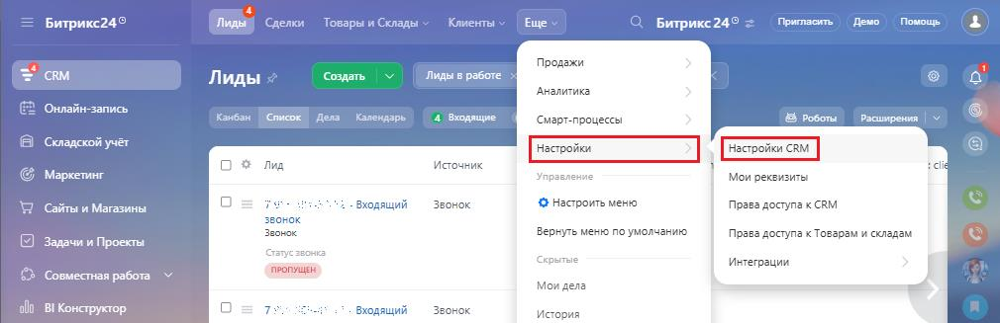
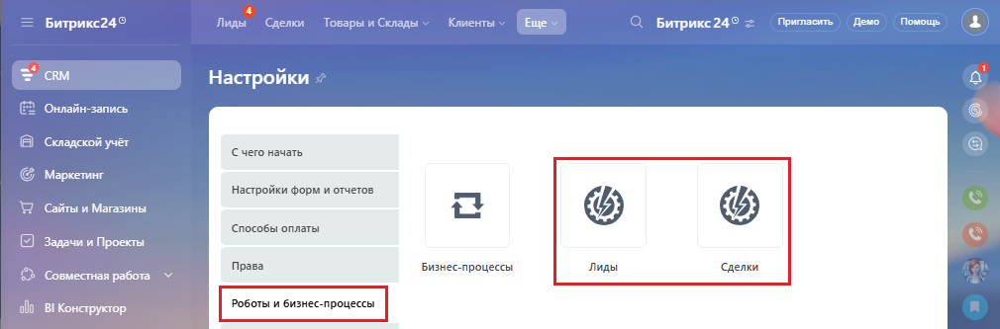
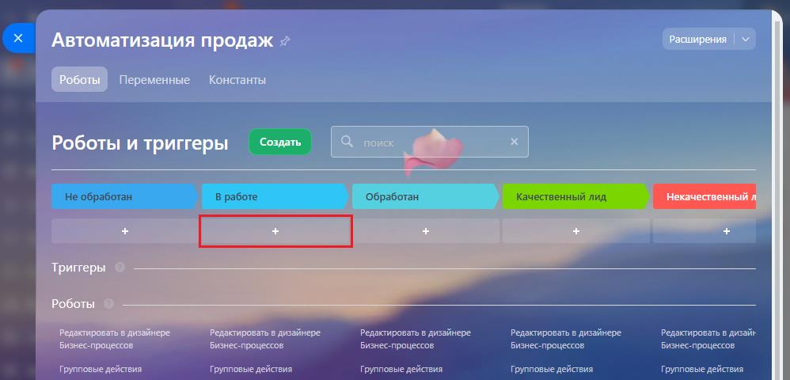
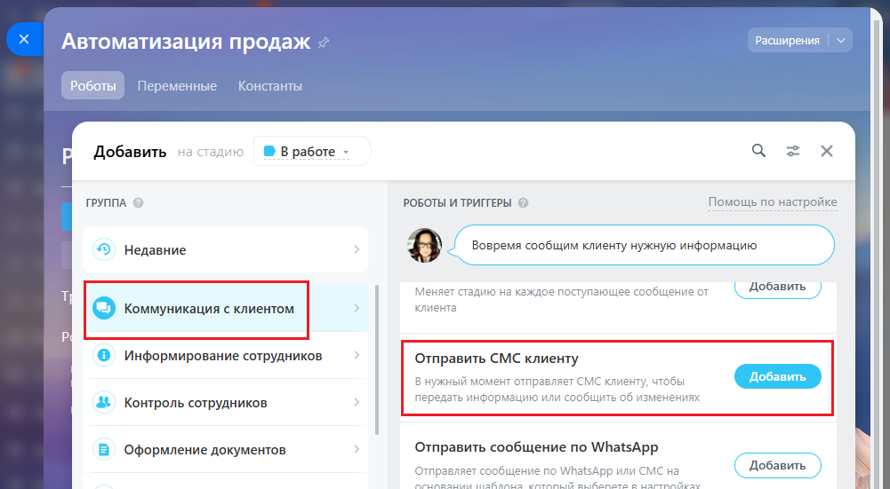
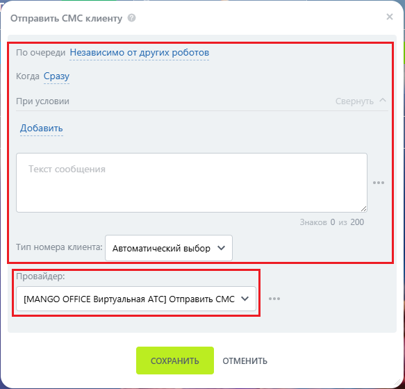
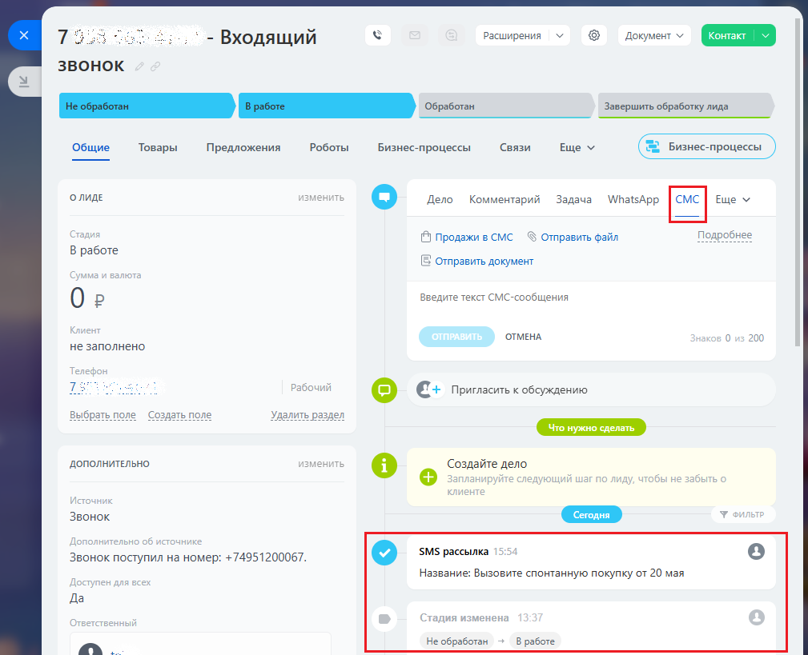

# Как настроить уведомление в роботах и бизнес-процессах

> Трассировка: PDF §2.7 · сквозные стр. 75-78 · источники: ч.1 `kb/sources/integration-bitrix24/Mango_office_integration_Bitrix24.pdf` с.75-78.

Чтобы сделать рассылку, в Битрикс24 следует: 1) выберите "CRM"; 2) нажмите кнопку "Настройка", затем выберите "Настройка CRM":

> **Описание иллюстрации INTB24-§2.7-1** (к §2.7 «Как настроить уведомление в роботах и бизнес-процессах», стр. 75; 1010×327 px). Снимок экрана / схема.
> Относится к тексту руководства: «…ение в роботах и бизнес-процессах Чтобы сделать рассылку, в Битрикс24 следует: 1) выберите "CRM"; 2) нажмите кнопку "Настройка", затем выберите "Настройка CRM":».
> Текст на изображении (OCR, требует сверки): Битрикс249; Товары и Склады ~; Клиенты | ще |; О. Битрике24® =; Продажи; ‘Создать; Лиды в работе >|; Лиды >; Аналитика; 'Онлайн-запись; Konan; список; fens Календарь; 4 Веодищие; ‘Cwapt-npouecce!; 8 Роботы; расширения | V; Складской учёт; ‘Источник; оз; лид; Маркетинг; Управление; ‘Mom реквизиты; "Сайты м Магазины; Входящий; вонок; @ Настроить меню; Права доступа к САМ; нок; Beane; Вернуть меню по умолчанию; Права доступа x Товарам и складам; Задачи и Проекты; any; re; скрытые; `Интеграции; Совместная работа; Мои дела; ofa; BI Конструктор.; кодящий; Звонок; История:

3) выберите пункт "Роботы и бизнес-процессы"; 4) выберите, для какой сущности будет использован робот: лид, сделка:

> **Описание иллюстрации INTB24-§2.7-2** (к §2.7 «Как настроить уведомление в роботах и бизнес-процессах», стр. 75; 1010×333 px). Снимок экрана / схема.
> Относится к тексту руководства: «…"Настройка", затем выберите "Настройка CRM": 3) выберите пункт "Роботы и бизнес-процессы"; 4) выберите, для какой сущности будет использован робот: лид, сделка:».
> Текст на изображении (OCR, требует сверки): = Битрикс24°; Лиды; ры и Склады:; Клиенты; Ewe; Burpuxe 24°; Пригласить; Демо; Помощь; CRM.; Настройки; Онлайн-запись; Складской учёт; Cuero начать; Маркетинг; Настройки форм и отчетов; "Сайты и Магазины; ‘способы оплаты; Задачи и Проекты; Права; Бизнес-процессы; Snes; Сделки; "Совместная работа; BI Конструктор,; Роботы и бизнес-процессы

5) Начните редактировать робота. Для добавления SMS уведомления выберите "+" на нужном этапе воронки продаж:

> **Описание иллюстрации INTB24-§2.7-3** (к §2.7 «Как настроить уведомление в роботах и бизнес-процессах», стр. 75; 998×480 px). Снимок экрана / схема.
> Относится к тексту руководства: «…акой сущности будет использован робот: лид, сделка: 5) Начните редактировать робота. Для добавления SMS уведомления выберите "+" на нужном этапе воронки продаж:».
> Текст на изображении (OCR, требует сверки): `Расширения | ~; Автоматизация продаж 2; (PEERED переменные Конаанты; Создать; Роботы и триггеры; rae!; samp; в дизайнере:; Редактировать в дизайнере; редактировать в дизай»; Бизнес-процессов:; Групповые действия

Интеграция Виртуальной АТС MANGO OFFICE и Битрикс24 | Версия от 03.03.2026 Нажмите на пункт "Коммуникация с клиентом", затем в блоке "Роботы и Триггеры" выберите пункт "Отправить СМС клиенту":

> **Описание иллюстрации INTB24-§2.7-4** (к §2.7 «Как настроить уведомление в роботах и бизнес-процессах», стр. 76; 1001×551 px). Снимок экрана / схема.
> Относится к тексту руководства: «…Нажмите на пункт "Коммуникация с клиентом", затем в блоке "Роботы и Триггеры" выберите пункт "Отправить СМС клиенту":».
> Текст на изображении (OCR, требует сверки): расширения.; Автоматизация продаж; Роботы; Переменные; Константы; © Вработе -; Добавить на; ГРУППА; РОБОТЫ И ТРИПЕРЫ; Помощь по настройке.; © Недавние; B J пони сообщим клиенту нужную информацию; Меняет стадию Ha каждое поступающее сообщение от; Добавить; клиента; (©) коммуникация с клиентом; © Информирование сотрудников; Отправить СМС клиенту; В нужный момент отправляет CMC клиенту, чтобы; передать информацию или сообщить об изменениях; `4% Контроль сотрудников; В Оформление документов; Отправить сообщение по WhatsApp; Отправляет сообщение по WhatsApp или СМС на; а А вала идеи

В настройках уведомления: 1) выберите провайдера: MANGO OFFICE Виртуальная АТС; 2) настройте другие параметры уведомления; 3) нажмите кнопку "Сохранить":

> **Описание иллюстрации INTB24-§2.7-5** (к §2.7 «Как настроить уведомление в роботах и бизнес-процессах», стр. 76; 583×560 px). Снимок экрана / схема.
> Относится к тексту руководства: «…енту": В настройках уведомления: 1) выберите провайдера: MANGO OFFICE Виртуальная АТС; 2) настройте другие параметры уведомления; 3) нажмите кнопку "Сохранить":».
> Текст на изображении (OCR, требует сверки): Отправить СМС клиенту; По очереди Независимо от других роботов; Когда Сразу; При условии; Добавить; eee; 200; Тип номера клиента:; Автоматический выбор VY; Провайдер:; [MANGO OFFICE Виртуальная АТС] Отправить СМС М

Интеграция Виртуальной АТС MANGO OFFICE и Битрикс24 | Версия от 03.03.2026 При наступлении соответствующего события, автоматически отправится SMS и зафиксируется в карточке. На примере ниже, SMS была автоматически отправлена при смене статуса сделки:

> **Описание иллюстрации INTB24-§2.7-6** (к §2.7 «Как настроить уведомление в роботах и бизнес-процессах», стр. 77; 1009×819 px). Снимок экрана / схема.
> Относится к тексту руководства: «… соответствующего события, автоматически отправится SMS и зафиксируется в карточке. На примере ниже, SMS была автоматически отправлена при смене статуса сделки:».
> Текст на изображении (OCR, требует сверки): 75:; >. - Входящий; Расширения; звонок; Завершить обработку лида; Общие; Товары; Предложения; Роботы; Бизнес-процессы; Связи; еще v; onmae; Дело; Комментарий; Задача; WhatsApp; Ewe У; © Продажи в CMC; 3 Отправить файл; В работе; {Е отправить документ; Oe; Введите текст СМС-сообщения; ОТМЕНА; 200; не заполнено; рабочий; [5] (+ пригласить к обсуждению; выб); е Создать г; Удалить раздел; ДОПОЛНИТЕЛЬНО; [:] © Создайте дело; Звонок поступил Ha номер: +74951200067.; © swspaccu; Название: Вызовите спонтанную покупку от 20 мая; Да; He обработан; В работе.

Интеграция Виртуальной АТС MANGO OFFICE и Битрикс24 | Версия от 03.03.2026
