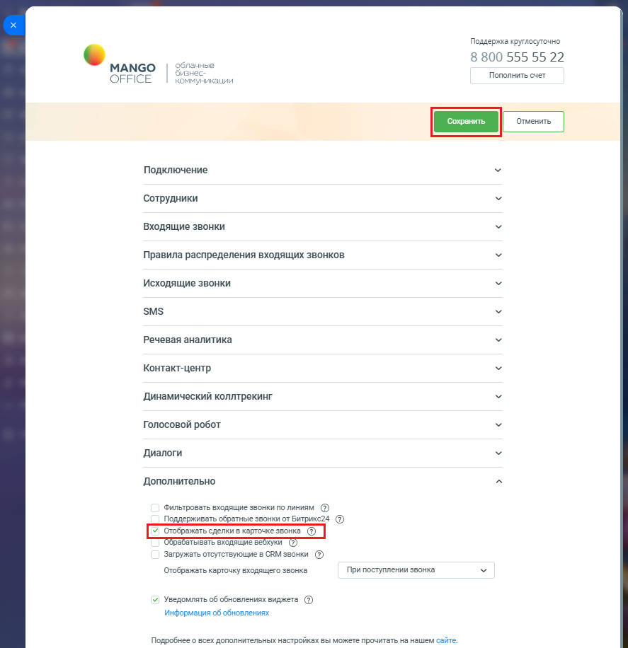

# 2.8. Отображать сделки в карточке звонка

> Трассировка: PDF §2.8 · сквозные стр. 78-79 · источники: ч.1 `kb/sources/integration-bitrix24/Mango_office_integration_Bitrix24.pdf` с.78-79.

Если данная настройка включена, то в карточке звонка будут отображаться последние 10 сделок с данным Клиентом. В результате оператор, обрабатывающий звонок, будет видеть заключал ли этот Клиент сделки ранее и на какую сумму. Чтобы включить или выключить показ информации о сделках, выполните: 1) откройте форму настройки приложения; 2) нажмите на пункт "Дополнительно"; 3) установите флаг "Отображать сделки в карточке звонка"; 4) нажмите кнопку "Сохранить" в верхней части формы настройки приложения интеграции:

> **Описание иллюстрации INTB24-§2.8-1** (к §2.8 «Отображать сделки в карточке звонка», стр. 78; 887×916 px). Снимок экрана / схема.
> Относится к тексту руководства: «…в верхней части формы настройки приложения интеграции:».
> Текст на изображении (OCR, требует сверки): Поддержка круглосуточно; ные; 8 800 555 55 22; МАМСО; Пополнить счет; OFFICE; KO; уникации; Подключение; Сотрудники; Входящие звонки; Правила распределения входящих звонков; Исходящие звонки; SMS; Речевая аналитика; Контакт-центр; Динамический коллтрекинг; Голосовой робот; Диалоги; Дополнительно; Фильтровать входящие звонки по линиям (7); Поддерживать обратные звонки от Битрикс24 (2); ывать входящие; уки; Загружать отсутствующие в CRM звонки (2); Отображать карточку входящего звонка; При поступлении звонка; v) Уведомлять об обновлениях виджета (7); Информация об обновлениях; Подробнее о всех д…

Интеграция Виртуальной АТС MANGO OFFICE и Битрикс24 | Версия от 03.03.2026
