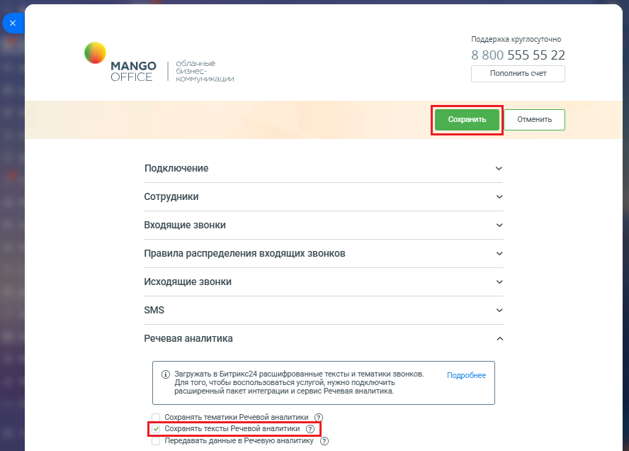

# Как настроить

> Трассировка: PDF §2.10 · сквозные стр. 85-86 · источники: ч.1 `kb/sources/integration-bitrix24/Mango_office_integration_Bitrix24.pdf` с.85-86.

Чтобы включить функцию сохранения тематик Речевой аналитики, в настройках сервиса интеграции необходимо: 1) откройте форму настройки приложения интеграции; 2) откройте блок "Речевая аналитика"; 3) установите флаг "Сохранять тексты Речевой Аналитики"; 4) нажмите кнопку "Сохранить" в верхней части формы настройки приложения интеграции:

> **Описание иллюстрации INTB24-§2.10-1** (к §2.10 «Как настроить», стр. 85; 888×636 px). Снимок экрана / схема.
> Относится к тексту руководства: «…ечевая аналитика"; 3) установите флаг "Сохранять тексты Речевой Аналитики"; 4) нажмите кнопку "Сохранить" в верхней части формы настройки приложения интеграции:».
> Текст на изображении (OCR, требует сверки): Поддержка круглосуточно; 8 800 555 55 22; ные; МАМСО; OFFICE; Викации; Пополнить счет; Подключение; Сотрудники; Входящие звонки; Правила распределения входящих звонков; Исходящие звонки; SMS; Речевая аналитика; @ Загружать в Битрикс24 расшифрованные тексты и тематики звонков.; Подробнее; Для того, чтобы воспользоваться услугой, нужно подключить; расширенный пакет интеграции и сервис Речевая аналитика.; Сох; нять тематики Речевой аналитики (2); Передавать данные в Речевую аналитику (2)

Интеграция Виртуальной АТС MANGO OFFICE и Битрикс24 | Версия от 03.03.2026
