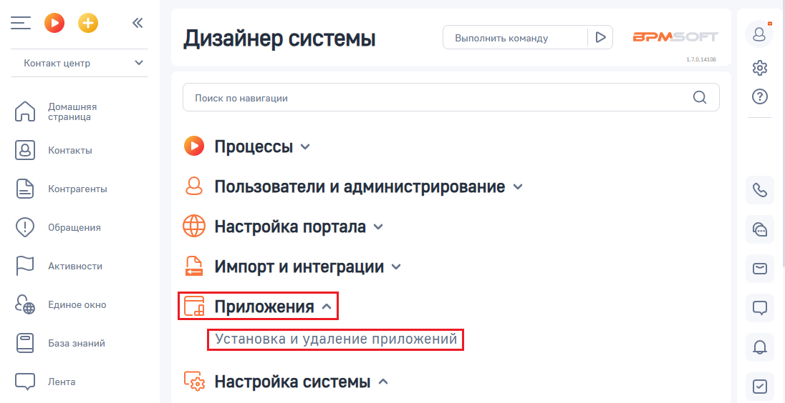
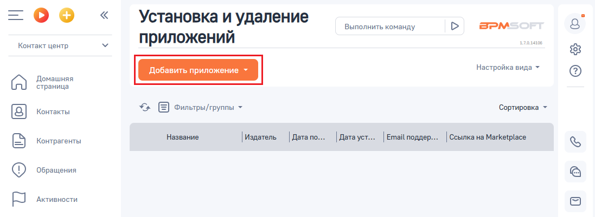
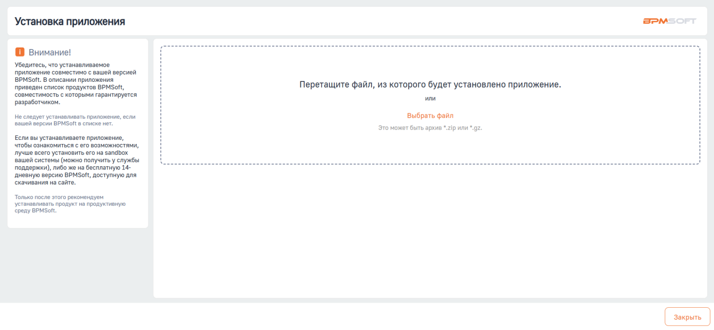

# Установка приложения

> Трассировка: PDF §1 · сквозные стр. 7-9 · источники: ч.1 `kb/sources/integration-bpmsoft/Mango_office_integration_BPMSoft.pdf` с.7-9.

Чтобы установить приложение интеграции, необходимо: 1) открыть ваш BPMSoft; Примечание. Для входа в BPMSoft вам потребуются ссылка на BPMSoft, а также логин и пароль пользователя BPMSoft. Необходимые данные вы можете узнать у своего администратора.

> **Описание иллюстрации INTBPM-§1-1** (к §1 «Установка приложения», стр. 7; 38×38 px). Пиктограмма (значок элемента интерфейса).
> Относится к тексту руководства: «…Для входа в BPMSoft вам потребуются ссылка на BPMSoft, а также логин и пароль пользователя BPMSoft. Необходимые данные вы можете узнать у своего администратора.».
> Текста на изображении нет; назначение элемента — см. текст, к которому он относится.

2) нажать на кнопку ; 3) выбрать пункт “Открыть дизайнер системы”:

> **Описание иллюстрации INTBPM-§1-2** (к §1 «Установка приложения», стр. 7; 1098×235 px). Снимок экрана / схема.
> Относится к тексту руководства: «…узнать у своего администратора. 2) нажать на кнопку ; 3) выбрать пункт “Открыть дизайнер системы”:».
> Текст на изображении (OCR, требует сверки): Домашняя страница; Выполнить команд}; оператора; Контакт центр; Домашняя; 52; ить страницу; страница; Открыть дизайнер системы; Мои; Ожидают; Решенные; Средняя; Kouta}; обращения в; ответа; обращения; оценка по; продолжит; pT

4) открывшуюся страницу дизайнера системы прокрутить вниз так, чтобы был виден блок “Приложения”. В этом блоке нажать на ссылку “Установка и удаление приложений”:

> **Описание иллюстрации INTBPM-§1-3** (к §1 «Установка приложения», стр. 7; 1096×564 px). Снимок экрана / схема.
> Относится к тексту руководства: «… открывшуюся страницу дизайнера системы прокрутить вниз так, чтобы был виден блок “Приложения”. В этом блоке нажать на ссылку “Установка и удаление приложений”:».
> Текст на изображении (OCR, требует сверки): оо; BPM; Дизайнер системы; Выполнить команду; Контакт центр.; spose; Поиск по навигации; Домашняя; ‘страница; Контакты; О процессы v; Контрагенты; Q Пользователи и администрирование v; Обращения; @ настройка портала v; `Активности; Импорт и интеграции у; Единое окно; База знаний; Лента; (53 Настройка системы ^

Руководство по интеграции АТС MANGO OFFICE и BPMSoft | Версия от 22.06.2026 5) нажать на кнопку “Добавить приложение”:

> **Описание иллюстрации INTBPM-§1-4** (к §1 «Установка приложения», стр. 8; 1097×401 px). Снимок экрана / схема.
> Относится к тексту руководства: «…5) нажать на кнопку “Добавить приложение”:».
> Текст на изображении (OCR, требует сверки): Установка и удаление; Выполнить команду; BPM; Контакт центр.; приложений; 08; Настройка вида +; Домашняя; страница; oe; Фильтры/группы +; ‘Сортировка ~; Контакты; Контрагенты; Название; Издатель; | Дата по.; [ Датауст... | Email поддер...; Ссылка на Marketplace; Обращения; `Активности

6) выбрать пункт “Установить из файла”:

> **Описание иллюстрации INTBPM-§1-5** (к §1 «Установка приложения», стр. 8; 388×263 px). Снимок экрана / схема.
> Относится к тексту руководства: «…5) нажать на кнопку “Добавить приложение”: 6) выбрать пункт “Установить из файла”:».
> Текст на изображении (OCR, требует сверки): Установка и удаление; приложений; Установить из файла; Создать новое приложение; ТЕСТЫ; издает; | Дата по.

7) нажать на кнопку “Выбрать файл”:

> **Описание иллюстрации INTBPM-§1-6** (к §1 «Установка приложения», стр. 8; 1377×637 px). Снимок экрана / схема.
> Относится к тексту руководства: «…5) нажать на кнопку “Добавить приложение”: 6) выбрать пункт “Установить из файла”: 7) нажать на кнопку “Выбрать файл”:».
> Текст на изображении (OCR, требует сверки): Установка приложения; О внимание!; Убедитесь, что устанавливаемое; приложение совместимо с вашей версией; BPMSoft. В описании приложения; приведен список продуктов BPMSoft,; Перетащите файл, из которого будет установлено приложение.; совместимость с которыми гарантируется; разработчиком.; ‘или; He следует устанавливать приложение, если,; Выбрать файл; вашей версии BPMSoft в списке нет.; это может быть архив *21р или *.g2.; Если вы устанавливаете приложение,; чтобы ознакомиться с его возможностями,; лучше всего установить ero на sandbox; вашей системы (можно получитьу службы; поддержки), либо ж…

Руководство по интеграции АТС MANGO OFFICE и BPMSoft | Версия от 22.06.2026 8) в открывшемся окне программы “Проводник” (если вы работаете под Windows) нужно указать архив (соответствующий Вашей редакции BPMSoft), в котором содержатся файлы приложения интеграции, затем нажать кнопку “Продолжить”. Будет выполнена загрузка приложения из архива и отображено соответствующее сообщение. 9) после завершения загрузки, автоматически начнется установка приложения. Вам нужно дождаться окончания установки приложения, при этом нельзя выходить из системы, закрывать окно браузера. Примечание. Установка приложение интеграции может занять до 10 минут. 10) после завершения установки приложения проверьте, что не выдано сообщение об ошибке. После получения сообщения об успешной установке приложения, нужно выполнить установку системных настроек, описанных далее.
