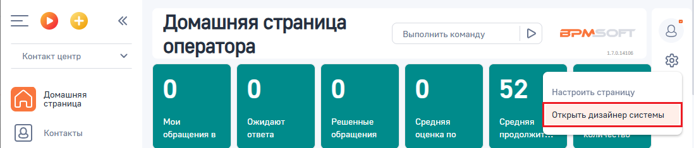
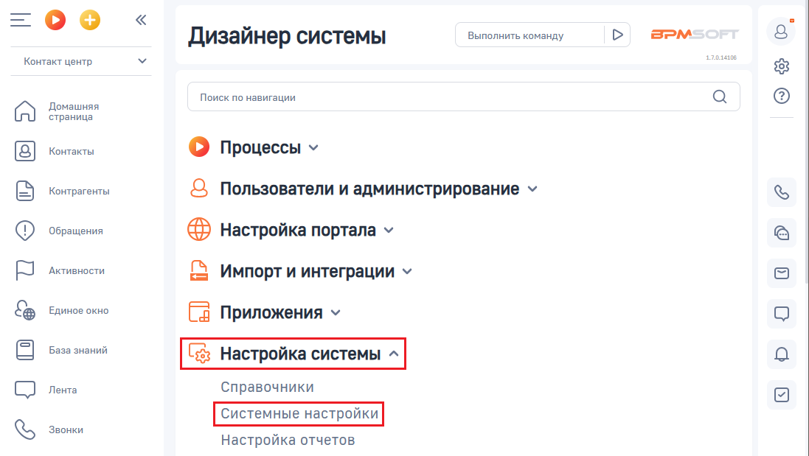
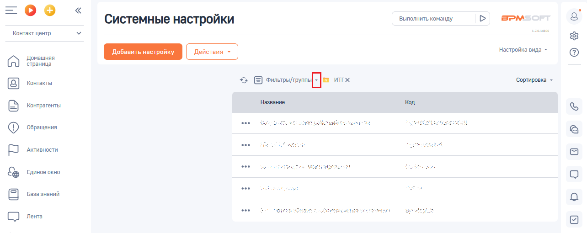
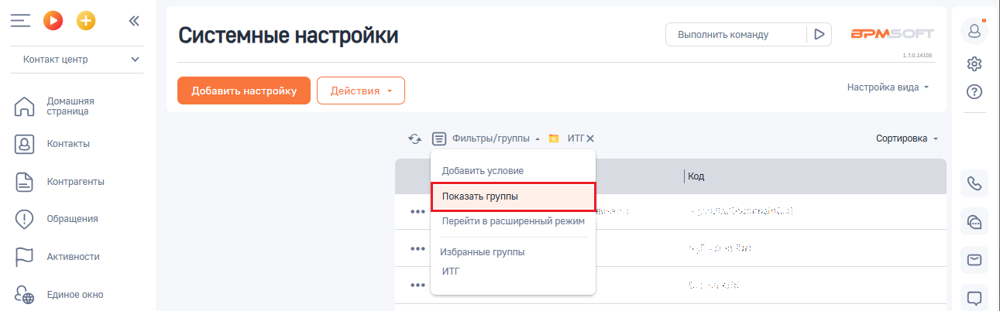
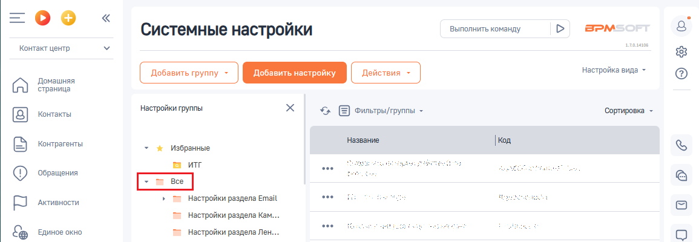
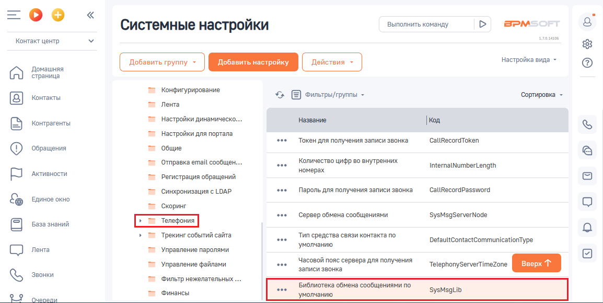
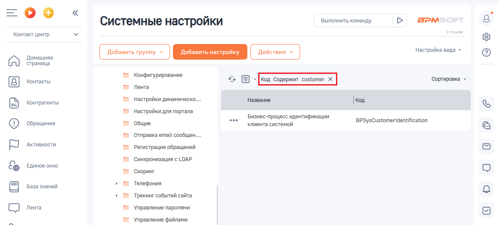
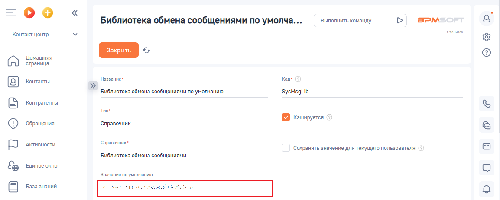
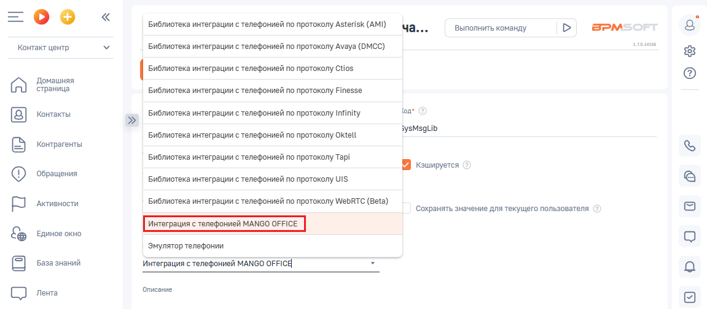
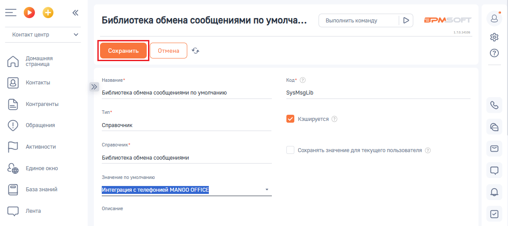

# Установка системных настроек

> Трассировка: PDF §1 · сквозные стр. 9-13 · источники: ч.1 `kb/sources/integration-bpmsoft/Mango_office_integration_BPMSoft.pdf` с.9-13.

В вашем BPMSoft выполните следующие действия: 1) нажмите BPMSoft; Примечание. Для входа в BPMSoft вам потребуются - ссылка на BPMSoft, а также логин и пароль пользователя BPMSoft. Необходимые данные вы можете узнать у своего администратора.

> **Описание иллюстрации INTBPM-§1-1** (к §1 «Установка системных настроек», стр. 9; 38×38 px). Пиктограмма (значок элемента интерфейса).
> Относится к тексту руководства: «…я входа в BPMSoft вам потребуются - ссылка на BPMSoft, а также логин и пароль пользователя BPMSoft. Необходимые данные вы можете узнать у своего администратора.».
> Текста на изображении нет; назначение элемента — см. текст, к которому он относится.

2) нажмите на кнопку ; 3) выберите пункт “Открыть дизайнер системы”:

> **Описание иллюстрации INTBPM-§1-2** (к §1 «Установка системных настроек», стр. 9; 1098×235 px). Снимок экрана / схема.
> Относится к тексту руководства: «…узнать у своего администратора. 2) нажмите на кнопку ; 3) выберите пункт “Открыть дизайнер системы”:».
> Текст на изображении (OCR, требует сверки): Домашняя страница; Выполнить команд}; оператора; Контакт центр; Домашняя; 52; ить страницу; страница; Открыть дизайнер системы; Мои; Ожидают; Решенные; Средняя; Kouta}; обращения в; ответа; обращения; оценка по; продолжит; pT

4) открывшуюся страницу дизайнера системы прокрутите вниз до блока “Настройка системы”. В этом блоке нажмите на ссылку “Системные настройки”;

> **Описание иллюстрации INTBPM-§1-3** (к §1 «Установка системных настроек», стр. 9; 1097×619 px). Снимок экрана / схема.
> Относится к тексту руководства: «…дизайнер системы”: 4) открывшуюся страницу дизайнера системы прокрутите вниз до блока “Настройка системы”. В этом блоке нажмите на ссылку “Системные настройки”;».
> Текст на изображении (OCR, требует сверки): Выполнить команду; BPM; Дизайнер системы; Контакт центр.; золы; Домашняя; Поиск по навигации; ‘страница; Контакты; О процессы v; Контрагенты; Q Пользователи и администрирование v; Обращения; @ настройка портала v; `Активности; Импорт и интеграции у; Единое окно; Fa Приложения у; База знаний; Лента; Справочники; Звонки; Настройка отчетов

Руководство по интеграции АТС MANGO OFFICE и BPMSoft | Версия от 22.06.2026

> **Описание иллюстрации INTBPM-§1-4** (к §1 «Установка системных настроек», стр. 10; 23×34 px). Пиктограмма (значок элемента интерфейса).
> Относится к тексту руководства: «…дизайнер системы”: 4) открывшуюся страницу дизайнера системы прокрутите вниз до блока “Настройка системы”. В этом блоке нажмите на ссылку “Системные настройки”;».
> Текста на изображении нет; назначение элемента — см. текст, к которому он относится.

5) нажмите на значок :

> **Описание иллюстрации INTBPM-§1-5** (к §1 «Установка системных настроек», стр. 10; 1284×510 px). Снимок экрана / схема.
> Относится к тексту руководства: «…5) нажмите на значок :».
> Текст на изображении (OCR, требует сверки): Системные настройки; Выполнить команду; BPM:; алан; Контакт центр; настройка вида -; Домашняя; страница; Контакты; Е) хильтры/грутиь; ‘Сортировка -; Контрагенты; Название; sth; ot; ‘Обращения; Активности.; кан; sent; Единое окно; {2 везазнания; te; oe; СО ль

6. выберите пункт “Показать группы”:

> **Описание иллюстрации INTBPM-§1-6** (к §1 «Установка системных настроек», стр. 10; 1291×402 px). Снимок экрана / схема.
> Относится к тексту руководства: «…5) нажмите на значок : 6. выберите пункт “Показать группы”:».
> Текст на изображении (OCR, требует сверки): =oO°o; Выполнить команду; BPM:; Системные настройки; алан; Контакт центр; настройка вида -; Домашняя; страница; Контакты; Е) фильтрытруппы = 22 итх; ‘Сортировка -; Добавить условие; контрагенты; ‘Обращения; Перейти в расширенный режим; oe; Активности.; Избранные группы; ит; ЕДИНОЕ окно

7. прокрутите список “Все” вниз до пункта “Телефония”:

> **Описание иллюстрации INTBPM-§1-7** (к §1 «Установка системных настроек», стр. 10; 1155×400 px). Снимок экрана / схема.
> Относится к тексту руководства: «…нажмите на значок : 6. выберите пункт “Показать группы”: 7. прокрутите список “Все” вниз до пункта “Телефония”:».
> Текст на изображении (OCR, требует сверки): =oO°o; Системные настройки; Выполнить команду; BPM:; алан; Контакт центр; настройка вида -; Домашняя; страница; "настройки группы; уг; Е) Фильтры/труппы -; 'Сортировка -; Контакты; Контрагенты; Название,; | koa; 7 & Избранные; м иг; ‘Обращения; Активности.; 2 Настройки раздела Email; = Настройки раздела Кам.; Единое окно; = Настройки раздела Лен.

Руководство по интеграции АТС MANGO OFFICE и BPMSoft | Версия от 22.06.2026 8. нажмите на пункт “Телефония”. Будет открыт список параметров; 9. дважды нажмите на строку “Библиотека обмена сообщениями по умолчанию”:

> **Описание иллюстрации INTBPM-§1-8** (к §1 «Установка системных настроек», стр. 11; 1154×582 px). Снимок экрана / схема.
> Относится к тексту руководства: «…8. нажмите на пункт “Телефония”. Будет открыт список параметров; 9. дважды нажмите на строку “Библиотека обмена сообщениями по умолчанию”:».
> Текст на изображении (OCR, требует сверки): Выполнить команду; BPM:; Системные настройки; Контакт центр; настройка вида ~; Домашняя; страница; Конфигурирование; Контакты; уг; Фильтры/группы -; 'Сортировка -; Лента; контрагенты; настройки динамическо...; Название,; | koa; "настройки для портала; `Токен для получения записи звонка; CallRecordToken; ‘Обращения; Общие; Количество цифр во внутренних; Отправка email сообщен...; InternalNumberLength; Активности.; номерах; Регистрация обращений; ‘Синхронизация с LDAP; Пароль для получения записи звонка.; CallRecordPassword; ЕДИНОЕ окно; ‘Скоринг; Сервер обмена сообщениями; ‘SysMsgServerNode; Ба…

Важно! Если в списке параметров нет строки “Библиотека обмена сообщениями по умолчанию”, то возможно у вас настроен фильтр, который

> **Описание иллюстрации INTBPM-§1-9** (к §1 «Установка системных настроек», стр. 11; 26×27 px). Пиктограмма (значок элемента интерфейса).
> Относится к тексту руководства: «…а сообщениями по умолчанию”: Важно! Если в списке параметров нет строки “Библиотека обмена сообщениями по умолчанию”, то возможно у вас настроен фильтр, который».
> Текста на изображении нет; назначение элемента — см. текст, к которому он относится.

отображается над списком параметров. Отключите фильтр, нажав кнопку . После этого будет отображен полный список параметров.

> **Описание иллюстрации INTBPM-§1-10** (к §1 «Установка системных настроек», стр. 11; 1154×521 px). Снимок экрана / схема.
> Относится к тексту руководства: «…можно у вас настроен фильтр, который отображается над списком параметров. Отключите фильтр, нажав кнопку . После этого будет отображен полный список параметров.».
> Текст на изображении (OCR, требует сверки): оо; BPM:; Системные настройки; Выполнить команду; алан; Контакт центр; настройка вида ~; Домашняя; страница; Конфигурирование; Контакты; уг; 'Сортировка -; Лента; aaa]; Контрагенты; "настройки динамическо..; Название,; | koa; "настройки для портала; oo; Бизнес-процесс идентификации; ‘Обращения; Общие; клиента системой; BPSysCustomeridentification; Отправка email сообщен...; Активности.; Регистрация обращений; ‘Синхронизация с LDAP; Единое окно; ‘Скоринг; Телефония; Трекинг событий сайта; СО ль; Управление паролями; Управление файлами

Руководство по интеграции АТС MANGO OFFICE и BPMSoft | Версия от 22.06.2026 10. нажмите на строку “Значение по умолчанию”. Будет показан раскрывающийся список;

> **Описание иллюстрации INTBPM-§1-11** (к §1 «Установка системных настроек», стр. 12; 1154×463 px). Снимок экрана / схема.
> Относится к тексту руководства: «…“Значение по умолчанию”. Будет показан раскрывающийся список;».
> Текст на изображении (OCR, требует сверки): Библиотека обмена сообщениями по умолча...; Выполнить команду; BPM:; Контакт центр; ease; Домашняя; страница; название"; Kon; Контакты; Библиотека обмена сообщениями по умолчанию; зузмедиь; Контрагенты; Tune; Keumpyeren; ‘Обращения; ‘справочник; Активности.; Справочник"; ‘Сохранять значение для текущего пользователя; Библиотека обмена сообщениями; Единое окно; Знечение по умолчанию; mn; зы

12. выберите пункт “Интеграция с телефонией MANGO OFFICE”; Примечание. Если в списке “Значение по умолчанию” нет пункта “Интеграция с телефонией MANGO OFFICE”, значит приложение не установлено. Попробуйте повторно установить приложение по этой инструкции.

> **Описание иллюстрации INTBPM-§1-12** (к §1 «Установка системных настроек», стр. 12; 1151×505 px). Снимок экрана / схема.
> Относится к тексту руководства: «…по умолчанию” нет пункта “Интеграция с телефонией MANGO OFFICE”, значит приложение не установлено. Попробуйте повторно установить приложение по этой инструкции.».
> Текст на изображении (OCR, требует сверки): Библиотека интеграции с телефонией по протоколу Asterisk (AMI); Выполнить команду; BPM:; sans; Контакт центр; Библиотека интеграции с телефонией по протоколу Avaya (DMCC); Домашняя; | Библиотека интеграции с телефонией по протоколу Ctios; страница; Библиотека интеграции с телефонией по протоколу Finesse; fon; Контакты; | Библиотека интеграции с телефонией no протоколу Infinity; 3ysMsgLib; Библиотека интеграции с телефонией no протоколу Oktell; Контрагенты; Библиотека интеграции с телефонией по протоколу Tapi; QD Koumyerca ©; ‘Обращения; | Библиотека интеграции с телефонией по протоколу 1$.; Ак…

13. нажмите на кнопку “Сохранить”:

> **Описание иллюстрации INTBPM-§1-13** (к §1 «Установка системных настроек», стр. 12; 1153×514 px). Снимок экрана / схема.
> Относится к тексту руководства: «…я с телефонией MANGO OFFICE”, значит приложение не установлено. Попробуйте повторно установить приложение по этой инструкции. 13. нажмите на кнопку “Сохранить”:».
> Текст на изображении (OCR, требует сверки): Библиотека обмена сообщениями по умолча...; Выполнить команду; BPM:; алан; Контакт центр; Домашняя; страница; название"; Kon; Контакты; Библиотека обмена сообщениями по умолчанию; зузмедиь; Контрагенты; Tune; Keumpyeren; ‘Обращения; ‘справочник; Активности.; Справочник"; ‘Сохранять значение для текущего пользователя; Библиотека обмена сообщениями; Единое окно; Значение по умолчанию; База знаний; ‘Описание; СО ле

Далее, вам следует переходить к настройкам интеграции в Личном кабинете MANGO OFFICE. Руководство по интеграции АТС MANGO OFFICE и BPMSoft | Версия от 22.06.2026
