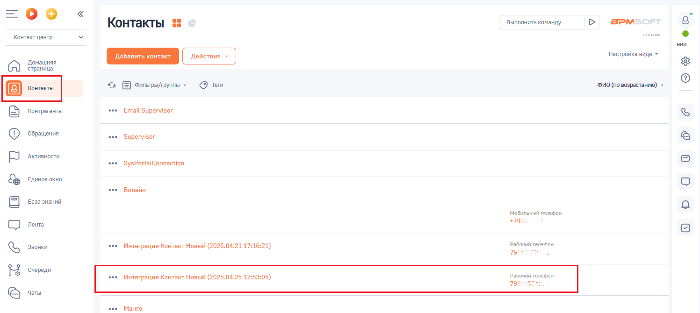
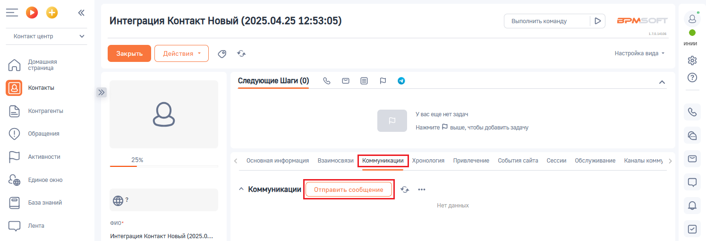
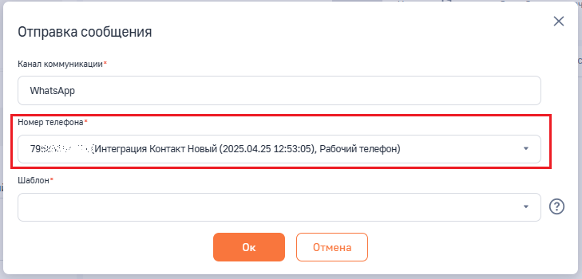
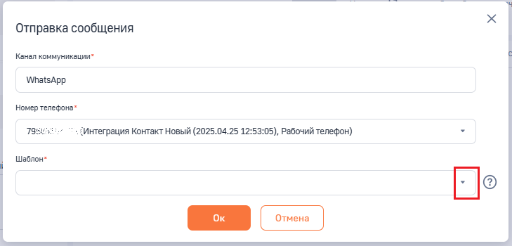
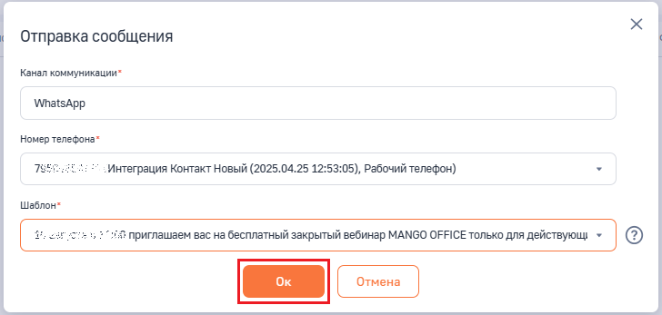
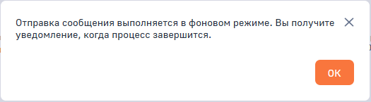
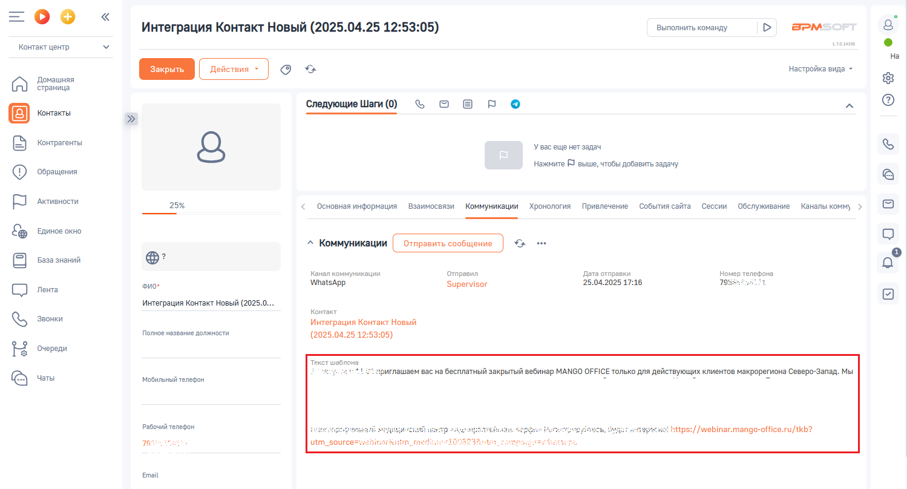

# Как отправить Клиенту сообщение WhatsApp

> Трассировка: PDF §2.8 · сквозные стр. 75-77 · источники: ч.1 `kb/sources/integration-bpmsoft/Mango_office_integration_BPMSoft.pdf` с.75-77.

Для этого в вашей BPMSoft следует: 1) отфильтруйте записи в разделе “Контакты” или “Контрагенты” так, чтобы найти запись о Клиенте, которому хотите отправить HSM-сообщение; 2) нажмите на строку с данными контакта, которому хотите отправить HSM- сообщение. Будет открыта карточка контакта;

> **Описание иллюстрации INTBPM-§2.8-1** (к §2.8 «Как отправить Клиенту сообщение WhatsApp», стр. 75; 1497×670 px). Снимок экрана / схема.
> Относится к тексту руководства: «…те, которому хотите отправить HSM-сообщение; 2) нажмите на строку с данными контакта, которому хотите отправить HSM- сообщение. Будет открыта карточка контакта;».
> Текст на изображении (OCR, требует сверки): Контакты; Выполнить команду; в>м; алая; Контакт центр; нии.; настройка вида -; Домашняя; страница; Фильтры/группы -; ФИО (по возрастанию) -; @ tem; oe; © соломы; Email Supervisor; Ф сени; Supervisor; БР лее; SysPortalConne; &% виновокно; Билайн; {2 везазнания; Мобильный телефон.; +795:; СО ль; Рабочий телефон,; Интеграция Контакт Новый (2025.04.21 17:16:21); Qe зи; Te; Очереди; Интеграция Контакт Новый (2025.04.25 12:; 05); Рабочий телефон; Mauro.

3) откройте закладку “Коммуникации”; 4) нажмите на кнопку “Отправить сообщение”:

> **Описание иллюстрации INTBPM-§2.8-2** (к §2.8 «Как отправить Клиенту сообщение WhatsApp», стр. 75; 1495×510 px). Снимок экрана / схема.
> Относится к тексту руководства: «…кта, которому хотите отправить HSM- сообщение. Будет открыта карточка контакта; 3) откройте закладку “Коммуникации”; 4) нажмите на кнопку “Отправить сообщение”:».
> Текст на изображении (OCR, требует сверки): =oO°o; Интеграция Контакт Новый (2025.04.25 12:53:05); Выполнить команду; BPM:; rouse; Контакт центр; ‘инии; oe; настройка вида -; Домашняя; страница; ‘Следующие Шаги (0); ъовро; Контакты; Контрагенты; 'Увасеще нет задач; Нажмите © выше, чтобы добавить задачу; ‘Обращения; Активности.; 25%; cevomenwipopiaiin ssamocenan [коту] monn anes CoHuTICaira Око OBEnymieanN Kokam ony; Единое окно; и о; База знаний; негданных; Лента; ‘ono; Интеграция Контакт Новый (2025.0...

6) вы можете выбрать номер телефона Клиента, на который будет отправлено hsm-сообщение, если у клиента несколько номеров телефонов: Руководство по интеграции АТС MANGO OFFICE и BPMSoft | Версия от 22.06.2026

> **Описание иллюстрации INTBPM-§2.8-3** (к §2.8 «Как отправить Клиенту сообщение WhatsApp», стр. 76; 729×350 px). Снимок экрана / схема.
> Относится к тексту руководства: «…нопку “Отправить сообщение”: 6) вы можете выбрать номер телефона Клиента, на который будет отправлено hsm-сообщение, если у клиента несколько номеров телефонов:».
> Текст на изображении (OCR, требует сверки): Отправка сообщения; Канал коммуникации"; WhatsApp; Номер Tenedoxa*; 795: „Интеграция Контакт Новый (2025.04.25 12:53:05), Рабочий телефон); Шаблон*; Cc

> **Описание иллюстрации INTBPM-§2.8-4** (к §2.8 «Как отправить Клиенту сообщение WhatsApp», стр. 76; 16×26 px). Пиктограмма (значок элемента интерфейса).
> Относится к тексту руководства: «…нопку “Отправить сообщение”: 6) вы можете выбрать номер телефона Клиента, на который будет отправлено hsm-сообщение, если у клиента несколько номеров телефонов:».
> Текста на изображении нет; назначение элемента — см. текст, к которому он относится.

7) в поле “Шаблон“ нажмите на кнопку “Стрелка” , чтобы выбрать шаблон hsm-сообщения:

> **Описание иллюстрации INTBPM-§2.8-5** (к §2.8 «Как отправить Клиенту сообщение WhatsApp», стр. 76; 729×350 px). Снимок экрана / схема.
> Относится к тексту руководства: «…7) в поле “Шаблон“ нажмите на кнопку “Стрелка” , чтобы выбрать шаблон hsm-сообщения:».
> Текст на изображении (OCR, требует сверки): Отправка сообщения; Канал коммуникации*; WhatsApp; Номер телефона*; 795: „Интеграция Контакт Новый (2025.04.25 12:53:05), Рабочий телефон); Шаблон*; Cc

8) выберите шаблон hsm-сообщения: 9) нажмите на кнопку “Ок”:

> **Описание иллюстрации INTBPM-§2.8-6** (к §2.8 «Как отправить Клиенту сообщение WhatsApp», стр. 76; 728×347 px). Снимок экрана / схема.
> Относится к тексту руководства: «…7) в поле “Шаблон“ нажмите на кнопку “Стрелка” , чтобы выбрать шаблон hsm-сообщения: 8) выберите шаблон hsm-сообщения: 9) нажмите на кнопку “Ок”:».
> Текст на изображении (OCR, требует сверки): Отправка сообщения; Канал коммуникации*; WhatsApp; Номер Tenedoxa*; ^ „Интеграция Контакт Новый (2025.04.25 12:53:05), Рабочий телефон); Шаблон*; “3 приглашаем вас на бесплатный закрытый вебинар MANGO OFFICE только для действующ: * | (2)

10) будет запущено процесс отправки hsm-сообщения и выдано соответствующее сообщение, в котором нажмите кнопку “Ок”:

> **Описание иллюстрации INTBPM-§2.8-7** (к §2.8 «Как отправить Клиенту сообщение WhatsApp», стр. 76; 525×145 px). Снимок экрана / схема.
> Относится к тексту руководства: «…процесс отправки hsm-сообщения и выдано соответствующее сообщение, в котором нажмите кнопку “Ок”:».
> Текст на изображении (OCR, требует сверки): Отправка сообщения выполняется в фоновом режиме. Вы получите Ж; уведомление, когда процесс завершится.

Руководство по интеграции АТС MANGO OFFICE и BPMSoft | Версия от 22.06.2026 11) после того, как сообщение будет отправлено, в вашем BPMSoft будет отображено уведомление, а также в разделе “Коммуникации” будет отображена информация об отправленном сообщении:

> **Описание иллюстрации INTBPM-§2.8-8** (к §2.8 «Как отправить Клиенту сообщение WhatsApp», стр. 77; 1499×808 px). Снимок экрана / схема.
> Относится к тексту руководства: «…ообщение будет отправлено, в вашем BPMSoft будет отображено уведомление, а также в разделе “Коммуникации” будет отображена информация об отправленном сообщении:».
> Текст на изображении (OCR, требует сверки): BPM:; Интеграция Контакт Новый (2025.04.25 12:53:05); Выполнить команду; ease; Контакт центр; на; oe; настройка вида -; Домашняя; страница; ‘Следующие Шаги (0); ъовро; Контакты; Контрагенты; 'Увасеще нет задач; Нажмите © выше, чтобы добавить задачу; ‘Обращения; Активности.; 25%; ‘основная информация; Взаимосвязи Коммуникации; Хронология; Привлечение; События сайта Сессии; Обслуживание; Каналы комм); Единое окно; База знаний; Kanan коммуникации; Отправил; ara отправки,; Номер телефона:; 25.04.2025 17:16; TNs; Лента; Фио-; WhatsApp; Supervisor; интеграция Контакт Новый (2025.0...; Контакт; Звонк…
