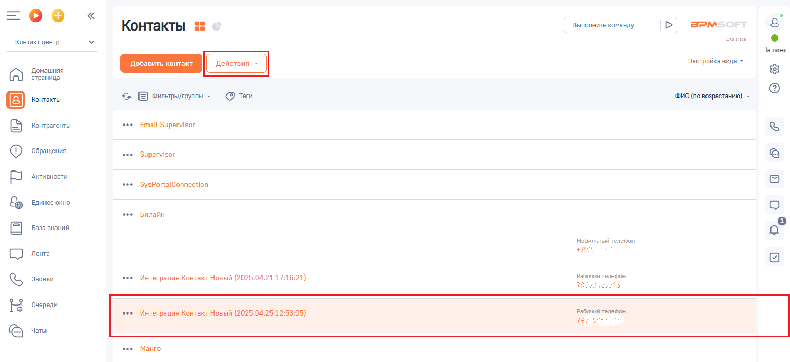
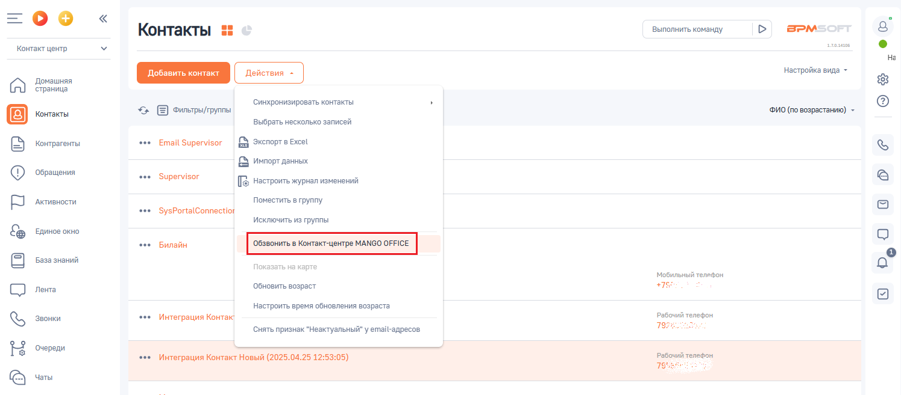
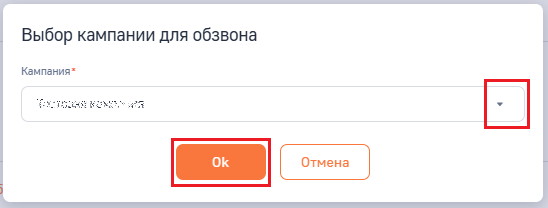
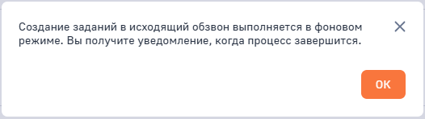
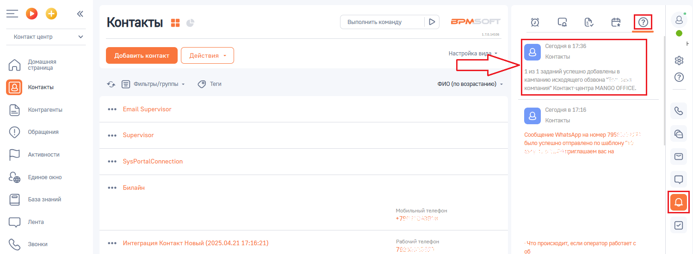

# Как добавить задание в кампанию исходящего обзвона Контакт-центра MANGO OFFICE

> Трассировка: PDF §2.9 · сквозные стр. 78-81 · источники: ч.1 `kb/sources/integration-bpmsoft/Mango_office_integration_BPMSoft.pdf` с.78-81.

MANGO OFFICE Чтобы добавлять номера телефонов в кампанию ИО Контакт-центра MANGO OFFICE, следует: 1) войдите в ваш BPMSoft; 2) отфильтруйте записи в нужном вам разделе, так чтобы найти нужную вам запись: Контакты, Контрагенты; 3) нажмите на строку с данными контакта, который хотите добавить в кампанию ИО; 4) нажмите на кнопку “Действия”: Руководство по интеграции АТС MANGO OFFICE и BPMSoft | Версия от 22.06.2026

> **Описание иллюстрации INTBPM-§2.9-1** (к §2.9 «Как добавить задание в кампанию исходящего обзвона Контакт-центра MANGO OFFICE», стр. 79; 1495×686 px). Снимок экрана / схема.
> Относится к тексту руководства: «…найти нужную вам запись: Контакты, Контрагенты; 3) нажмите на строку с данными контакта, который хотите добавить в кампанию ИО; 4) нажмите на кнопку “Действия”:».
> Текст на изображении (OCR, требует сверки): Контакты; ct; Выполнить команду; в>м; Контакт центр; алая; Ча линь; настройка вида -; Домашняя; страница; Е) фильтрыитруппы -; @ tem; ФИО (по возрастанию) -; oe; Email Supervisor; контрагенты; ‘Обращения; Supervisor; Активности.; ‘SysPortalConnection; ЕДИНОЕ окно; Билайн; База знаний; Мобильный телефон.; Лента; Рабочий телефон; Звонки; Интеграция Контакт Новый (2025.04.21 17:; 21); тех; Очереди; Интеграция Контакт Новый (2025.04.25 12:53:05); Рабочий телефон,; Чаты; Манго

5) нажмите на пункт “Обзвонить в Контакт-центре MANGO OFFICE”;

> **Описание иллюстрации INTBPM-§2.9-2** (к §2.9 «Как добавить задание в кампанию исходящего обзвона Контакт-центра MANGO OFFICE», стр. 79; 1495×657 px). Снимок экрана / схема.
> Относится к тексту руководства: «…5) нажмите на пункт “Обзвонить в Контакт-центре MANGO OFFICE”;».
> Текст на изображении (OCR, требует сверки): Выполнить команду; BPM:; Контакты; алан; Контакт центр; настройка вида -; Домашняя; страница; Синхронизировать контакты; Е) оильтрыруппы; ФИО (по возрастанию) -; выбрать несколько записей; Контрагенты; Email Supervisor; LB экопорт в Excel; [$ импорт данных; ‘Обращения; oe; Supervisor; [2 нестроитьжурнал изменений; Активности.; Поместить в группу; ‘SysPortalConnectiot; Исключить из группы; Единое окно; Билайн; База знаний; мобильный телефон; Лента; Обновить возраст; +75; Настроить время обновления возраста; Звонки; Интеграция Контак; Рабочий телефон; Снять признак "Неактуальный" у email-anpecos…

6) выберите название кампании ИО, в которую хотите добавить запись; 7) нажмите на кнопку “Ок”:

> **Описание иллюстрации INTBPM-§2.9-3** (к §2.9 «Как добавить задание в кампанию исходящего обзвона Контакт-центра MANGO OFFICE», стр. 79; 548×208 px). Снимок экрана / схема.
> Относится к тексту руководства: «…5) нажмите на пункт “Обзвонить в Контакт-центре MANGO OFFICE”; 6) выберите название кампании ИО, в которую хотите добавить запись; 7) нажмите на кнопку “Ок”:».
> Текст на изображении (OCR, требует сверки): Выбор кампании для обзвона; Кампания*; “ESTRUS REM ae

Руководство по интеграции АТС MANGO OFFICE и BPMSoft | Версия от 22.06.2026 8) будет запущено создание заданий в исходящий обзвон в фоновом режиме и выдано соответствующее сообщение, в котором нажмите кнопку “Ок”:

> **Описание иллюстрации INTBPM-§2.9-4** (к §2.9 «Как добавить задание в кампанию исходящего обзвона Контакт-центра MANGO OFFICE», стр. 80; 526×148 px). Снимок экрана / схема.
> Относится к тексту руководства: «…8) будет запущено создание заданий в исходящий обзвон в фоновом режиме и выдано соответствующее сообщение, в котором нажмите кнопку “Ок”:».
> Текст на изображении (OCR, требует сверки): Xx; Создание заданий в исходящий обзвон выполняется в фоновом; режиме. Вы получите уведомление, когда процесс завершится.

9) после того, как задание будет добавлено в кампанию ИО Контакт-центре MANGO OFFICE, в вашем BPMSoft будет отображено уведомление:

> **Описание иллюстрации INTBPM-§2.9-5** (к §2.9 «Как добавить задание в кампанию исходящего обзвона Контакт-центра MANGO OFFICE», стр. 80; 1498×550 px). Снимок экрана / схема.
> Относится к тексту руководства: «…котором нажмите кнопку “Ок”: 9) после того, как задание будет добавлено в кампанию ИО Контакт-центре MANGO OFFICE, в вашем BPMSoft будет отображено уведомление:».
> Текст на изображении (OCR, требует сверки): Выполнить команду; BPM:; Ca; Контакты; алан; Контакт центр; ‘Сегодня в 17:36; настройка в; Домашняя; страница; 131 заданий успешно добавлены в; ‘Фильтры/группы -; ФИО (по возрастанию) -; кампанию исходящего обзвона “т.; @ tem; компания” Контакт-центра MANGO OFFICE.; Контрагенты; Email Supervisor; Сегодня в 17:16; ‘Обращения; oe; Supervisor; ‘Сообщение WhatsApp на номер 795:; было улешно отправлено no шаблону”; Активности.; 2 приглашаем вас на; ‘SysPortalConnection; Единое окно; Билайн; База знаний; мобильный телефон; +786; Лента; Звонки; Интеграция Контакт Новый (2025.04.21 17:16:21); Рабочий …

Руководство по интеграции АТС MANGO OFFICE и BPMSoft | Версия от 22.06.2026
