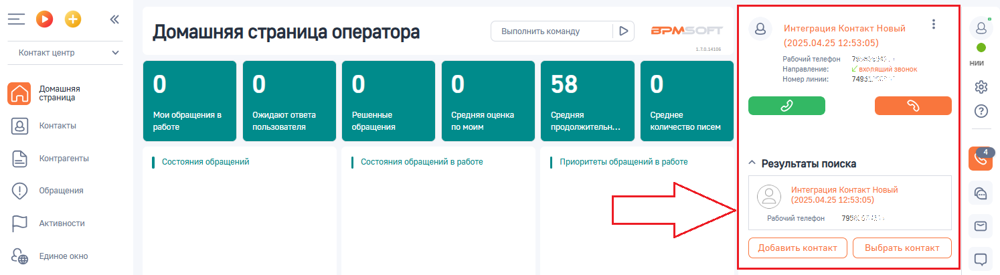
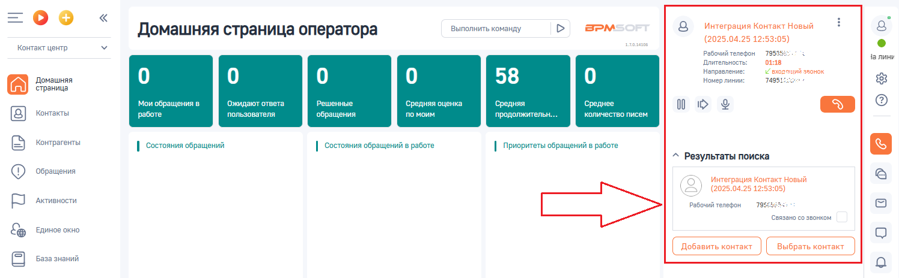
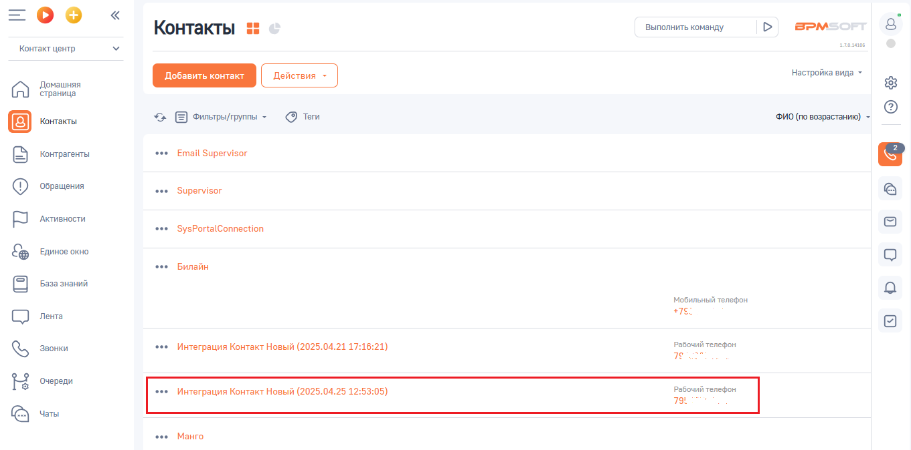

# 3.1. Входящий звонок

> Трассировка: PDF §3.1 · сквозные стр. 81-82 · источники: ч.1 `kb/sources/integration-bpmsoft/Mango_office_integration_BPMSoft.pdf` с.81-82.

При входящем звонке у сотрудника зазвонит телефон (указанный в карточке сотрудника в Личном кабинете в качестве средства приема вызовов). А также, в BPMSoft будет показано всплывающее уведомление о входящем вызове.

> **Описание иллюстрации INTBPM-§3.1-1** (к §3.1 «Входящий звонок», стр. 81; 1494×411 px). Снимок экрана / схема.
> Относится к тексту руководства: «…занный в карточке сотрудника в Личном кабинете в качестве средства приема вызовов). А также, в BPMSoft будет показано всплывающее уведомление о входящем вызове.».
> Текст на изображении (OCR, требует сверки): =oO°o; Интеграция Контакт Новый; Домашняя страница оператора; Выполнить команду; BPM:; (2025.04.25 12:53:05); Контакт центр; аля; Рабочий телефон; ре; нии; Направление:; Г вхопяший звонок; 745.; Номер линии:; Домашняя; 58; страница; Мои обращения в; ожидают ответа; Решенные; Средняя оценка; средняя; Среднее; Контакты; пол; вателя; им; жительн.; ли; тво писем; работе; обращения; Контрагенты; | состояния обращений; | состояния обращений в работе; | Приоритеты обращений в работе; ^ Результаты поиска; ow; ‘Обращения; ‘Активности; T9883; Единое окно

Если сотрудник примет вызов, то карточка звонка будет иметь вид:

> **Описание иллюстрации INTBPM-§3.1-2** (к §3.1 «Входящий звонок», стр. 81; 1496×464 px). Снимок экрана / схема.
> Относится к тексту руководства: «…а приема вызовов). А также, в BPMSoft будет показано всплывающее уведомление о входящем вызове. Если сотрудник примет вызов, то карточка звонка будет иметь вид:».
> Текст на изображении (OCR, требует сверки): Выполнить команду; BPM:; Интеграция Контакт Новый; Домашняя страница оператора; (2025.04.25 12:53:05); Контакт центр; аля; Рабочий телефон; 7955:; Чалини; Длительность:; 01:; Направление:; Г вхореший звонок; 745; Домашняя; 58; Номер линии:; страница; твета; Решенные; ращения в; Ожида; Ср; няя оценка; средняя; Среднее; 00; Контакты; работе; пользователя; обращения; по моим; продолжительн.; количество писем; Контрагенты; | состояния обращений; | состояния обращений в работе; | Приоритеты обращений в работе; ^ Результаты поиска; ‘Обращения; ow; (2025.04.25 12:; ‘Активности; 7968308; ‘связано со з…

Руководство по интеграции АТС MANGO OFFICE и BPMSoft | Версия от 22.06.2026 Если ранее была включена настройка создавать контакт/контрагента/лид при входящем звонке, то в BPMSoft будет создан контакт/контрагента/лид:

> **Описание иллюстрации INTBPM-§3.1-3** (к §3.1 «Входящий звонок», стр. 82; 1361×674 px). Снимок экрана / схема.
> Относится к тексту руководства: «…Если ранее была включена настройка создавать контакт/контрагента/лид при входящем звонке, то в BPMSoft будет создан контакт/контрагента/лид:».
> Текст на изображении (OCR, требует сверки): Выполнить команду; BPM:; Контакты; алая; Контакт центр; настройка вида -; Домашняя; страница; Фильтры/группы -; @ tem; ФИО (по возрастанию) -; oe; контрагенты; Email Supervisor; ‘Обращения; Supervisor; Активности.; ‘SysPortalConnection; ЕДИНОЕ окно; Билайн; База знаний; Мобильный телефон; Лента; Звонки; Интеграция Контакт Новый (2025.04.21 17:; Рабочий телефон; 7s; Очереди; Интеграция Контакт Новый (202!; 5 12:; Чаты; "Манго

Чтобы принять звонок, нужно поднять трубку рабочего телефона или принять звонок в вашем MTalker софтфоне. Чтобы завершить звонок, нужно положить трубку рабочего телефона или

> **Описание иллюстрации INTBPM-§3.1-4** (к §3.1 «Входящий звонок», стр. 82; 125×37 px). Фрагмент интерфейса (кнопка, переключатель или поле).
> Относится к тексту руководства: «… звонок, нужно поднять трубку рабочего телефона или принять звонок в вашем MTalker софтфоне. Чтобы завершить звонок, нужно положить трубку рабочего телефона или».
> Текста на изображении нет; назначение элемента — см. текст, к которому он относится.

нажать кнопку в карточке звонка.
