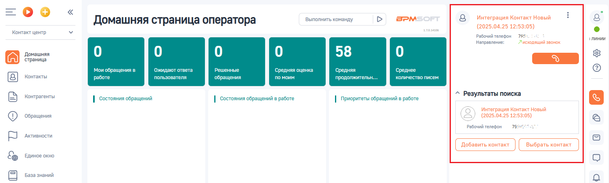

# 3.2. Исходящий звонок

> Трассировка: PDF §3.2 · сквозные стр. 82-83 · источники: ч.1 `kb/sources/integration-bpmsoft/Mango_office_integration_BPMSoft.pdf` с.82-83.

Вы можете инициировать исходящий звонок, кликнув по номеру телефона в интерфейсе BPMSoft или набрать его на своем рабочем телефоне. Например, по клику по номеру телефона контрагента будет инициирован исходящий звонок этому контрагенту. При этом, если сотрудник кликнул на номер телефона в BPMSoft, то сначала зазвонит его рабочий телефон, и только после того как сотрудник поднимет трубку – начнется звонок на выбранный номер телефона, а также в BPMSoft будет показана карточка исходящего звонка.

> **Описание иллюстрации INTBPM-§3.2-1** (к §3.2 «Исходящий звонок», стр. 82; 1498×451 px). Снимок экрана / схема.
> Относится к тексту руководства: «…н, и только после того как сотрудник поднимет трубку – начнется звонок на выбранный номер телефона, а также в BPMSoft будет показана карточка исходящего звонка.».
> Текст на изображении (OCR, требует сверки): Выполнить команду; BPM:; Интеграция Контакт Новый; Домашняя страница оператора; аля; (2025.04.25 12:53:05); Контакт центр; Рабочий телефон; 78; линии; Направление:; Лисходящий звонок; Домашняя; 58; страница; Мои обращения в; ожидают ответа; Решенные; дняя оценка; средняя; Среднее; Контакты; работе; польз; ва; ля; обращения; им; пр; лжительн.; уч; пи; Контрагенты; ^ Результаты поиска; | состояния обращений; | состояния обращений в работе; | Приоритеты обращений в работе; ‘Обращения; To; ‘Активности; Единое окно; База знаний

Руководство по интеграции АТС MANGO OFFICE и BPMSoft | Версия от 22.06.2026
