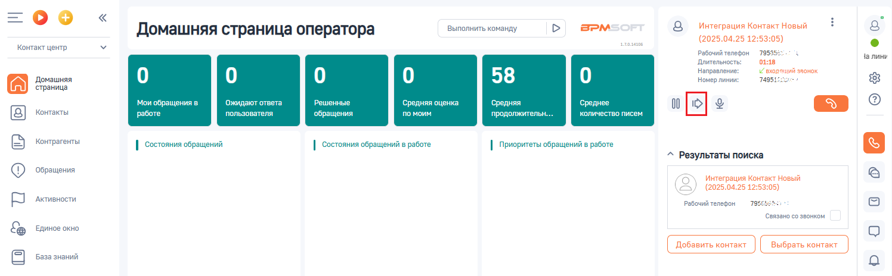
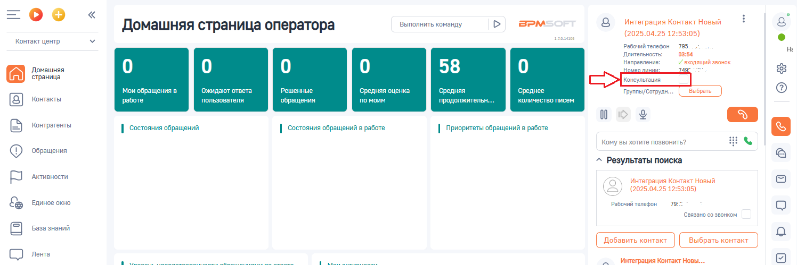
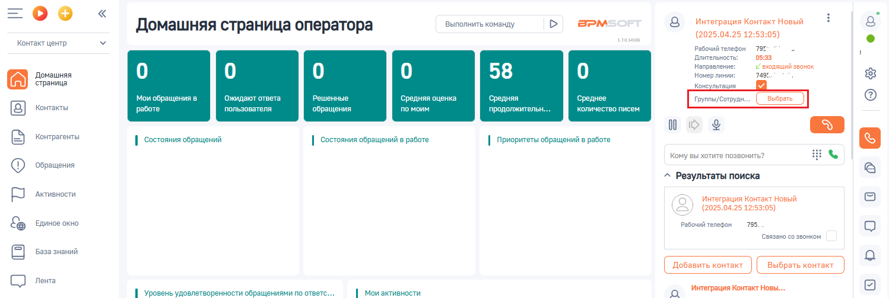
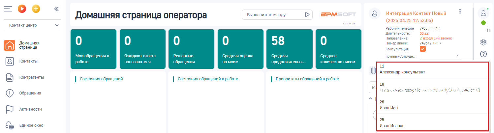
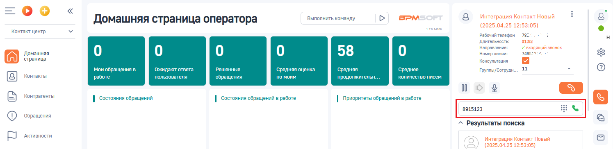
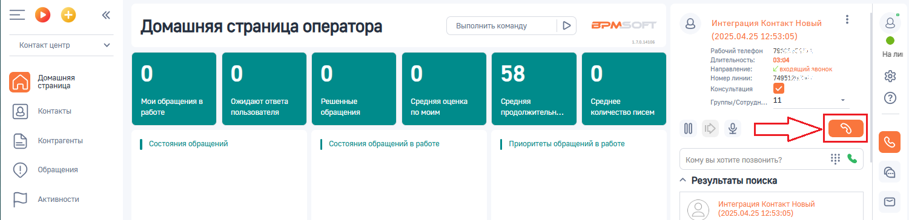

# Как перевести звонок с консультацией

> Трассировка: PDF §3.3 · сквозные стр. 83-86 · источники: ч.1 `kb/sources/integration-bpmsoft/Mango_office_integration_BPMSoft.pdf` с.83-86.

Чтобы перевести звонок с консультацией, в коммутационной панели BPMSoft следует:

> **Описание иллюстрации INTBPM-§3.3-1** (к §3.3 «Как перевести звонок с консультацией», стр. 83; 28×28 px). Пиктограмма (значок элемента интерфейса).
> Относится к тексту руководства: «…можно только при переводе с консультацией. Как перевести звонок с консультацией Чтобы перевести звонок с консультацией, в коммутационной панели BPMSoft следует:».
> Текста на изображении нет; назначение элемента — см. текст, к которому он относится.

1) нажать на кнопку ;

> **Описание иллюстрации INTBPM-§3.3-2** (к §3.3 «Как перевести звонок с консультацией», стр. 83; 1496×464 px). Снимок экрана / схема.
> Относится к тексту руководства: «…Как перевести звонок с консультацией Чтобы перевести звонок с консультацией, в коммутационной панели BPMSoft следует: 1) нажать на кнопку ;».
> Текст на изображении (OCR, требует сверки): Выполнить команду; BPM:; Интеграция Контакт Новый; Домашняя страница оператора; аля; (2025.04.25 12:!; Контакт центр; Рабочий телефон; 795%; Чалини; Длительность:; 10:18; Направление:; Г вхореший звонок; Домашняя; 58; Номер линии:; 7495;; страница; бращения в; ожидаю; тв; Решенные; дня; оценка; Cpe; ня; средне; Контакты; работе; ва; ля; обращения; по; им; про; жительн.; ич; тво пи; Контрагенты; | состояния обращений; | состояния обращений в работе; | Приоритеты обращений в работе; ^ Результаты поиска; ‘Обращения; (2025.04.25 12:53:05); ‘Активности; ес; ‘связано со звонком; Единое окно; База зн…

Руководство по интеграции АТС MANGO OFFICE и BPMSoft | Версия от 22.06.2026 2. активировать переключатель “Консультация”;

> **Описание иллюстрации INTBPM-§3.3-3** (к §3.3 «Как перевести звонок с консультацией», стр. 84; 1496×499 px). Снимок экрана / схема.
> Относится к тексту руководства: «…2. активировать переключатель “Консультация”;».
> Текст на изображении (OCR, требует сверки): Выполнить команду; BPM:; Интеграция Контакт Новый; Домашняя страница оператора; аля; (2025.04.25 12:!; Контакт центр; 795.; Рабочий телефон; Длительность:; 03:54; Направление:; Домашняя; 58; и входящий звонок; страница; твета; Решенные; ка; бращения в; ожидаю; дняя о; средняя; Среднее; Группы Сотруд:; Контакты; работе; польз; вателя; обращения; по моим; продолжительн.; Олич; тво пи; 00; Контрагенты; | состояния обращений; | состояния обращений в работе; | Приоритеты обращений в работе; 53 в; кому вы хотите позвонить?; ‘Обращения; ^ Результаты поиска; ‘Активности; (2025.04.25 12:53:05); Единое …

3. если нужно перевести звонок на сотрудника, которому выдан внутренний номер телефона ВАТС, то надо: • нажать на значение “ВЫБРАТЬ” напротив поля “Группы/Сотрудники”:

> **Описание иллюстрации INTBPM-§3.3-4** (к §3.3 «Как перевести звонок с консультацией», стр. 84; 1498×503 px). Снимок экрана / схема.
> Относится к тексту руководства: «… нужно перевести звонок на сотрудника, которому выдан внутренний номер телефона ВАТС, то надо: • нажать на значение “ВЫБРАТЬ” напротив поля “Группы/Сотрудники”:».
> Текст на изображении (OCR, требует сверки): BPM:; Интеграция Контакт Новый; Домашняя страница оператора; Выполнить команду; аля; (2025.04.25 12:53:05); Контакт центр; Рабочий телефон; 798; Длительность:; 05:33; Направление:; „Г входящий звонок; 749:; Домашняя; 58; Номер линии:; страница; Консультация; Мои обращения в; ожидают ответа; Решенные; средняя оценка; средняя; Среднее; Группы/ Сотрудь; Контакты; работе; ва; ля; обращения; по; им; про; жительн.; ич; тво пи; 00; Контрагенты; | состояния обращений; | состояния обращений в работе; | Приоритеты обращений в работе; 53 в; кому вы хотите позвонить?; ‘Обращения; ^ Результаты поиска; ‘Акт…

• кликните по полю “Группы/Сотрудники”. Появится выпадающий список ваших сотрудников, которые имеют внутренний номер телефона ВАТС и, на которых можно перевести звонок. Вам нужно выбрать номер сотрудника, на которого будет переведен звонок; Примечание. Начните печать номер телефона сотрудника, на которого надо перевести звонок, в поле “Группы/Сотрудники”. Будет показан список сотрудников, соответствующих введенному номеру.

> **Описание иллюстрации INTBPM-§3.3-5** (к §3.3 «Как перевести звонок с консультацией», стр. 84; 1498×404 px). Снимок экрана / схема.
> Относится к тексту руководства: «…ь номер телефона сотрудника, на которого надо перевести звонок, в поле “Группы/Сотрудники”. Будет показан список сотрудников, соответствующих введенному номеру.».
> Текст на изображении (OCR, требует сверки): Выполнить команду; BPM:; Интеграция Контакт Новый; Домашняя страница оператора; аля; (2025.04.25 12:53:05); Контакт центр; Рабочий телефон; 75; Длительность:; 00:; Направление:; Г входяший звонок; Домашняя; 58; Номер линии:; 74; страница; Консультация; ожидаю; Решенные; дня; ка; ня; бращения в; Среднее; Группы/Сотрудн.. |; Контакты; работе; польз; вателя; обращения; по моим; продолжительн.; kon; тво писем; 11; OO} Александр консультант; Контрагенты; | состояния обращений; | состояния обращений в работе; | Приоритеты обращений в работе; a (HEC ANE:; wr; ee; ‘Обращения; Иван Иан; ‘Активности; Ед…

Руководство по интеграции АТС MANGO OFFICE и BPMSoft | Версия от 22.06.2026 4) если нужно перевести звонок на произвольный номер телефона, то надо ввести произвольный номер в поле “Кому вы хотите позвонить”:

> **Описание иллюстрации INTBPM-§3.3-6** (к §3.3 «Как перевести звонок с консультацией», стр. 85; 1495×364 px). Снимок экрана / схема.
> Относится к тексту руководства: «…4) если нужно перевести звонок на произвольный номер телефона, то надо ввести произвольный номер в поле “Кому вы хотите позвонить”:».
> Текст на изображении (OCR, требует сверки): Выполнить команду; BPM:; Интеграция Контакт Новый; Домашняя страница оператора; аля; (2025.04.25 12:53:05); Контакт центр; Рабочий телефон; Длительность:; 01:; Направление:; „Г входящий звонок; 7498:; Домашняя; 58; Номер линии:; страница; Консультация; et; Мои обращения в; ожидают отве"; Решенные; средняя оценка; средняя; Среднее; Группы/Сотрудн...; Контакты; работе; ва; ля; обращения; им; жительн.; коли; тво писем; 00; Контрагенты; | состояния обращений; | состояния обращений в работе; | Приоритеты обращений в работе; ‘Обращения; ^ Результаты поиска; ‘Активности; ow

> **Описание иллюстрации INTBPM-§3.3-7** (к §3.3 «Как перевести звонок с консультацией», стр. 85; 62×36 px). Пиктограмма (значок элемента интерфейса).
> Относится к тексту руководства: «…4) если нужно перевести звонок на произвольный номер телефона, то надо ввести произвольный номер в поле “Кому вы хотите позвонить”:».
> Текста на изображении нет; назначение элемента — см. текст, к которому он относится.

5) нажмите на кнопку . Текущий звонок Клиента будет поставлен на удержание и начнется звонок выбранному сотруднику, либо на введенный произвольный номер.

> **Описание иллюстрации INTBPM-§3.3-8** (к §3.3 «Как перевести звонок с консультацией», стр. 85; 1501×364 px). Снимок экрана / схема.
> Относится к тексту руководства: «…нить”: 5) нажмите на кнопку . Текущий звонок Клиента будет поставлен на удержание и начнется звонок выбранному сотруднику, либо на введенный произвольный номер.».
> Текст на изображении (OCR, требует сверки): Выполнить команду; BPM:; Интеграция Контакт Новый; Домашняя страница оператора; аля; (2025.04.25 12:!; Контакт центр; Рабочий телефон; Ha nm; Длительность:; 034; Направление:; „Г входящий звонок; Домашняя; 58; Номер линии:; 749512; страница; Консультация; твета; Решенные; ка; et; ращения в; Ожида; яя OU; средняя; Среднее; Группы/Сотрудн.; [8] ктакы; работе; польз; ля; обращения; по моим; продолжительн.; kon; on; 00; С стриоть; | состояния обращений; | состояния обращений в работе; | Приоритеты обращений в работе; кому вы хотите позвонить?; Ф сени; ^ Результаты поиска; БР лее; (2025.04.25 12:53…

Как только вызываемый абонент снимет трубку, между вами будет установлено соединение. После разговора с абонентом, чтобы перевести звонок на выбранного сотрудника / введенный номер телефона, нужно нажать на ссылку “СОЕДИНИТЬ” в поле “Консультация”. Иначе, если абонент, на которого переводится звонок, не берет трубку или в процессе консультации вопрос был решен без необходимости перевода звонка, то можно отменить перевод. Для этого нужно нажать на ссылку “ВЕРНУТЬСЯ” в поле “Консультация”. Важно. Нажатие кнопки “Отбой” на коммутационной панели не приведет к переводу звонка. Руководство по интеграции АТС MANGO OFFICE и BPMSoft | Версия от 22.06.2026
