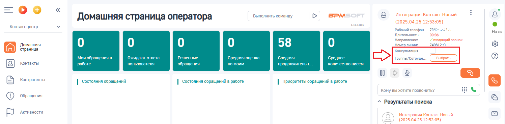
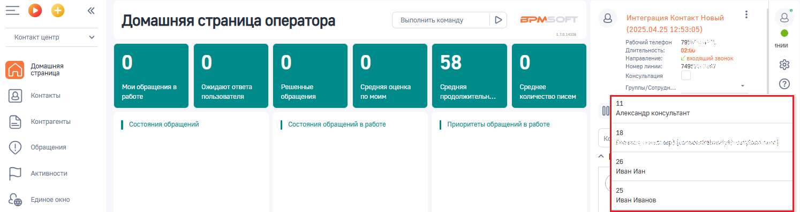
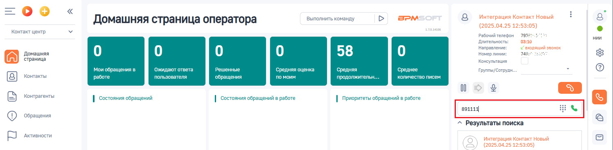
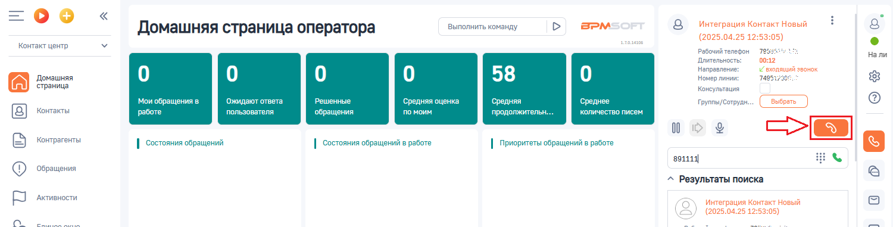

# Слепой перевод или как перевести звонок без консультации

> Трассировка: PDF §3.3 · сквозные стр. 86-88 · источники: ч.1 `kb/sources/integration-bpmsoft/Mango_office_integration_BPMSoft.pdf` с.86-88.

Чтобы выполнить слепой перевод звонка, то есть без предварительной консультации, в коммутационной панели BPMSoft следует:

> **Описание иллюстрации INTBPM-§3.3-1** (к §3.3 «Слепой перевод или как перевести звонок без консультации», стр. 86; 28×28 px). Пиктограмма (значок элемента интерфейса).
> Относится к тексту руководства: «… как перевести звонок без консультации Чтобы выполнить слепой перевод звонка, то есть без предварительной консультации, в коммутационной панели BPMSoft следует:».
> Текста на изображении нет; назначение элемента — см. текст, к которому он относится.

1. нажать на кнопку ;

> **Описание иллюстрации INTBPM-§3.3-2** (к §3.3 «Слепой перевод или как перевести звонок без консультации», стр. 86; 1496×464 px). Снимок экрана / схема.
> Относится к тексту руководства: «…без консультации Чтобы выполнить слепой перевод звонка, то есть без предварительной консультации, в коммутационной панели BPMSoft следует: 1. нажать на кнопку ;».
> Текст на изображении (OCR, требует сверки): Выполнить команду; BPM:; Интеграция Контакт Новый; Домашняя страница оператора; аля; (2025.04.25 12:!; Контакт центр; Рабочий телефон; 795%; Чалини; Длительность:; 10:18; Направление:; Г вхореший звонок; Домашняя; 58; Номер линии:; 7495;; страница; бращения в; ожидаю; тв; Решенные; дня; оценка; Cpe; ня; средне; Контакты; работе; ва; ля; обращения; по; им; про; жительн.; ич; тво пи; Контрагенты; | состояния обращений; | состояния обращений в работе; | Приоритеты обращений в работе; ^ Результаты поиска; ‘Обращения; (2025.04.25 12:53:05); ‘Активности; ес; ‘связано со звонком; Единое окно; База зн…

2) СНЯТЬ галочку “Консультация”, если она установлена; 3) если нужно перевести звонок на сотрудника, которому выдан внутренний номер телефона ВАТС, то надо: • нажать на значение “ВЫБРАТЬ” напротив поля “Группы/Сотрудники”:

> **Описание иллюстрации INTBPM-§3.3-3** (к §3.3 «Слепой перевод или как перевести звонок без консультации», стр. 86; 1497×370 px). Снимок экрана / схема.
> Относится к тексту руководства: «… нужно перевести звонок на сотрудника, которому выдан внутренний номер телефона ВАТС, то надо: • нажать на значение “ВЫБРАТЬ” напротив поля “Группы/Сотрудники”:».
> Текст на изображении (OCR, требует сверки): Выполнить команду; BPM:; Интеграция Контакт Новый; Домашняя страница оператора; аля; (2025.04.25 12:53:05); Контакт центр; 78; Рабочий телефон; He nw; Длительность:; 00:38; Направление:; „Г входящий звонок; Домашняя; 58; Номер линии,; 24; страница; Консультация; твета; Решенные; ка; бращения в; ожидаю; дняя о; средняя; Среднее; Группы/ Сотрудь; Контакты; работе; пол; вателя; ращения; по моим; продолжительн.; оличество пи; 00; Контрагенты; | состояния обращений; | состояния обращений в работе; | Приоритеты обращений в работе; 53 в; кому вы хотите позвонить?; ‘Обращения; ^ Результаты поиска; ‘Ак…

• кликните по полю “Группы/Сотрудники”. Появится выпадающий список ваших сотрудников, которые имеют внутренний номер телефона ВАТС и, на которых можно перевести звонок. Вам нужно выбрать номер сотрудника, на которого будет переведен звонок; Примечание. Начните печать номер телефона сотрудника, на которого надо перевести звонок, в поле “Группы/Сотрудники”. Будет показан список сотрудников, соответствующих введенному номеру.

> **Описание иллюстрации INTBPM-§3.3-4** (к §3.3 «Слепой перевод или как перевести звонок без консультации», стр. 86; 1494×397 px). Снимок экрана / схема.
> Относится к тексту руководства: «…ь номер телефона сотрудника, на которого надо перевести звонок, в поле “Группы/Сотрудники”. Будет показан список сотрудников, соответствующих введенному номеру.».
> Текст на изображении (OCR, требует сверки): Выполнить команду; BPM:; Интеграция Контакт Новый; Домашняя страница оператора; аля; (2025.04.25 12:53:05); Контакт центр; Рабочий телефон; 795; нии; Длительность:; 02:; Направление:; и влодяший звонок; Домашняя; 58; Номер линии:; 7498; страница; Консультация; Mo; Onna; Решенные; дняя о; ка; ня; бращения в; Среднее; Группы/Сотрудн...; Контакты; работе; польз; вателя; обращения; по моим; продолжительн.; количество писем; 11; Og; `Александр консультант; Контрагенты; | состояния обращений; | состояния обращений в работе; | Приоритеты обращений в работе; 18; ‘Обращения; 26; Иван Иан; ‘Активности; …

Руководство по интеграции АТС MANGO OFFICE и BPMSoft | Версия от 22.06.2026 3) если нужно перевести звонок на произвольный номер телефона, то надо ввести произвольный номер в поле “Кому вы хотите позвонить”:

> **Описание иллюстрации INTBPM-§3.3-5** (к §3.3 «Слепой перевод или как перевести звонок без консультации», стр. 87; 1498×368 px). Снимок экрана / схема.
> Относится к тексту руководства: «…3) если нужно перевести звонок на произвольный номер телефона, то надо ввести произвольный номер в поле “Кому вы хотите позвонить”:».
> Текст на изображении (OCR, требует сверки): Выполнить команду; BPM:; Интеграция Контакт Новый; Домашняя страница оператора; аля; (2025.04.25 12:53:05); Контакт центр; Рабочий телефон; 795; Длительность:; нии; Направление:; „Г входяший звонок; Домашняя; 58; Номер линии:; 743"; страница; Консультация; и обращения в; ожидают ответа; Решенные; едняя оценка; Средняя; Среднее; Группы/Сотрудн...; Контакты; работе; поль; ля; обращения; по моим; лжительн.; коли; пи; 00; Контрагенты; | состояния обращений; | состояния обращений в работе; | Приоритеты обращений в работе; ‘Обращения; ^ Результаты поиска; ‘Активности; ow

> **Описание иллюстрации INTBPM-§3.3-6** (к §3.3 «Слепой перевод или как перевести звонок без консультации», стр. 87; 62×36 px). Пиктограмма (значок элемента интерфейса).
> Относится к тексту руководства: «…3) если нужно перевести звонок на произвольный номер телефона, то надо ввести произвольный номер в поле “Кому вы хотите позвонить”:».
> Текста на изображении нет; назначение элемента — см. текст, к которому он относится.

4) нажмите на кнопку , см. рисунок ниже. Звонок немедленно переведется на выбранного сотрудника или введенный произвольный номер. Важно. Нажатие кнопки “Отбой” на коммутационной панели не приведет к переводу звонка.

> **Описание иллюстрации INTBPM-§3.3-7** (к §3.3 «Слепой перевод или как перевести звонок без консультации», стр. 87; 1500×381 px). Снимок экрана / схема.
> Относится к тексту руководства: «…нно переведется на выбранного сотрудника или введенный произвольный номер. Важно. Нажатие кнопки “Отбой” на коммутационной панели не приведет к переводу звонка.».
> Текст на изображении (OCR, требует сверки): Выполнить команду; BPM:; Интеграция Контакт Новый; Домашняя страница оператора; (2025.04.25 12:!; аля; Контакт центр; Рабочий телефон; те:; Длительность:; Нали; „Г входящий звонок; Направление:; Домашняя; 58; Номер линии:; 749; страница; Консультация; обращения в; Ожида; Решенные; дняя оценка; ня; Среднее; Группы/ Сотрудь; Контакты; работе; польз; теля; обращения; по моим; про; олжительн.; ‚количе; во писем; 00; Контрагенты; | состояния обращений; | состояния обращений в работе; | Приоритеты обращений в работе; зала; ‘Обращения; ^ Результаты поиска; ‘Активности; ow; (2025.04.25 12:53:05); rou;…

Руководство по интеграции АТС MANGO OFFICE и BPMSoft | Версия от 22.06.2026
