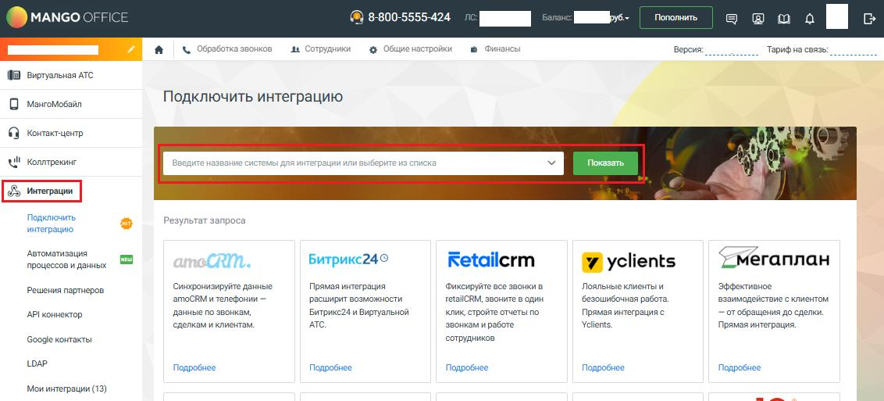
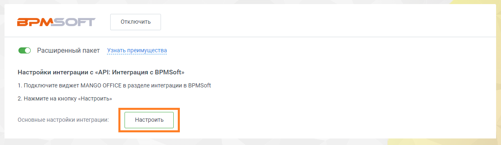

# Установка и базовые настройки

> Трассировка: PDF §1 · сквозные стр. 13-14 · источники: ч.1 `kb/sources/integration-bpmsoft/Mango_office_integration_BPMSoft.pdf` с.13-14.

Для того чтобы подключить приложение интеграции с BPMSoft, нужно выполнить: 1. войдите в ваш Личный кабинет MANGO OFFICE; 2. выберите вашу Виртуальную АТС, если у вас их несколько; 3. перейти в раздел “Интеграции”; 4. выполните одно из действий: – в блоке “BPMSoft” нажмите на кнопку “Подробнее”; – введите название интеграции BPMSoft в поле “Введите название системы для интеграции…” и нажмите кнопку “Показать”:

> **Описание иллюстрации INTBPM-§1-1** (к §1 «Установка и базовые настройки», стр. 13; 1132×513 px). Снимок экрана / схема.
> Относится к тексту руководства: «…ке “BPMSoft” нажмите на кнопку “Подробнее”; – введите название интеграции BPMSoft в поле “Введите название системы для интеграции…” и нажмите кнопку “Показать”:».
> Текст на изображении (OCR, требует сверки): МАМСО (; ) 8-800-5555-424; Пополнить; юшо М в; а | & O6na601; „в Сотрудники; & Общие настройки; @ Финансы; Версия:; Тарифна связь:; Brennan АТС; Подключить интеграцию; О Masrotosonn; We; опре; 08a); tt д; Ka; Показать; uA; `Интеграции; Подключить; Результат запр.; интеграцию; Автоматизация; процессов и данных; CRM.; Битрикс24©; Retailerm; <мегаплан; (И yclients; Синхронизируйте данные; Прямая интеграция; Фиксируйте ace звонки в; Лояльные клиентыи; эффективное; Решения партнеров; ‘amoCRM и телефонии —; расширит возможности; retallCRM, звоните в один; безошибочная работа.; взаимодействие с клиен…

5. на открывшейся странице “Подключить интеграцию”, нажмите на кнопку “Подключить”;

> **Описание иллюстрации INTBPM-§1-2** (к §1 «Установка и базовые настройки», стр. 13; 1244×588 px). Снимок экрана / схема.
> Относится к тексту руководства: «…поле “Введите название системы для интеграции…” и нажмите кнопку “Показать”: 5. на открывшейся странице “Подключить интеграцию”, нажмите на кнопку “Подключить”;».
> Текст на изображении (OCR, требует сверки): Подключить интеграцию; OF; По; aT; Bit!; aK; BPM:; Фиксация информации о вызовах, передача данных коллтрекинга и многое другое. Автоматизируйте рутинную работу и дополните информацию о клиентах в вашей CRM. При; подключении интеграции с Creatio вам станут доступны следующие функции:; Прием и совершение звонков; всплывающее окно звонка - при каждом звонке открывается всплывающее окно с данными клиента. В нем показаны последние 5 обращений, лидов или продаж. Контакт; автоматически создается при звонке от нового клиента.; История общения с клиентом — информация о каждом звонке фиксируется в истор…

Руководство по интеграции АТС MANGO OFFICE и BPMSoft | Версия от 22.06.2026 6. в открывшемся всплывающем окне с информацией о подключении нужно указать количество ваших сотрудников, которые будут пользоваться интеграцией с BPMSoft; Примечание. Параметры подключения могут отличаться в зависимости от тарифного плана вашей Виртуальной АТС. 7. нажать на кнопку “Сохранить”. Будет открыта страница “Мои интеграции” в Личном кабинете MANGO OFFICE; 8. нажать на кнопку “Настроить”. Вы перейдете к настройкам подключения к BPMSoft.

> **Описание иллюстрации INTBPM-§1-3** (к §1 «Установка и базовые настройки», стр. 14; 1223×355 px). Снимок экрана / схема.
> Относится к тексту руководства: «…нить”. Будет открыта страница “Мои интеграции” в Личном кабинете MANGO OFFICE; 8. нажать на кнопку “Настроить”. Вы перейдете к настройкам подключения к BPMSoft.».
> Текст на изображении (OCR, требует сверки): Е>М5оОРТ; ‘отключить; © Расширенный пакет; Настройки интеграции с «API: Интеграция с BPMSoft»; 1. Подключите виджет MANGO OFFICE в разделе интеграции в BPMSoft; 2. Нажмите на кнопку «Настроить»,; ‘Основные настройки интеграции:
