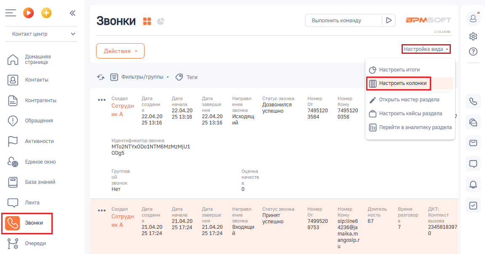
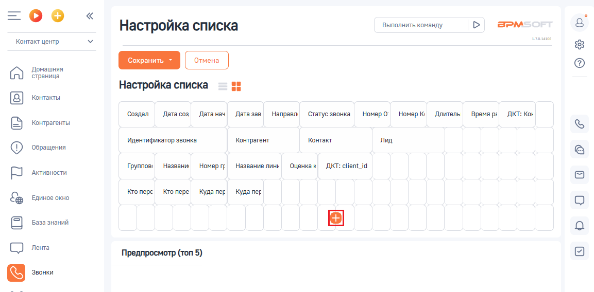
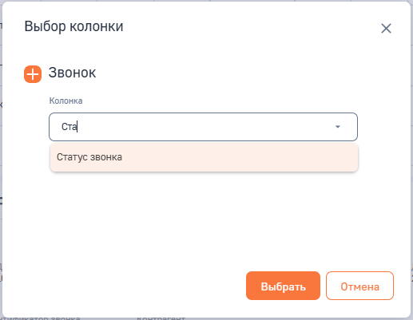
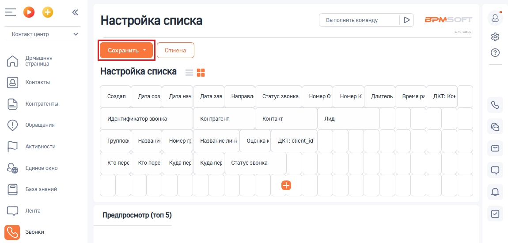

# 4.1. Настройка внешнего вида таблицы звонков

> Трассировка: PDF §4.1 · сквозные стр. 88-91 · источники: ч.1 `kb/sources/integration-bpmsoft/Mango_office_integration_BPMSoft.pdf` с.88-91.

Чтобы настроить внешний вид таблицы звонков, необходимо: 1) нажать на пункт “Контакт-центр” в раскрывающемся списке; 2) нажать на пункт “Звонки”; 3) нажать на ссылку “Настройка вида”; 4) в открывшемся списке выберите пункт “Настроить колонки”: Руководство по интеграции АТС MANGO OFFICE и BPMSoft | Версия от 22.06.2026

> **Описание иллюстрации INTBPM-§4.1-1** (к §4.1 «Настройка внешнего вида таблицы звонков», стр. 89; 1151×604 px). Снимок экрана / схема.
> Относится к тексту руководства: «…т-центр” в раскрывающемся списке; 2) нажать на пункт “Звонки”; 3) нажать на ссылку “Настройка вида”; 4) в открывшемся списке выберите пункт “Настроить колонки”:».
> Текст на изображении (OCR, требует сверки): =oO°o; Звонки :; Выполнить команду; BPM:; Контакт центр; таль; Настройка вида -; Домашняя; страница; (© настроить итоги; Контакты; Фильтры/группы - (9 Теги; oe; Создал; Дата; Направл; Статус звонка; Номер; Контрагенты; ‘создани; начала; заверше; ние; `Дозвонился; Кому; {открыть мастер раздела; Сотрудн; 22.04.20; ния; звонка; 7495120; икА; ‘успешно; (© настроить кейсы раздела; 2513:16; исходящ; 3584; 0358; ‘Обращения; 25 13:16; ий; (№) перейти в аналитику раздела; Активности.; `Идентификатор звонка; (MTo2NTYxODoANTM6MzMzMjUL; 0095; Единое окно; Группов,; Оценка; ой; качеств,; База знаний; звоно…

> **Описание иллюстрации INTBPM-§4.1-2** (к §4.1 «Настройка внешнего вида таблицы звонков», стр. 89; 29×29 px). Пиктограмма (значок элемента интерфейса).
> Относится к тексту руководства: «…т-центр” в раскрывающемся списке; 2) нажать на пункт “Звонки”; 3) нажать на ссылку “Настройка вида”; 4) в открывшемся списке выберите пункт “Настроить колонки”:».
> Текста на изображении нет; назначение элемента — см. текст, к которому он относится.

4) нажать на кнопку на открывшейся странице “Настройка списка”:

> **Описание иллюстрации INTBPM-§4.1-3** (к §4.1 «Настройка внешнего вида таблицы звонков», стр. 89; 1153×568 px). Снимок экрана / схема.
> Относится к тексту руководства: «…4) нажать на кнопку на открывшейся странице “Настройка списка”:».
> Текст на изображении (OCR, требует сверки): Выполнить команду; BPM:; Настройка списка; rouse; Контакт центр; Домашняя; страница; Контакты; Создал Датасоз fara нач; Дата зав.; 'Направл — Статус звонка; Номеро’ Номерю Длитель; Время pe; ДКТ: Kor; Контрагенты; Идентификатор звонка; Контрагент; Контакт; лид; ‘Обращения; Группов; 'Названи,; Homep rp; Название линь; ‘Оценка к; ДКТ: client_id; Активности.; Кто пере| Кто пере; Куда пер; kyna ner; Единое окно; База знаний; СО ле; Предпросмотр (топ 5)

5) в открывшемся окне “Выбор колонки” в поле “Колонка” ввести “Статус звонка”. Будет показан выпадающий список из названий колонок, в котором нужно кликнуть на значение “Статус звонка”; 6) нажать на кнопку “Выбрать”:

> **Описание иллюстрации INTBPM-§4.1-4** (к §4.1 «Настройка внешнего вида таблицы звонков», стр. 89; 517×401 px). Снимок экрана / схема.
> Относится к тексту руководства: «…вести “Статус звонка”. Будет показан выпадающий список из названий колонок, в котором нужно кликнуть на значение “Статус звонка”; 6) нажать на кнопку “Выбрать”:».
> Текст на изображении (OCR, требует сверки): Выбор колонки; Звонок; Колонка; Статус звонка

Руководство по интеграции АТС MANGO OFFICE и BPMSoft | Версия от 22.06.2026 Будет закрыто окно “Выбор колонки” и снова открыто окно “Настройка списка”, в котором нужно нажать кнопку “Сохранить”:

> **Описание иллюстрации INTBPM-§4.1-5** (к §4.1 «Настройка внешнего вида таблицы звонков», стр. 90; 1150×552 px). Снимок экрана / схема.
> Относится к тексту руководства: «…Будет закрыто окно “Выбор колонки” и снова открыто окно “Настройка списка”, в котором нужно нажать кнопку “Сохранить”:».
> Текст на изображении (OCR, требует сверки): =oO°o; Настройка списка; Выполнить команду; BPM:; Контакт центр; Домашняя; страница; Контакты; Создал Датасоз fara нач; Дата зав.; 'Направл — Статус звонка; Номеро’ Номерю Длитель; Время pe; ДКТ: Kor; Контрагенты; Идентификатор звонка; Контрагент; Контакт; лид; ‘Обращения; Группов; 'Названи,; Homep rp; Название линь; ‘Оценка к; дкт:; Активности.; Кто пере| Кто пере; Куда пер; kyna ner; Статус звонка; Единое окно; База знаний; СО ле; Предпросмотр (топ 5)

Руководство по интеграции АТС MANGO OFFICE и BPMSoft | Версия от 22.06.2026
