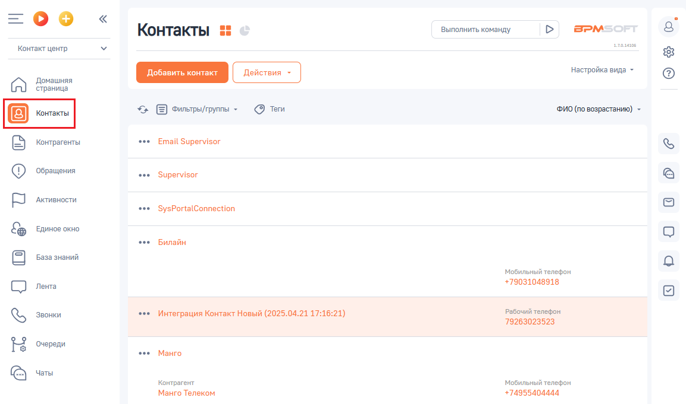
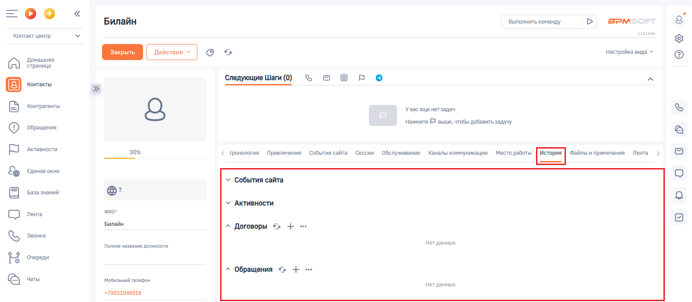

# 5. История вызовов

> Трассировка: PDF §5 · сквозные стр. 91-92 · источники: ч.1 `kb/sources/integration-bpmsoft/Mango_office_integration_BPMSoft.pdf` с.91-92.

Каждый звонок от контакта отображается в истории взаимоотношений с контактом. Чтобы открыть эту историю, необходимо нажать на пункт “Контакты”. Будет открыт список ваших контактов:

> **Описание иллюстрации INTBPM-§5-1** (к §5 «История вызовов», стр. 91; 1153×681 px). Снимок экрана / схема.
> Относится к тексту руководства: «…такта отображается в истории взаимоотношений с контактом. Чтобы открыть эту историю, необходимо нажать на пункт “Контакты”. Будет открыт список ваших контактов:».
> Текст на изображении (OCR, требует сверки): оо; Выполнить команду; BPM:; Контакты; алан; Контакт центр; настройка вида -; Домашняя; страница; Е Фильтры/группы -; @ tem; ФИО (по возрастанию) -; Контрагенты; Email Supervisor; ‘Обращения; oe; Supervisor; Активности.; ‘SysPortalConnection; Единое окно; Билайн; База знаний; мобильный телефон; +79031048918; Лента; Звонки; ae; Интеграция Контакт Новый (2025.04.21 17:16:21); Рабочий телефон; 79263023523; Очереди; "Манго; © vers; Контрагент.; Манго Телеком; +74955404444

Чтобы посмотреть взаимодействия с выбранным контактом дважды нажмите на нужный вам контакт. В открывшейся карточке контакта нажать на вкладку “История”. Будет отображена история взаимодействия с выбранным контактом:

> **Описание иллюстрации INTBPM-§5-2** (к §5 «История вызовов», стр. 91; 1553×679 px). Снимок экрана / схема.
> Относится к тексту руководства: «…отображена история взаимодействия с выбранным контактом:».
> Текст на изображении (OCR, требует сверки): =oO°o; BPM:; Билайн; Выполнить команду; ease; Контакт центр; га; настройка вида -; Домашняя; страница; ‘Следующие Шаги (0); ъовро; Контакты; Контрагенты; Увас еще нет задач; Нажмите © выше, чтобы добавить задачу; ‘Обращения; Активности.; 30%; фонология Привлечение События сайта Сессии Обслуживание Каналы коммуникации р ыы Лента; Единое окно; ‘События сайта.; База знаний; Фио-; Лента; Звонки; Полное название должности; Нет данных; Очереди; © vers; Мобильный телефон; +79031048918

Руководство по интеграции АТС MANGO OFFICE и BPMSoft | Версия от 22.06.2026
