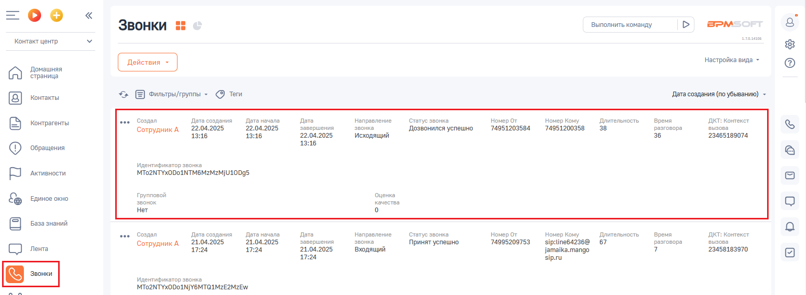
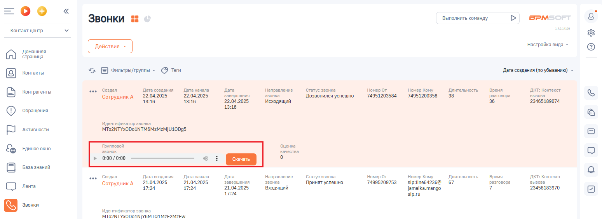

# 6. Запись разговоров

> Трассировка: PDF §6 · сквозные стр. 92-93 · источники: ч.1 `kb/sources/integration-bpmsoft/Mango_office_integration_BPMSoft.pdf` с.92-93.

Если в Виртуальной АТС подключена услуга записи разговоров, то при наличии записи разговора - ее можно прослушать и/или скачать в BPMSoft. Примечания: 1) запись разговора может отобразиться в карточке звонка с небольшой задержкой. 2) если длительность разговора менее 6 сек, то запись разговора не сохранится в Виртуальной АТС и соответственно ссылка на нее не отобразится в BPMSoft. Если в ходе обработки вызова, сотрудники переводили его на других сотрудников, то в BPMSoft будет сохранены все записи разговоров с клиентом с каждым из сотрудников; Чтобы перейти к записи разговора, необходимо: 1. нажать на пункт “Звонки”; 2. нажать на строку с данными разговора. Будут отображены дополнительные элементы интерфейса;

> **Описание иллюстрации INTBPM-§6-1** (к §6 «Запись разговоров», стр. 92; 1553×570 px). Снимок экрана / схема.
> Относится к тексту руководства: «…с данными разговора. Будут отображены дополнительные элементы интерфейса;».
> Текст на изображении (OCR, требует сверки): BPM:; Звонки 55; Выполнить команду; алая; Контакт центр; настройка вида -; Домашняя; страница; Контакты; ‘Фильтрыйтруппы ~ Tew; `Дата создания (no убыванию) -; Контрагенты; Создал; Дата создания; Дата начала; Дата; Направление; Статус звонка; "Номер от; Номер Кому; Длительность,; Время; OKT: Контекст; Сотрудник А; 22.04.2025; завершения; звонка; Дозвонился успешно; 74951203584; 74951200358; 38; разговора; вызова; 32.04.2025; 13:16; Исходящий; 36; 23465189074; ‘Обращения; Идентификатор звонка; Активности.; МТО2МТУХО0О1МТМ6М2М2М]10095; Единое окно; Групповой; Оценка; звонок; качества; Нет; База …

3. кнопки “Открыть”, “Удалить”;

> **Описание иллюстрации INTBPM-§6-2** (к §6 «Запись разговоров», стр. 92; 15×17 px). Пиктограмма (значок элемента интерфейса).
> Относится к тексту руководства: «…разговора. Будут отображены дополнительные элементы интерфейса; 3. кнопки “Открыть”, “Удалить”;».
> Текста на изображении нет; назначение элемента — см. текст, к которому он относится.

4. чтобы прослушать запись, нужно нажать на кнопку , а чтобы скачать

> **Описание иллюстрации INTBPM-§6-3** (к §6 «Запись разговоров», стр. 92; 84×37 px). Фрагмент интерфейса (кнопка, переключатель или поле).
> Относится к тексту руководства: «…дополнительные элементы интерфейса; 3. кнопки “Открыть”, “Удалить”; 4. чтобы прослушать запись, нужно нажать на кнопку , а чтобы скачать».
> Текста на изображении нет; назначение элемента — см. текст, к которому он относится.

запись – нажать на кнопку “Скачать” :

> **Описание иллюстрации INTBPM-§6-4** (к §6 «Запись разговоров», стр. 92; 1549×564 px). Снимок экрана / схема.
> Относится к тексту руководства: «…кнопки “Открыть”, “Удалить”; 4. чтобы прослушать запись, нужно нажать на кнопку , а чтобы скачать запись – нажать на кнопку “Скачать” :».
> Текст на изображении (OCR, требует сверки): =oO°o; Звонки 55; Выполнить команду; BPM:; алан; Контакт центр; настройка вида -; Домашняя; страница; Контакты; ‘Фильтрыйтруппы ~ Tew; `Дата создания (no убыванию) -; ae; Создал; "Дата создания; "Дата начала; Дата; Направление; ‘Статус звонка; Homep Or; Номер Кому; Длительность,; Время; OKT: Контекст; Контрагенты; 22.04.2025; завершения; ‘звонка; 74951203584; 74951200358; 38; разговора; вызова; Сотрудник A; Дозвонился успешно; Belscie; 13:16; Исходящий; 36; 23465189074; ‘Обращения; `Идентификатор звонка; Активности.; (MTo2NTYxODo1NTM6MzMzMJU10Dg5; Групповой; Оценка; Единое окно; звонок; качест…

Руководство по интеграции АТС MANGO OFFICE и BPMSoft | Версия от 22.06.2026
