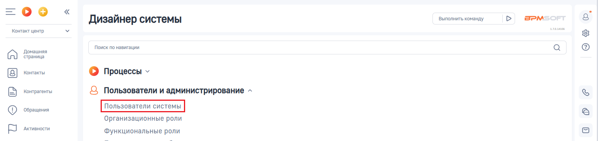
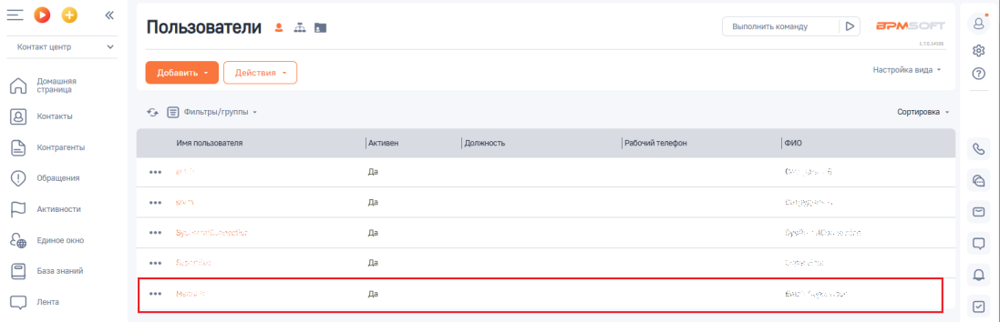
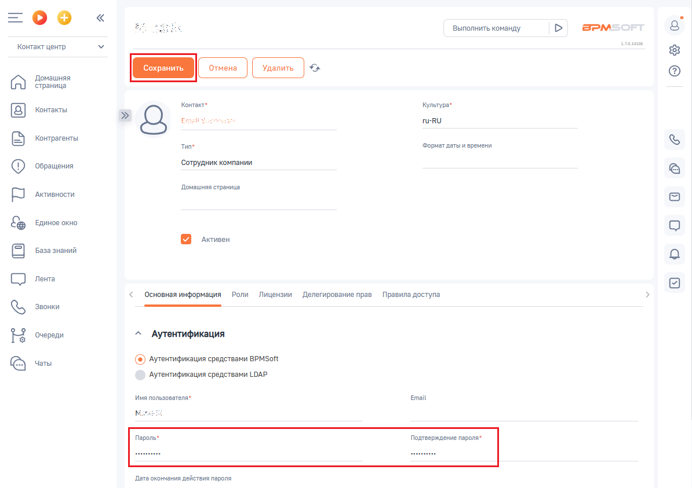

# Как изменить логин и пароль API BPMSoft

> Трассировка: PDF §— · сквозные стр. 93-95 · источники: ч.1 `kb/sources/integration-bpmsoft/Mango_office_integration_BPMSoft.pdf` с.93-95.

Логин и пароль API BPMSoft – это логин и пароль пользователя BPMSoft, который необходим для настройки интеграции в Личном кабинете MANGO OFFICE. Чтобы изменить логин или пароль API BPMSoft, необходимо: 1) войдите в ваш BPMSoft;

> **Описание иллюстрации INTBPM-§—-1** (к §— «Как изменить логин и пароль API BPMSoft», стр. 93; 38×38 px). Пиктограмма (значок элемента интерфейса).
> Относится к тексту руководства: «…t, который необходим для настройки интеграции в Личном кабинете MANGO OFFICE. Чтобы изменить логин или пароль API BPMSoft, необходимо: 1) войдите в ваш BPMSoft;».
> Текста на изображении нет; назначение элемента — см. текст, к которому он относится.

2) нажать на кнопку ; 3) выбрать пункт “Открыть дизайнер системы”:

> **Описание иллюстрации INTBPM-§—-2** (к §— «Как изменить логин и пароль API BPMSoft», стр. 93; 365×331 px). Снимок экрана / схема.
> Относится к тексту руководства: «…войдите в ваш BPMSoft; 2) нажать на кнопку ; 3) выбрать пункт “Открыть дизайнер системы”:».
> Текст на изображении (OCR, требует сверки): нить все; Настроить страницу; Открыть дизайнер системы

4) на открывшейся странице нажать на ссылку “Пользователи системы”;

> **Описание иллюстрации INTBPM-§—-3** (к §— «Как изменить логин и пароль API BPMSoft», стр. 93; 1557×368 px). Снимок экрана / схема.
> Относится к тексту руководства: «…2) нажать на кнопку ; 3) выбрать пункт “Открыть дизайнер системы”: 4) на открывшейся странице нажать на ссылку “Пользователи системы”;».
> Текст на изображении (OCR, требует сверки): Выполнить команду; BPM:; Дизайнер системы; Контакт центр; Домашняя; Поиск по навигации; страница; Контакты; © Процессы у; Контрагенты; Q Пользователи и администрирование ^; ‘Обращения; Организационные роли; Активности.; Функциональные роли

5) найдите строку с данными пользователя BPMSoft, чей логин и пароль будет использован для настройки интеграции в Личном кабинете MANGO OFFICE. Примечание. При необходимости используйте фильтры для поиска, нажав на кнопку “Фильтры”. 6. чтобы изменить пароль, дважды нажмите на строку с данными нужного вам пользователя;

> **Описание иллюстрации INTBPM-§—-4** (к §— «Как изменить логин и пароль API BPMSoft», стр. 93; 1097×354 px). Снимок экрана / схема.
> Относится к тексту руководства: «… необходимости используйте фильтры для поиска, нажав на кнопку “Фильтры”. 6. чтобы изменить пароль, дважды нажмите на строку с данными нужного вам пользователя;».
> Текст на изображении (OCR, требует сверки): =oo; Пользователи = 2. т; | выполнитьоманду; > а>маот; Koyo wore; ce; "настройка enna -; Го); Erp; <> В ownepayrpynna -; Copmpaea -; [8] Kora; Актив; Exe окно; в Ао; Saas nah; пез; be

Руководство по интеграции АТС MANGO OFFICE и BPMSoft | Версия от 22.06.2026 6) на вкладке “Основная информация” в поле “Имя пользователя” будет указан логин API BPMSoft, а в поле “Пароль” – указан пароль API BPMSoft. 7) При необходимости, изменить пароль API BPMSoft, затем нажмите кнопку “Сохранить”. Данные логин и пароль API BPMSoft нужно использовать для настройки интеграции в Личном кабинете MANGO OFFICE.

> **Описание иллюстрации INTBPM-§—-5** (к §— «Как изменить логин и пароль API BPMSoft», стр. 94; 1194×843 px). Снимок экрана / схема.
> Относится к тексту руководства: «…оль API BPMSoft, затем нажмите кнопку “Сохранить”. Данные логин и пароль API BPMSoft нужно использовать для настройки интеграции в Личном кабинете MANGO OFFICE.».
> Текст на изображении (OCR, требует сверки): Выполнить команду; BPM:; Контакт центр; алая; oe; Домашняя; страница; Контакт"; Культура"; Контакты; ий; ru-RU; ze!; Контрагенты; ‘Тип; ‘Формат даты и времени; ‘Обращения; Сотрудник компании; Домашняя страница; Активности.; Единое окно; Активен; СО ль; Основная информация; Роли; Лицензии; Делегирование прав; Правила доступа; Qe зи; Очереди; Аутентификация; (©) Аутентификация средствами BPMSott; © vers; ‘Аутентификация средствами LDAP; имя пользователя"; Email; Mone; Пароль“; Подтверждение пароля"; Дата окончания действия пароля

Руководство по интеграции АТС MANGO OFFICE и BPMSoft | Версия от 22.06.2026
