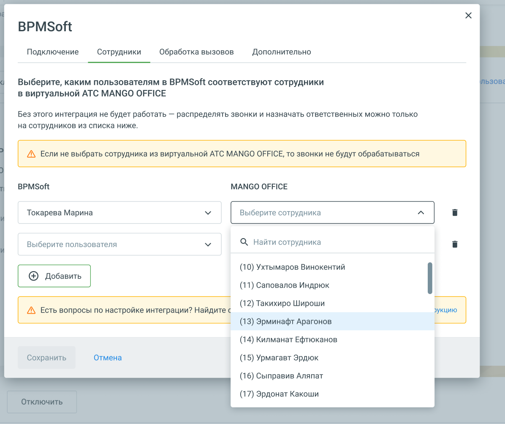
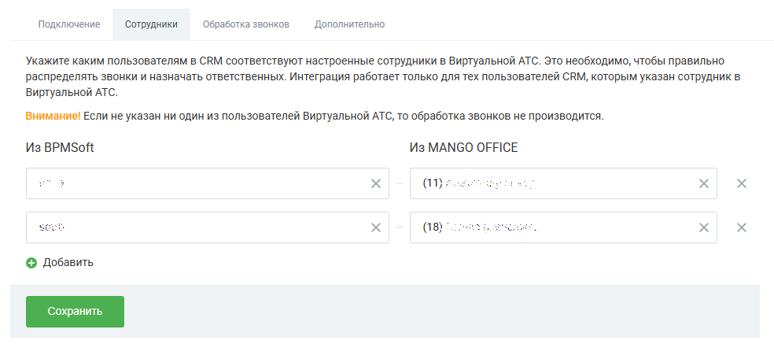

# Как настроить сопоставление сотрудников

> Трассировка: PDF §1 · сквозные стр. 18-20 · источники: ч.1 `kb/sources/integration-bpmsoft/Mango_office_integration_BPMSoft.pdf` с.18-20.

На вкладке “Сотрудники” необходимо: 1. нажмите на кнопку “Добавить”. Будут показаны поля для выбора сотрудников Виртуальной АТС и BPMSoft;

> **Описание иллюстрации INTBPM-§1-1** (к §1 «Как настроить сопоставление сотрудников», стр. 18; 1196×1004 px). Снимок экрана / схема.
> Относится к тексту руководства: «…ставление сотрудников На вкладке “Сотрудники” необходимо: 1. нажмите на кнопку “Добавить”. Будут показаны поля для выбора сотрудников Виртуальной АТС и BPMSoft;».
> Текст на изображении (OCR, требует сверки): BPMSoft; Подключение; Сотрудники; Обработка вызовов; Дополнительно; Выберите, каким пользователям в ВРМ$ой соответствуют сотрудники; в виртуальной ATC MANGO OFFICE; Без этого интеграция не будет работать — распределять звонки и назначать ответственных можно только; на сотрудников из списка ниже.; А Если не выбрать сотрудника из виртуальной ATC MANGO OFFICE, то звонки не будут обрабатываться; MANGO OFFICE; Токарева Марина; Выберите сотрудника; Выберите пользователя; Q Найти сотрудника; (10) Ухтымаров Винокентий; ® добавить; (11) Саповалов Индрюк; (12) Такихиро Широши; А Есть вопросы по настройк…

2. выберите сотрудника BPMSoft и выберите соответствующего ему сотрудника Виртуальной АТС; 3. настройте сопоставление для всех сотрудников, которые будут пользоваться интеграцией; 4. нажмите кнопку “Сохранить”. Примечание. Вкладки “Сотрудники” и “Обработка звонков” доступны после успешного подключения к BPMSoft. Руководство по интеграции АТС MANGO OFFICE и BPMSoft | Версия от 22.06.2026

> **Описание иллюстрации INTBPM-§1-2** (к §1 «Как настроить сопоставление сотрудников», стр. 19; 984×437 px). Снимок экрана / схема.
> Относится к тексту руководства: «…которые будут пользоваться интеграцией; 4. нажмите кнопку “Сохранить”. Примечание. Вкладки “Сотрудники” и “Обработка звонков” доступны после».
> Текст на изображении (OCR, требует сверки): Подключение; ‘Сотрудники; Обработка звонков; Дополнительно; Укажите каким пользователям в CRM соответствуют настроенные сотрудники в Виртуальной АТС. Это необходимо, чтобы правильно; распределять звонки и назначать ответственных. Интеграция работает только для тех пользователей CRM, которым указан сотрудник в.; Виртуальной ATC.; Внимание! Если He указан ни один из пользователей Виртуальной ATC, то обработка звонков не производится.; Из BPMSoft; Из MANGO OFFICE; (nye; © добавить

В зависимости от ваших задач следует установить дополнительные настройки интеграции. Руководство по интеграции АТС MANGO OFFICE и BPMSoft | Версия от 22.06.2026
