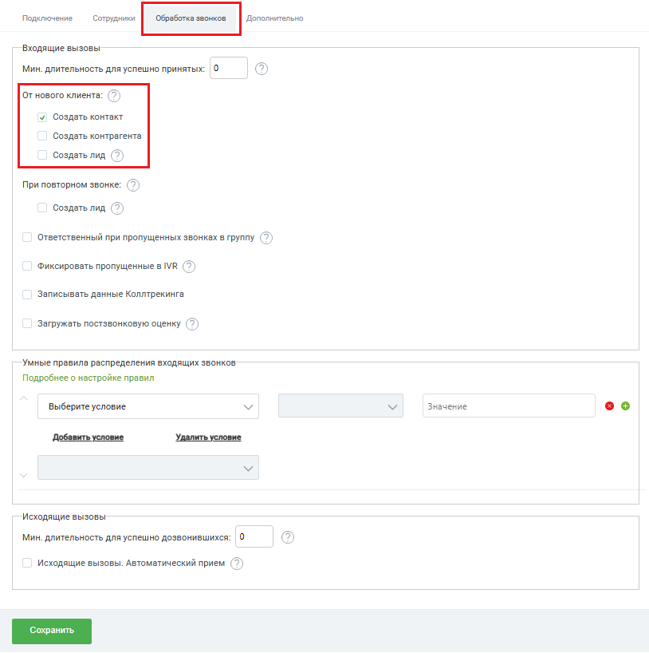

# Создавать контакт / контрагента / лид при звонках с новых номеров

> Трассировка: PDF §2.1 · сквозные стр. 22-24 · источники: ч.1 `kb/sources/integration-bpmsoft/Mango_office_integration_BPMSoft.pdf` с.22-24.

В поле “От нового клиента” вы можете выбрать способ обработки звонка с нового номера, который еще не сохранен в BPMSoft. Доступен множественный выбор: • Создать контакт; • Создать контрагента; • Создать лид. При выборе нескольких значений будут автоматически создаваться выбранные сущности. Например, если вы выбрали пункты “Создавать контакт” и “Создавать контрагента”, то для каждого принятого входящего звонка с нового номера телефона будет создан новый контакт и новый контрагент. А также, в созданной сущности сохранится номер телефона, с которого вам звонили.

> **Описание иллюстрации INTBPM-§2.1-1** (к §2.1 «Создавать контакт / контрагента / лид при звонках с новых номеров», стр. 22; 814×818 px). Снимок экрана / схема.
> Относится к тексту руководства: «… звонка с нового номера телефона будет создан новый контакт и новый контрагент. А также, в созданной сущности сохранится номер телефона, с которого вам звонили.».
> Текст на изображении (OCR, требует сверки): речные Сорри Aonansens; Входящие вызовы; Мин. длительность для успешно принятых:; Ot нового клиента: (7); У Создать контакт; Создать контрагента; Создать лид (>); При повторном звонке: (; Ответственный при пропущенных звонках в группу (7); Фиксировать пропущенные в IVR [© ); Записывать данные Коллтрекинга; Загружать постзвонковую оценку; Умные правила распределения входящих звонков; Подробнее о настройке правил; Выберите условие; Значение; оо; Добавить условие; Удалить условие; Исходящие вызовы; Мин. длительность для успешно дозвонившихся: |0; Исходящие вызовы. Автоматический прием (>)

Руководство по интеграции АТС MANGO OFFICE и BPMSoft | Версия от 22.06.2026 При выборе значения “Создавать лид” появляется возможность настроить тип потребности клиента и стадию лида, которая будет установлена для создаваемого лида в BPMSoft: • в выпадающих списках “Тип потребности для принятых” и “Тип потребности для пропущенных” вы можете выбрать тип потребности, на основании которого лид будет создан в BPMSoft; • в выпадающих списках “Этап для принятых” и “Этап для пропущенных” вы можете выбрать стадию, которая будет установлена для лида при принятом или пропущенном звонке. Примечание. В интерфейсе BPMSoft используются поля “Этап для принятых” и “Этап для пропущенных”. Под этапом в данном случае подразумевается стадия лида. Чтобы сохранить настройки, нужно нажать кнопку “Сохранить” внизу окна “Основные настройки интеграции”.

> **Описание иллюстрации INTBPM-§2.1-2** (к §2.1 «Создавать контакт / контрагента / лид при звонках с новых номеров», стр. 23; 855×993 px). Снимок экрана / схема.
> Относится к тексту руководства: «…. Под этапом в данном случае подразумевается стадия лида. Чтобы сохранить настройки, нужно нажать кнопку “Сохранить” внизу окна “Основные настройки интеграции”.».
> Текст на изображении (OCR, требует сверки): Подключение; Сотрудники; Обработка звонков; Дополнительно; Входящие вызовы; Мин. длительность для успешно принятых: |0; От нового клиента: [© ); Создать контакт; Создать контрагента; У! Создать лид Q; Этап для лидов; Тип потребности для принятых; Тип потребности для пропущенных; Этап для принятых; Этап для пропущенных; При повторном звонке: [© ); Создать лид (7 2 ); Ответственный при пропущенных звонках в группу (' 2); Фиксировать пропущенные в МВ ( 2 ); Записывать данные Коллтрекинга; Загружать постзвонковую оценку [© ); Умные правила распределения входящих звонков; Подробнее о настройке прав…

Руководство по интеграции АТС MANGO OFFICE и BPMSoft | Версия от 22.06.2026
