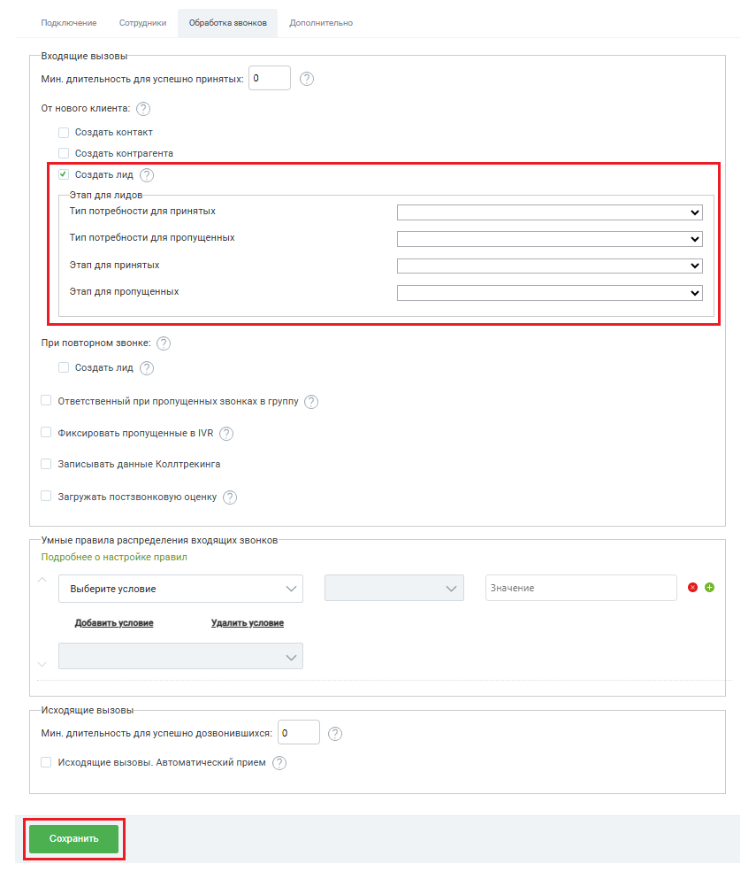

# Ответственный при пропущенных звонках в группу

> Трассировка: PDF §2.1 · сквозные стр. 24-25 · источники: ч.1 `kb/sources/integration-bpmsoft/Mango_office_integration_BPMSoft.pdf` с.24-25.

Если включен флаг “Ответственный при пропущенных звонках в группу” и включена опция создания контакта / контрагента / лида, то при каждом звонке с нового номера телефона, распределенном в любую группу ВАТС и пропущенном, в BPMSoft создается контакт / контрагент / лид, в котором указывается ответственный сотрудник. Если флаг выключен, в контакте / контрагенте / лиде в качестве ответственного сотрудника будет указан тот сотрудник, на которого распределился вызов. Чтобы назначить ответственного при пропущенных на группу, в окне “Основные настройки интеграции” следует: 1) включить флаг “Ответственный при пропущенных звонках в группу”; 2) выбрать ответственного сотрудника. Важно! Вы можете указать ответственным только тех сотрудников, у которых есть внутренний номер Виртуальной АТС, связанный с вашим аккаунтом BPMSoft. 3) нажать на кнопку “Сохранить” внизу окна “Основные настройки интеграции”:

> **Описание иллюстрации INTBPM-§2.1-1** (к §2.1 «Ответственный при пропущенных звонках в группу», стр. 24; 855×993 px). Снимок экрана / схема.
> Относится к тексту руководства: «… которых есть внутренний номер Виртуальной АТС, связанный с вашим аккаунтом BPMSoft. 3) нажать на кнопку “Сохранить” внизу окна “Основные настройки интеграции”:».
> Текст на изображении (OCR, требует сверки): Подключение; Сотрудники; Обработка звонков; Дополнительно; Входящие вызовы; Мин. длительность для успешно принятых: |0; От нового клиента: [© ); Создать контакт; Создать контрагента; У! Создать лид Q; Этап для лидов; Тип потребности для принятых; Тип потребности для пропущенных; Этап для принятых; Этап для пропущенных; При повторном звонке: [© ); Создать лид (7 2 ); Ответственный при пропущенных звонках в группу (' 2); Фиксировать пропущенные в МВ ( 2 ); Записывать данные Коллтрекинга; Загружать постзвонковую оценку [© ); Умные правила распределения входящих звонков; Подробнее о настройке прав…

Руководство по интеграции АТС MANGO OFFICE и BPMSoft | Версия от 22.06.2026
