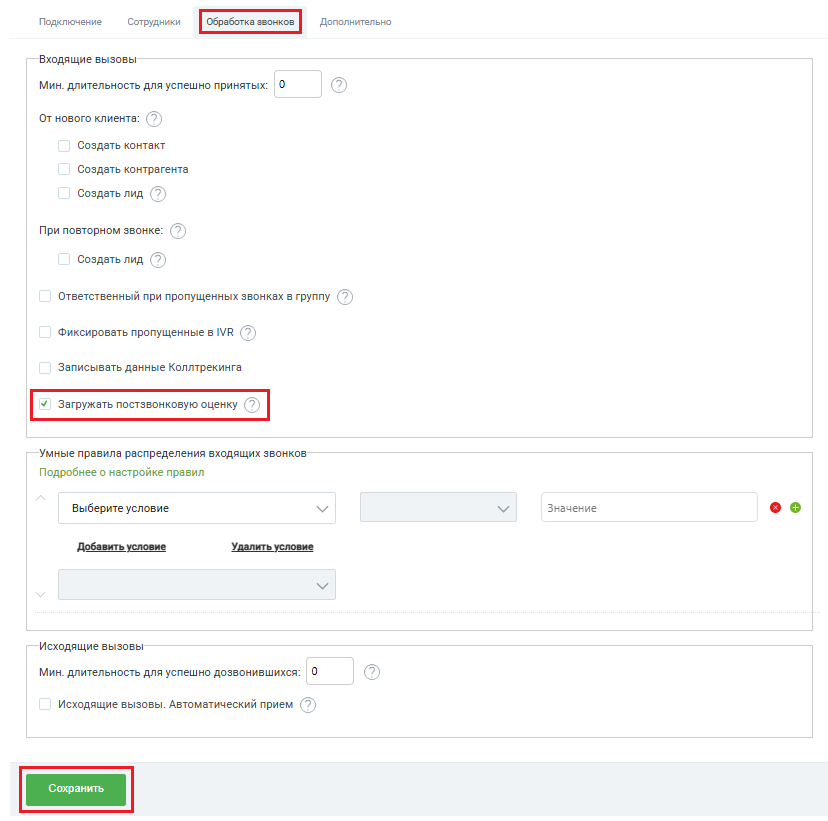

# Как подключить

> Трассировка: PDF §2.1 · сквозные стр. 26-27 · источники: ч.1 `kb/sources/integration-bpmsoft/Mango_office_integration_BPMSoft.pdf` с.26-27.

Чтобы включить передачу постзвонковой оценки в вашей BPMSoft, в основных настройках интеграции необходимо: 1) открыть закладку “Обработка звонков”; 2) активировать переключатель “Загружать постзвонковую оценку”; 3) нажать кнопку “Сохранить”: Руководство по интеграции АТС MANGO OFFICE и BPMSoft | Версия от 22.06.2026

> **Описание иллюстрации INTBPM-§2.1-1** (к §2.1 «Как подключить», стр. 27; 828×821 px). Снимок экрана / схема.
> Относится к тексту руководства: «…1) открыть закладку “Обработка звонков”; 2) активировать переключатель “Загружать постзвонковую оценку”; 3) нажать кнопку “Сохранить”:».
> Текст на изображении (OCR, требует сверки): Подключение; Сотрудники; Дополнительно; Входящие вызовы; Мин. длительность для успешно принятых:; OT нового клиента: (>); Создать контакт; Создать контрагента; Создать лид; При повторном звонке:; Ответственный при пропущенных звонках в группу (7); Фиксировать пропущенные в IVR; Записывать данные Коллтрекинга; Умные правила распределения входящих звонков; Подробнее о настройке правил; Выберите условие; Значение; оо; Добавить условие; Удалить условие; Исходящие вызовы; Мин. длительность для успешно дозвонившихся: |0; Исходящие вызовы. Автоматический прием
