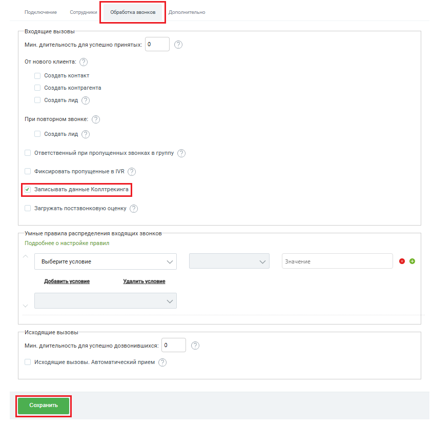

# Как включить или выключить сохранение данных коллтрекинга

> Трассировка: PDF §2.2 · сквозные стр. 30-31 · источники: ч.1 `kb/sources/integration-bpmsoft/Mango_office_integration_BPMSoft.pdf` с.30-31.

Чтобы включить сохранение данных КТ в BPMSoft, в окне “Основные настойки интеграции” на вкладке “Обработка звонков” нужно установить флаг “Записывать данные Коллтрекинга”. Чтобы выключить сохранение данных КТ – снять флаг “Записывать данные Коллтрекинга”. Примечание. Если флаг выключен, то все ранее накопленные данные коллтрекинга останутся в BPMSoft, а новые данные коллтрекинга перестанут поступать в BPMSoft. Чтобы сохранить настройки, нужно нажать кнопку “Сохранить”.

> **Описание иллюстрации INTBPM-§2.2-1** (к §2.2 «Как включить или выключить сохранение данных коллтрекинга», стр. 30; 843×829 px). Снимок экрана / схема.
> Относится к тексту руководства: «…данные коллтрекинга останутся в BPMSoft, а новые данные коллтрекинга перестанут поступать в BPMSoft. Чтобы сохранить настройки, нужно нажать кнопку “Сохранить”.».
> Текст на изображении (OCR, требует сверки): орон Copan Aoconrerste; Входящие вызовы; Мин. длительность для успешно принятых:; OT нового клиента: (>); Создать контакт; Создать контрагента; Создать лид (>); При повторном звонке: (>); Ответственный при пропущенных звонках в группу (7); Фиксировать пропущенные в МВ (7); Загружать постзвонковую оценку; Умные правила распределения входящих звонков; Подробнее о настройке правил; Выберите условие; Значение; оо; Добавить условие; Удалить условие; Исходящие вызовы; Мин. длительность для успешно дозвонившихся: |0; Исходящие вызовы. Автоматический прием (>)

Руководство по интеграции АТС MANGO OFFICE и BPMSoft | Версия от 22.06.2026
