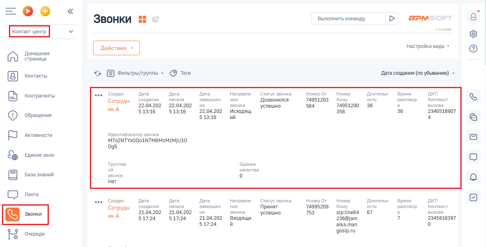
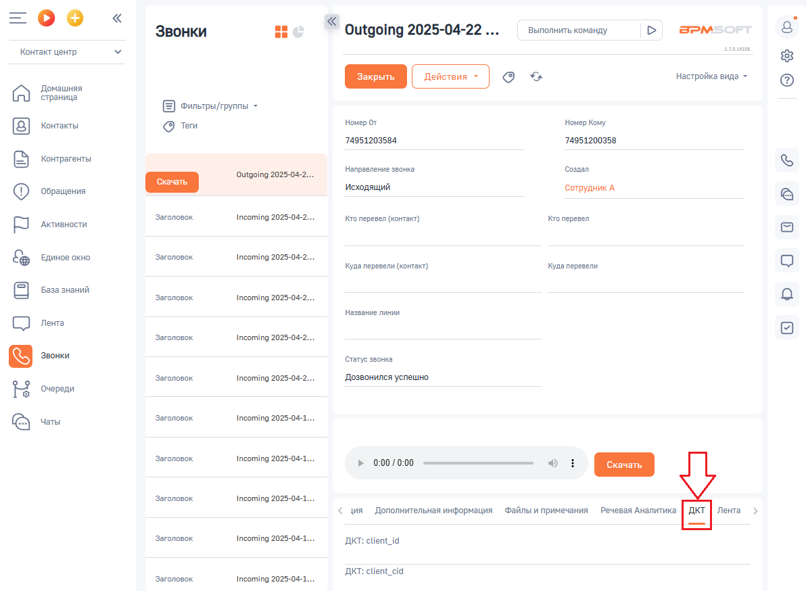
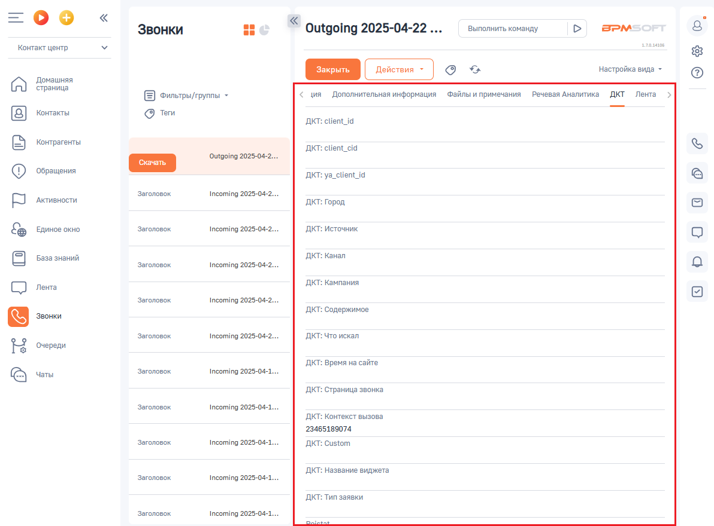

# Как посмотреть данные коллтрекинга в BPMSoft

> Трассировка: PDF §2.2 · сквозные стр. 31-32 · источники: ч.1 `kb/sources/integration-bpmsoft/Mango_office_integration_BPMSoft.pdf` с.31-32.

Данные коллтрекинга отображаются в карточке звонка на вкладке “ДКТ”. Вот как этой сделать: 1. в вашем BPMSoft откройте раздел “Контакт центр”; 2. нажмите на пункт “Звонки”; 3. нажмите на строку с данными нужного вам звонка;

> **Описание иллюстрации INTBPM-§2.2-1** (к §2.2 «Как посмотреть данные коллтрекинга в BPMSoft», стр. 31; 1195×608 px). Снимок экрана / схема.
> Относится к тексту руководства: «…1. в вашем BPMSoft откройте раздел “Контакт центр”; 2. нажмите на пункт “Звонки”; 3. нажмите на строку с данными нужного вам звонка;».
> Текст на изображении (OCR, требует сверки): оо; Выполнить команду; BPM:; Звонки :; алая; настройка вида -; Домашняя; CA) страница; ‘Фильтры/группы; `Дата создания (no убыванию) -; [8] ктакы; Создал; Дата; Дата.; Hanpasne; Статус звонка; "Номер от; Номер; Длительн; Время; aut:; С sorrperae; Сотрудн; создания; начала; Завершен; ние; `Дозвонился; 74951203; Кому; ость; разговор; Контекст; 22.04.202; ия; звонка; успешно; 584; 74951200; вызова; икА; 513:16; 'Исходящ; 358; 36; 2346518907; ий; Ф сени; Идентификатор звонка; FE perce; (MTo2NTYxODoINTM6MzMzMjU10; 095; &% виновокно; Группов; Оценка; ой; качества; База знаний; звонок; Her; СО ль; oe…

4. в открывшейся карточке звонка, нажмите на вкладку “ДКТ”:

> **Описание иллюстрации INTBPM-§2.2-2** (к §2.2 «Как посмотреть данные коллтрекинга в BPMSoft», стр. 31; 1192×874 px). Снимок экрана / схема.
> Относится к тексту руководства: «…2. нажмите на пункт “Звонки”; 3. нажмите на строку с данными нужного вам звонка; 4. в открывшейся карточке звонка, нажмите на вкладку “ДКТ”:».
> Текст на изображении (OCR, требует сверки): =oO°o; Звонки; < outgoing 2025-04-22 ...; Выполнить команду; BPM; лань; Контакт центр; га; настройка вида -; Домашняя; страница; Фильтры/группы -; Контакты; Howep Or; Номер Кому; @ tem; 74951203584; 74951200358; Контрагенты; Направление звонка.; Создал; Outgoing 2025-04-2...; ‘Исходящий; Сотрудник А; ‘Обращения; Заголовок; Incoming 2025-04-2...; кто перевел (контакт); Кто перевел; Активности.; Единое окно; Incoming 2025-04-2.; Куда перевели (контакт); Куда перевели; "название линии; СО ль; Статус звонка; `Дозвонился успешно; Очереди; Incoming 2025-04-1...; © vers; Дополнительная информация; Фа…

Руководство по интеграции АТС MANGO OFFICE и BPMSoft | Версия от 22.06.2026 5. данные коллтрекинга отображаются на вкладке “ДКТ”:

> **Описание иллюстрации INTBPM-§2.2-3** (к §2.2 «Как посмотреть данные коллтрекинга в BPMSoft», стр. 32; 1192×880 px). Снимок экрана / схема.
> Относится к тексту руководства: «…5. данные коллтрекинга отображаются на вкладке “ДКТ”:».
> Текст на изображении (OCR, требует сверки): =oO°o; Звонки; < outgoing 2025-04-22; Выполнить команду; BPM; Контакт центр; зала; га; настройка вида -; Домашняя; страница; Фильтры/группы ~; Дополнительная информация; Файлы и примечания Речевая Аналитика ДКТ Лента; Контакты; @ tem; AKT: client_i; Контрагенты; AKT: client; id; Outgoing 2025-042...; ‘Обращения; ДКТ: ya_client i; Заголовок; Активности.; Incoming 2025-04-2...; AKT: Город; Единое окно; AKT: Источник; AKT: Канал; ©) sea nama; AKT: Кампания; СО ль; AKT: Содержимое; AKT: Что искал; Очереди; ДКТ: Время на сайте; Incoming 2025-04-1...; © vers; ДКТ: Страница звонка; AKT: Контекст вызо…
