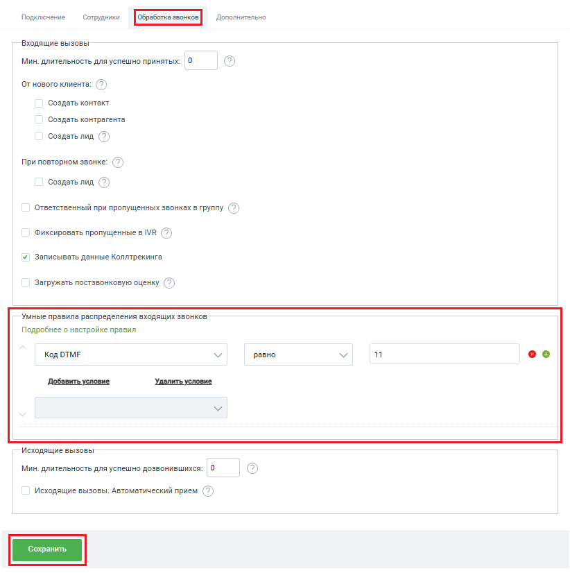
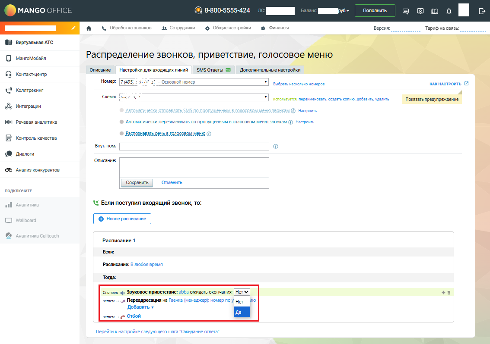
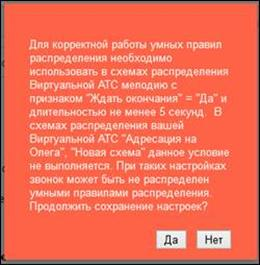
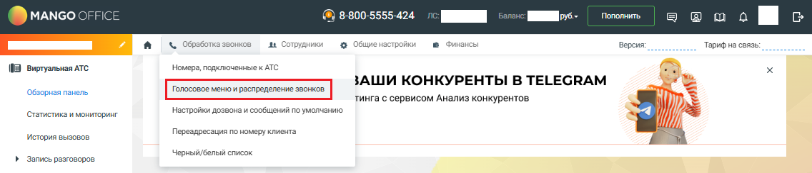

# Как создать и настроить умные правила

> Трассировка: PDF §2.2 · сквозные стр. 32-35 · источники: ч.1 `kb/sources/integration-bpmsoft/Mango_office_integration_BPMSoft.pdf` с.32-35.

1) Вам нужно открыть вкладку “Обработка звонков” и прокрутить эту вкладку вниз так, чтобы была видна группа полей “Умные правила распределения входящих вызовов”; 2) настроить собственный алгоритм распределения, указав правила обработки звонка. Можно указать до 20 правил и 5 условий в каждом правиле. При звонке правила анализируются в настроенном порядке, сверху-вниз. Для изменения порядка правил нужно нажать на стрелки

> **Описание иллюстрации INTBPM-§2.2-1** (к §2.2 «Как создать и настроить умные правила», стр. 32; 19×26 px). Пиктограмма (значок элемента интерфейса).
> Относится к тексту руководства: «…0 правил и 5 условий в каждом правиле. При звонке правила анализируются в настроенном порядке, сверху-вниз. Для изменения порядка правил нужно нажать на стрелки».
> Текста на изображении нет; назначение элемента — см. текст, к которому он относится.

> **Описание иллюстрации INTBPM-§2.2-2** (к §2.2 «Как создать и настроить умные правила», стр. 32; 18×20 px). Пиктограмма (значок элемента интерфейса).
> Относится к тексту руководства: «…0 правил и 5 условий в каждом правиле. При звонке правила анализируются в настроенном порядке, сверху-вниз. Для изменения порядка правил нужно нажать на стрелки».
> Текста на изображении нет; назначение элемента — см. текст, к которому он относится.

вверх и/или вниз необходимое количество раз;

> **Описание иллюстрации INTBPM-§2.2-3** (к §2.2 «Как создать и настроить умные правила», стр. 32; 13×20 px). Пиктограмма (значок элемента интерфейса).
> Относится к тексту руководства: «…онке правила анализируются в настроенном порядке, сверху-вниз. Для изменения порядка правил нужно нажать на стрелки вверх и/или вниз необходимое количество раз;».
> Текста на изображении нет; назначение элемента — см. текст, к которому он относится.

3) для добавления нового правила нужно нажать кнопку или ссылку

> **Описание иллюстрации INTBPM-§2.2-4** (к §2.2 «Как создать и настроить умные правила», стр. 32; 13×22 px). Пиктограмма (значок элемента интерфейса).
> Относится к тексту руководства: «…вверх и/или вниз необходимое количество раз; 3) для добавления нового правила нужно нажать кнопку или ссылку».
> Текста на изображении нет; назначение элемента — см. текст, к которому он относится.

“Добавить условие”, для удаления – кнопку или ссылку “Удалить условие”; Руководство по интеграции АТС MANGO OFFICE и BPMSoft | Версия от 22.06.2026 4) при настройке правила указать, какое значение анализировать: – из данных о текущем звонке; – из данных Виртуальной АТС; – из BPMSoft (для этого в CRM выполняется поиск по номеру звонящего и для найденного клиента выполняется анализ данных). По всем полям, в том числе пользовательским, а также по тэгам; 5. указать операцию сравнения (“равно”, “не равно”, “содержит” и т.д.) и указать, с каким значением необходимо сравнивать; 6. указать, какое действие необходимо выполнить, если результат проверки будет успешным (переадресовать на номер, переадресовать на ответственного и другие); 7. если результат проверки правила не будет успешным, то будет проверяться следующее правило. Если ни одно правило не подошло, то звонок будет обрабатываться по схеме переадресации, настроенной в Личном кабинете Виртуальной АТС; 8. чтобы сохранить настройки, нужно нажать кнопку “Сохранить”.

> **Описание иллюстрации INTBPM-§2.2-5** (к §2.2 «Как создать и настроить умные правила», стр. 33; 822×826 px). Снимок экрана / схема.
> Относится к тексту руководства: «…вонок будет обрабатываться по схеме переадресации, настроенной в Личном кабинете Виртуальной АТС; 8. чтобы сохранить настройки, нужно нажать кнопку “Сохранить”.».
> Текст на изображении (OCR, требует сверки): Подключение; Сотрудники; Дополнительно; Входящие вызовы; Мин. длительность для успешно принятых:; Ot нового клиента: (7); Создать контакт; Создать контрагента; Создать лид; При повторном звонке:; Создать лид (>); Ответственный при пропущенных звонках в группу (7); Фиксировать пропущенные в IVR; Записывать данные Коллтрекинга; Загружать постзвонковую оценку (7); Умные правила распределения входящих звонков; Подробнее о настройке правил; 11; оо; Код ОТМЕ; равно; Добавить условие; Удалить условие; Исходящие вызовы; Мин. длительность для успешно дозвонившихся: |0; Исходящие вызовы. Автоматический …

Руководство по интеграции АТС MANGO OFFICE и BPMSoft | Версия от 22.06.2026 Обратите внимание! Чтобы виджет мог выполнить анализ данных о звонке/клиенте, необходимо настроить схему распределения вызовов следующим образом: 1) установить звуковое приветствие, длительностью не менее 5-8 сек. Не рекомендуется устанавливать звуковое приветствие “Гудок” или “Тишина”, тем более, если вы настраиваете распределение входящих звонков на этапе ввода Клиентом DTMF-команд; 2) звуковому приветствию присвоить признак “Да” в поле “ожидать окончания”:

> **Описание иллюстрации INTBPM-§2.2-6** (к §2.2 «Как создать и настроить умные правила», стр. 34; 1134×798 px). Снимок экрана / схема.
> Относится к тексту руководства: «… вы настраиваете распределение входящих звонков на этапе ввода Клиентом DTMF-команд; 2) звуковому приветствию присвоить признак “Да” в поле “ожидать окончания”:».
> Текст на изображении (OCR, требует сверки): MANGO; -800-5555-424; нии; Пополнить; ооМе; а | & обработка звонков; „ва Сотрудники; & Общие настройки; ® Финансы; Версия:; Тарифна связь; UB. вотульвя arc; О Masrotosann; Распределение звонков, приветствие, голосов; Описание | Настройки для входящих линий; ‘SMS Ответы 28; ` Дополнительные настройки; © копает; кАКНАстРОИТЬ 2; "= Основной номер; выбрать neocons номеров; UW! коллтреюг; ото nepevvenossrs воздать копию, добавить удалить; Показать предупреждение; о vrerpavm; Ф несроиь; ММ речевая аналитика; строить; [В котроль качеств; Bayt. ном.; \® диалоги; "Описание:; 95 Анализ конкурентов; "Сох…

Тогда, при звонке, во время проигрывания приветствия, виджет выполнит анализ данных о звонке/клиенте и обработает вызов согласно настроенному умному правилу распределения вызовов. Важно! Если вы не выполните указанные выше требования к схеме распределения вызовов, то: 1) ваши звонки не будут обработаны умными правилами распределения звонков; 2) при настройке умных правил будет выдано следующее сообщение:

> **Описание иллюстрации INTBPM-§2.2-7** (к §2.2 «Как создать и настроить умные правила», стр. 34; 260×265 px). Снимок экрана / схема.
> Относится к тексту руководства: «…еделения вызовов, то: 1) ваши звонки не будут обработаны умными правилами распределения звонков; 2) при настройке умных правил будет выдано следующее сообщение:».
> Текст на изображении (OCR, требует сверки): Для корректной работы умных правил; распредепения; использовать в схемах распределения; Виртуальной АТС меподию с; признаком "Ждать окончания” = "Да" и; длительностью не менее 5 секунд. В; схемах распределения вашей; Виртуальной АТС "Адресация на; Олега”, "Новая схема" данное; не выполняется. При таких настройках; звонок может быть не распределен; умными правилами распределения; Прадопжить сохранение настроек?

Руководство по интеграции АТС MANGO OFFICE и BPMSoft | Версия от 22.06.2026 Для устранения ошибки необходимо перейти в Личный кабинет Виртуальной АТС, открыть в раздел “Голосовое меню и распределение звонков” (см. рисунок ниже) и настроить схему распределения вызовов так, чтобы она соответствовала указанным выше требованиям.

> **Описание иллюстрации INTBPM-§2.2-8** (к §2.2 «Как создать и настроить умные правила», стр. 35; 1136×244 px). Снимок экрана / схема.
> Относится к тексту руководства: «…л “Голосовое меню и распределение звонков” (см. рисунок ниже) и настроить схему распределения вызовов так, чтобы она соответствовала указанным выше требованиям.».
> Текст на изображении (OCR, требует сверки): MANGO OFFICE; @ 8-800-5555-42.; Пополнить; эфоо М ев; &. Обработка звонков; „ва Сотрудники; 1 O6uyte nacrp:; Финансы; Версия:; Тарифна связь:; (0B виртуальная ATC; Номера, подключенные к ATC; ЗАШИ КОНКУРЕНТЫ В TELEGRAM; Обзорная панель; тинга с сервисом Анализ конкурентов; ‘статистика мониторинг; Настройки дозвона и сообщений no умолчанию; ‘история вызовов; Переадресация по номеру клиента; > Запись разговоров; Черный/белый список
