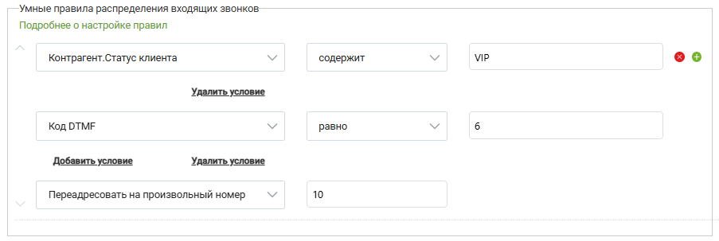
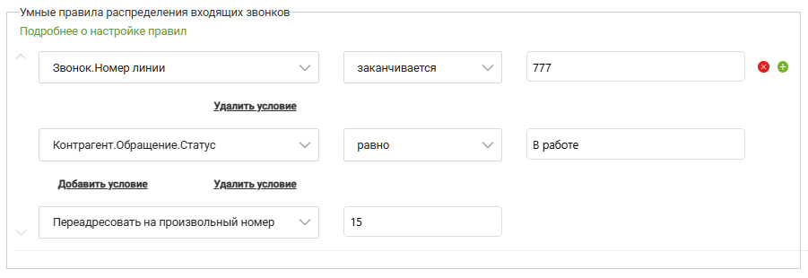

# Примеры настройки умного алгоритма распределения

> Трассировка: PDF §2.2 · сквозные стр. 35-36 · источники: ч.1 `kb/sources/integration-bpmsoft/Mango_office_integration_BPMSoft.pdf` с.35-36.

Пример 1. Звонит VIP-клиент. В IVR пользователь выбирает номер, соответствующий отделу технической поддержки. Его необходимо автоматически распределить на группу, занимающуюся VIP-клиентами. Пример настройки умных правил показан на рисунке:

> **Описание иллюстрации INTBPM-§2.2-1** (к §2.2 «Примеры настройки умного алгоритма распределения», стр. 35; 903×303 px). Снимок экрана / схема.
> Относится к тексту руководства: «…отделу технической поддержки. Его необходимо автоматически распределить на группу, занимающуюся VIP-клиентами. Пример настройки умных правил показан на рисунке:».
> Текст на изображении (OCR, требует сверки): “Умные правила распределения входящих звонков:; Подробнее о настройке правил; Контрагент.Статус клиента.; содержит; МР; оо; Удалить условие; Код ОТМЕ; равно; Добавить условие; Переадресовать на произвольный номер; 10

Пример 2. Звонит Клиент в техническую поддержку. Если есть открытое обращение – распределяем на ответственного. Если занят – на произвольный номер.

> **Описание иллюстрации INTBPM-§2.2-2** (к §2.2 «Примеры настройки умного алгоритма распределения», стр. 35; 901×310 px). Снимок экрана / схема.
> Относится к тексту руководства: «… на рисунке: Пример 2. Звонит Клиент в техническую поддержку. Если есть открытое обращение – распределяем на ответственного. Если занят – на произвольный номер.».
> Текст на изображении (OCR, требует сверки): `Умные правила распределения входящих звонков.; Подробнее о настройке правил; заканчивается; оо; ‘Звонок.Номер линии; Удалить условие; контрагент. Обращение Статус; равно; В работе; Добавить условие; Переадресовать на произвольный номер; 15

Руководство по интеграции АТС MANGO OFFICE и BPMSoft | Версия от 22.06.2026
