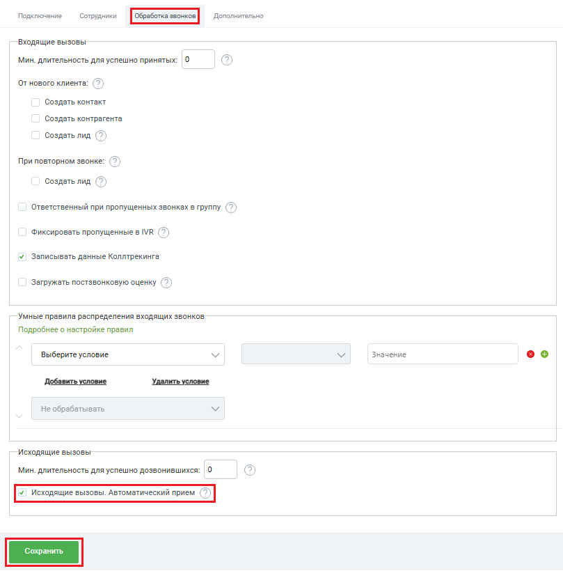

# Исходящий звонок по клику из BPMSoft

> Трассировка: PDF §2.3 · сквозные стр. 36-37 · источники: ч.1 `kb/sources/integration-bpmsoft/Mango_office_integration_BPMSoft.pdf` с.36-37.

Приложение поддерживает возможность исходящего звонка в один клик по номеру телефона. Если эта опция включена, тогда сотрудник может кликнуть на номер телефона клиента в BPMSoft, будет выполнен звонок клиенту, а в BPMSoft показана карточка исходящего звонка. Чтобы включить или выключить эту опцию, в окне “Основные настройки интеграции” следует: 1) включить флаг “Исходящие вызовы. Автоматический прием”; 2) нажать на кнопку “Сохранить” внизу окна “Основные настройки интеграции”:

> **Описание иллюстрации INTBPM-§2.3-1** (к §2.3 «Исходящий звонок по клику из BPMSoft», стр. 36; 809×820 px). Снимок экрана / схема.
> Относится к тексту руководства: «…интеграции” следует: 1) включить флаг “Исходящие вызовы. Автоматический прием”; 2) нажать на кнопку “Сохранить” внизу окна “Основные настройки интеграции”:».
> Текст на изображении (OCR, требует сверки): Подключение; Сотрудники Дополнительно; Входящие вызовы; Мин. длительность для успешно принятых:; OT нового клиента:; Создать контакт; Создать контрагента; Создать лид (>); При повторном звонке: (>); Ответственный при пропущенных звонках в группу (7); Фиксировать пропущенные в МВ (7); Записывать данные Коллтрекинга; Загружать постзвонковую оценку (7); Умные правила распределения входящих звонков; Подробнее о настройке правил; Выберите условие; Значение; оо; Добавить условие; Удалить условие; Не обрабатывать; Исходящие вызовы; Мин. длительность для успешно дозвонившихся: |0

Руководство по интеграции АТС MANGO OFFICE и BPMSoft | Версия от 22.06.2026
